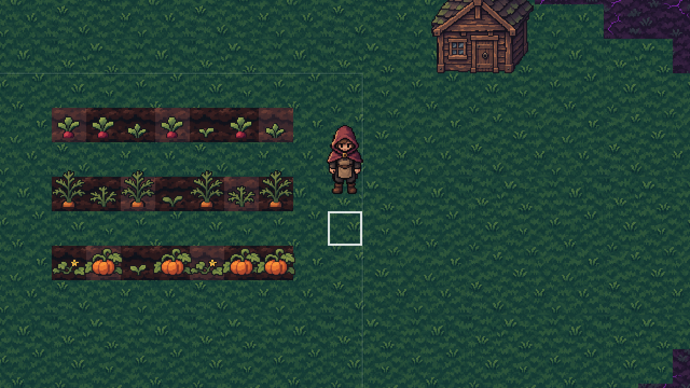
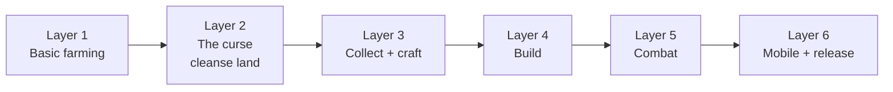

# Cursed Island Farm (working title)

> Farm, craft and fight to cleanse a cursed island. Every field you grow pushes the darkness back.

A moody dark-fantasy 2D top-down farming game, made with **Godot 4.7** by a solo developer.

## Status

**Early prototype.** Layer 1 (basic farming) and Layer 2 (the curse) are playable.

| | Feature |
|---|---|
| ✅ | Player walking in 8 directions, with walk animations |
| ✅ | Cursed-island map: a clean shore surrounded by cursed ground |
| ✅ | Till soil, plant seeds, water crops |
| ✅ | Day cycle: sleep at the house, watered crops grow overnight |
| ✅ | 3 crops: radish (3 days), carrot (5 days), pumpkin (8 days) |
| ✅ | Harvesting, inventory and money |
| ✅ | Shipping box (paid overnight) and seed shop |
| ✅ | Saving at the end of each day |
| ✅ | Mood lighting with lantern posts |
| ✅ | Healing cursed land with holy water, then farming on it |
| ✅ | The old farmlands, buried treasure and a healing progress score |
| ✅ | The old shrine: restore it to heal a huge area |

## Roadmap

Targets: **Android first**, then **Steam**.

## Run it

1. Install [Godot 4.7](https://godotengine.org/download).
2. In Godot, click **Import** and select this folder's `project.godot`.
3. Press **F5**.

## Controls

| Key | Action |
|---|---|
| WASD / arrow keys | Move |
| 1 | Hoe: till grass into soil |
| 2 | Watering can |
| 3 | Seeds (Q / E to change the seed type) |
| 4 | Hand (harvest ripe crops) |
| 5 | Holy water: heal a 3×3 patch of cursed land (buy it at the stall) |
| Space / left click | Use the tool on the highlighted tile |
| F | Interact (house door: sleep and save; shipping box: sell crops; stall: buy seeds; shrine: restore it) |

## Project structure

| Folder | What's inside |
|---|---|
| `scenes/` | Godot scenes: main, player, farm, ui |
| `scripts/` | GDScript code, same folders as `scenes/` |
| `data/` | Crop definitions and the tileset |
| `assets/` | Game-ready pixel art |
| `art_source/` | Original AI-generated images (not loaded by the game) |
| `tools/` | Dev scripts: shrinking AI art to real pixel size, building the map |
| `docs/` | [Game concept](docs/03_2026-11-03_game-concept.md), [Layer 1 plan](docs/01_2026-11-03_layer-1-farming.md), [art prompts](docs/02_2026-11-03_art-prompts-layer-1.md) |
| `research/` | Research notes from planning the game |

## Art

The pixel art is **AI-generated** (ChatGPT) from the prompts in [the art prompts doc](docs/02_2026-11-03_art-prompts-layer-1.md), then shrunk to its real pixel size with `tools/pixelize.gd` and checked by hand. This will be disclosed on store pages as required.
