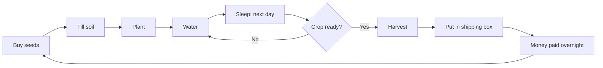

# Layer 1 plan: basic farming

**Date:** 2026-11-03

## Goal

A playable farming loop with real pixel art: walk around, farm, sell crops, buy seeds and see days pass. This is the foundation for all later layers.

Game direction: a moody dark-fantasy farm on a cursed island. See [03_2026-11-03_game-concept.md](03_2026-11-03_game-concept.md). Layer 1 is the small clean **shore** area where the player starts; the curse is only visible at the edges (cleansing comes in Layer 2).

## Settings

| Setting | Value |
|---|---|
| Engine | Godot 4.7.2, GDScript |
| View | 2D top-down |
| Grid | 32×32 tiles |
| Art | AI-generated 32×32 pixel art (ChatGPT), cleaned up; prompts in [02_2026-11-03_art-prompts-layer-1.md](02_2026-11-03_art-prompts-layer-1.md). Colored squares stand in until each asset is ready, so coding never waits for art. |
| Controls | Keyboard for now (mobile touch controls in a later layer) |
| Screen | Landscape, 1280×720 window |

## Core loop



## In scope

| Feature | Details |
|---|---|
| **Player movement** | Walk in 8 directions, collide with walls and objects |
| **Farm grid** | A field area (about 12×10 tiles) where farming is allowed |
| **Tools** | Hoe, watering can, seeds; switch with keys 1–4 |
| **Till soil** | Hoe turns grass into tilled soil |
| **Plant** | Seeds go into tilled soil |
| **Water** | Watered soil looks darker; resets every morning |
| **Crop growth** | Grows one stage per day **only if watered** |
| **Crops** | 3 types: fast (3 days), medium (5 days), slow (8 days) with different sell prices |
| **Harvest** | Interact with a ready crop to pick it up |
| **Inventory** | Simple: count of seeds and crops per type |
| **Shipping box** | Put crops in; money is paid when the day ends |
| **Shop** | Simple menu to buy seeds |
| **Day cycle** | Enter the house door to sleep and end the day; a day counter on screen |
| **HUD** | Day, money, selected tool, inventory counts |
| **Save / load** | Save at the end of each day; load on start |
| **Mood lighting** | The whole scene slightly darkened (`CanvasModulate`); lantern posts give warm light (`PointLight2D`) |
| **Cursed border (look only)** | Cursed ground tiles around the shore area that block walking; no cleansing yet |

## Not in Layer 1

Cleansing the curse and unlocking land (Layer 2), crafting, building, combat, NPCs, seasons, weather, energy/stamina, time of day, animals, sound, walking animations (still poses only), house interior, mobile controls.

## Controls

| Key | Action |
|---|---|
| WASD / arrows | Move |
| 1–4 | Select tool (hoe, watering can, seeds, hand) |
| Q / E | Change seed type |
| Space / left click | Use tool on the tile in front of the player |
| F | Interact (house door, shipping box, shop) |

## Build steps

Each step ends with something you can run in Godot and see working.

1. ✅ **Project setup:** folders, pixel settings, input keys
2. ✅ **Player movement:** the hooded farmer walks around a test map (8-way movement, 4 facing poses, camera follow)
3. ✅ **Farm grid:** a TileMap with grass, a farmable area and the cursed border, plus a highlight on the targeted tile
4. ✅ **Tools: till and plant:** switch tools, till soil, plant seeds (crops use a drawn placeholder until crop art exists)
5. ✅ **Water and day cycle:** watering, house door to sleep (with a fade), day counter, crops grow overnight
6. **Harvest and inventory:** pick crops, track counts, HUD
7. **Shipping box and shop:** sell crops, earn money, buy seeds
8. **Save / load:** keep progress between sessions
9. **Mood lighting:** darken the scene and add lantern light

## Project structure

```
scenes/
  main/        main.tscn (the farm level)
  player/      player.tscn
  farm/        crop.tscn, shipping_box.tscn, house.tscn
  ui/          hud.tscn, shop.tscn
scripts/       same folders as scenes/
  autoload/    game_state.gd (day, money, inventory), save_manager.gd
data/          crops data (name, days to grow, buy price, sell price)
assets/        tiles/, crops/, items/, tools/, objects/, player/ (see art prompts doc)
```

## Done when

- You can play several in-game days: buy seeds, farm, sell, and end with more money than you started.
- Crops grow only when watered.
- Closing and reopening the game keeps your progress.
- All Layer 1 art is in the game (no colored squares left).
- **Is it fun to play for 5 minutes?** If not, adjust before Layer 2.

## Open questions

- **Godot experience:** if this is the first time, each step will also explain the Godot concepts it uses (nodes, scenes, signals), compared with Angular.
