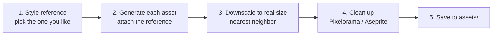

# Art prompts: Layer 1 (basic farming)

**Date:** 2026-11-03

Prompts for generating Layer 1 art with ChatGPT (GPT image). Style: original **moody dark-fantasy** top-down pixel art on a **32×32 grid** (chosen 2026-11-03, see S1).

**Lighting rule:** assets are generated in **neutral daylight** (muted colors, no night darkness, no glow). The dusk mood and lantern glow are added in Godot with lighting (`CanvasModulate` and `PointLight2D`), so the same art works for day, dusk and night.

## Workflow



1. **Style reference first.** Generate prompt **S1** several times and pick the one you like most. This decides the look of the whole game.
2. **Attach that image to every later prompt** and keep the sentence "Match the style of the attached reference exactly." This is the main trick for consistency.
3. **Save the original** from ChatGPT into `art_source/` using the file names in the tables below (for example `art_source/player/player_directions.png`). Godot ignores this folder.
4. **Downscale.** GPT draws each art pixel as a block of about 10×10 screen pixels. `tools/pixelize.gd` finds each sprite, measures the block size and samples one color per art pixel, then saves the real-size result into `assets/`. Claude runs it.
5. **Clean up** if needed. Fix stray pixels and colors in **Pixelorama** (free, made with Godot) or **Aseprite** (about $20).

**Tips:**
- One asset per image gives the best results. Sheets of many items come out messy.
- If the background isn't transparent, ask again: "Make the background transparent." If that fails, use a solid magenta `#FF00FF` background, which is easy to remove.
- Don't name existing games in prompts. Describe the style instead, so the art is original.
- Steam requires disclosing AI-generated content. Keep this doc as a record of how the art was made.

## Style block (paste at the start of every prompt)

```
Pixel art game asset for a 2D top-down farming game, 3/4 top-down view.
Designed for a 32x32 pixel grid: chunky, clearly visible pixels, no anti-aliasing,
no blur. Moody dark-fantasy style: muted, desaturated earthy colors, deep purples
and teals in the shadows. 3-tone shading, light from the top-left, neutral
daylight (not night, no glow effects). Realistic proportions, not chibi.
Transparent background. No text. Single object, centered, filling most of the image.
```

## S1: Style reference (chosen)

Saved as `art_source/style_reference.png`. Attach it to every asset prompt. This is the prompt that produced it:

```
Pixel art game scene for a 2D top-down farming game, 3/4 top-down view.
32x32 pixel tile grid, chunky visible pixels, no anti-aliasing, no blur.
Moody dark-fantasy style: muted, desaturated colors, deep purples and teals
in the shadows, warm lantern light as accent. 3-tone shading, light from the
top-left. No text, no visible grid lines.

Scene: a small farm patch at dusk, tilled soil with young plants and one
ripe carrot, a wooden crate, a glowing lantern on a post, and a hooded farmer
standing facing down. At one edge, the grass turns dark and corrupted with
purple cracks. Background: the grass itself.
```

Rejected first try: a bright, cute chibi style (too generic).

## Asset list and prompts

For every prompt below, send **one message** in this order:
1. The **style block**
2. The asset prompt from the table
3. "Match the style of the attached reference exactly."
4. Attach your chosen **S1 image**

### Ground textures (128×128 = a 4×4 block of tiles, must repeat seamlessly)

**Lesson from the grass (2026-11-03):** asking for a single 32×32 tile loses detail, because ChatGPT's own shrink turned the grass tufts into noise. A **large seamless texture** shrunk to 128×128 by `tools/pixelize.gd` keeps the detail and repeats cleanly. The game picks the right 32×32 piece of the 128×128 texture from each tile's position, so neighbors always line up.

Ground prompt (style block without "transparent background" and "single object"):

```
Pixel art game texture for a 2D top-down farming game, seen from above.
Designed for a 32x32 pixel grid: chunky, clearly visible pixels, no anti-aliasing,
no blur. Moody dark-fantasy style: muted, desaturated earthy colors, deep purples
and teals in the shadows. 3-tone shading, neutral daylight (not night, no glow).
No text, no border, no grid lines.

A square seamless tileable ground texture: [DESCRIPTION]. Fill the whole image
edge to edge. The left edge must match the right edge and the top must match the
bottom, so it repeats without visible seams.

Match the style of the attached reference exactly.
```

Save the original in `art_source/tiles/`. Claude shrinks it to `assets/tiles/` with `--height 128 --frame-w 128 --frame-h 128`.

| File | [DESCRIPTION] |
|---|---|
| `tiles/grass_master.png` ✅ done → `assets/tiles/grass.png` | short dark green grass with small tufts |
| `tiles/soil_dry_master.png` ✅ done → `assets/tiles/soil_dry.png` | tilled farm soil, brown earth with plowed rows running left to right, dry |
| `tiles/soil_wet_master.png` ✅ done → `assets/tiles/soil_wet.png` | **in the same ChatGPT chat as dry soil:** "Now make the exact same soil texture, but watered: darker, wetter brown, same rows, same layout." |
| `tiles/cursed_ground_master.png` ✅ done → `assets/tiles/cursed_ground.png` | cursed ground: dark purple-black dead grass with thin bright purple cracks (flat color, no glow effect) |
| `tiles/path_master.png` | packed light dirt path with small pebbles |

### Crops (32×32 each stage)

Generate each crop as **one image with its 4 stages in a horizontal row**. Draw **only the plant, no soil**: the soil is a separate tile. Claude shrinks it with `--height 20 --frame-w 32 --frame-h 32` (the ripe stage is about 20 art pixels tall) and sets `stages_texture` in `data/crops/<crop>.tres`.

| File | Stage descriptions (1–4) |
|---|---|
| `crops/radish_stages.png` ✅ done → `assets/crops/radish_stages.png` | tiny planted seed bump; small two-leaf sprout; leafy young plant; ripe radish with its red top showing and full leaves |
| `crops/carrot_stages.png` ✅ done → `assets/crops/carrot_stages.png` (frames 32×40) | tiny planted seed bump; small two-leaf sprout; leafy young plant with feathery leaves; ripe carrot with its orange top showing and tall feathery leaves |
| `crops/pumpkin_stages.png` ✅ done → `assets/crops/pumpkin_stages.png` (frames 40×32) | tiny planted seed bump; small two-leaf sprout; a short vine with big leaves and a yellow flower; a ripe orange pumpkin with a short vine and leaves |

### Items and icons (32×32)

| File | Prompt |
|---|---|
| `items/radish.png` | A harvested radish item icon. |
| `items/carrot.png` | A harvested carrot item icon. |
| `items/pumpkin.png` | A harvested pumpkin item icon. |
| `items/seeds_radish.png` | A small paper seed packet with a radish picture on it (no text). |
| `items/seeds_carrot.png` | A small paper seed packet with a carrot picture on it (no text). |
| `items/seeds_pumpkin.png` | A small paper seed packet with a pumpkin picture on it (no text). |
| `items/coin.png` | A gold coin icon. |
| `tools/hoe.png` | A farming hoe tool icon, wooden handle, iron blade, diagonal. |
| `tools/watering_can.png` | A metal watering can tool icon. |
| `tools/hand.png` | An open hand icon for picking up items. |

### Objects

| File | Size | Prompt |
|---|---|---|
| `objects/house.png` ✅ done → `assets/objects/house.png` | 96×96 | A small old wooden farmhouse with a dark mossy shingle roof, a door at the front center, one small window. |
| `objects/shipping_box.png` ✅ done (30×48 in a 40×48 frame, the open lid adds height) | 32×32 | A wooden shipping crate with an open lid. |
| `objects/shop_stall.png` ✅ done (75×96 in a 96×96 frame) | 64×64 | A small wooden market stall with a striped awning and seed bags on the counter. |
| `objects/tree.png` | 64×96 | A leafy dark green tree with a twisted brown trunk. |
| `objects/lantern_post.png` | 32×64 | A wooden post with a hanging iron lantern (unlit; the glow is added in Godot). |
| `objects/rock.png` | 32×32 | A small gray rock. |
| `objects/fence.png` | 32×32 | A wooden fence segment, horizontal. |

### Player (frames 48×64)

AI is weak at animation frames, so the still poses came first. The walk animation is generated per direction (see below).

| File | Prompt |
|---|---|
| `player/player_directions.png` ✅ done → `assets/player/player_idle.png` (4 frames of 48×64) | The hooded farmer from the reference: dark red hooded cloak, brown tunic with a cloth apron, leather boots. Shown in 4 poses in a horizontal row: facing down, facing up, facing left, facing right. Same size and same ground line for each, equal spacing. |

### Player walk animation (4 frames × 3 directions)

- One image per direction: down, up, side (facing left). Right = left mirrored in Godot.
- Attach `art_source/player/player_directions.png` and `art_source/style_reference.png`; best done in the same ChatGPT chat as the player.
- Claude shrinks them at the **same art pixel size as the idle poses** (about 9.7 source pixels per art pixel), so walking and standing frames match.

Walk down prompt (`art_source/player/walk_down.png`) ✅ done → `assets/player/walk_down.png` (shrunk with `--scale 9.70`; frame 3 lifted the same foot as frame 1, so its legs were replaced with frame 1's legs mirrored):

```
Pixel art game sprite sheet for a 2D top-down farming game, 3/4 top-down view.
Chunky, clearly visible pixels, no anti-aliasing, no blur. Moody dark-fantasy
style, muted colors, 3-tone shading, light from the top-left, neutral daylight.
Transparent background. No text, no shadow.

A 4-frame walking animation of the EXACT same hooded farmer from the attached
image (dark red hooded cloak, brown tunic, cloth apron, leather boots), walking
TOWARD the camera (facing down). Frames in one horizontal row with clear empty
space between them:
1) left foot stepping forward, right arm slightly forward
2) feet together under the body (passing pose)
3) right foot stepping forward, left arm slightly forward
4) feet together under the body (passing pose)
The cloak swings slightly with each step.

CRITICAL: every frame must be the same character at the exact same size, same
pixel size, same colors, same face and hood shape as the attached "facing down"
pose. Only the legs, arms and cloak edge move. Same ground line for all frames.
```

- ✅ **Walk up** (`walk_up.png` → `assets/player/walk_up.png`): "walking AWAY from the camera (facing up), seen from behind" and "...as the attached "facing up" pose".
- ✅ **Walk side** (`walk_side.png` → `assets/player/walk_side.png`): "walking to the LEFT (side view, facing left)", frames 1 and 3 "front leg forward, back leg behind, in a clear stride", and "...as the attached "facing left" pose".

Reject and regenerate if the face or hood changes, a frame has a different size, all frames look the same, or the background isn't transparent.

## Where files go

```
assets/
  tiles/  crops/  items/  tools/  objects/  player/
```

## Order to generate

1. **S1 style reference** (most important)
2. Player directions (needed for build step 2)
3. Grass, soil dry and wet, cursed ground (step 3)
4. Tool icons, crops, items (steps 4–6)
5. House, shipping box, shop stall (steps 5–7)
6. Tree, rock, fence, lantern post (decoration and lighting, anytime)
