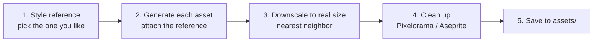

# Art prompts: Layer 1 (basic farming)

**Date:** 2026-11-03

Prompts for generating Layer 1 art with ChatGPT (GPT image). Style: original **moody dark-fantasy** top-down pixel art on a **32×32 grid** (chosen 2026-11-03, see S1).

**Lighting rule:** assets are generated in **neutral daylight** (muted colors, no night darkness, no glow). The dusk mood and lantern glow are added in Godot with lighting (`CanvasModulate` and `PointLight2D`), so the same art works for day, dusk and night.

## Workflow



1. **Style reference first.** Generate prompt **S1** several times and pick the one you like most. This decides the look of the whole game.
2. **Attach that image to every later prompt** and keep the sentence "Match the style of the attached reference exactly." This is the main trick for consistency.
3. **Downscale.** GPT outputs large images (about 1024px). They must be shrunk to the real size (e.g. 32×32) with **nearest neighbor** scaling, never smooth scaling. Claude can write a script for this.
4. **Clean up.** AI pixel art isn't on a perfect grid. Fix stray pixels and colors in **Pixelorama** (free, made with Godot) or **Aseprite** (about $20).
5. **Save** using the file names in the tables below.

**Tips:**
- One asset per image gives the best results. Sheets of many items come out messy.
- If the background isn't transparent, ask again: "Make the background transparent." If that fails, use a solid magenta `#FF00FF` background, which is easy to remove.
- Don't name existing games in prompts. Describe the style instead, so the art is original.
- Steam requires disclosing AI-generated content. Keep this doc as a record of how the art was made.

## Style block (paste at the start of every prompt)

```
Pixel art game asset for a 2D top-down farming game, 3/4 top-down view.
Designed for a 32x32 pixel grid: chunky, clearly visible pixels, no anti-aliasing,
no blur. Moody dark-fantasy style: muted, desaturated earthy colors, deep purples
and teals in the shadows. 3-tone shading, light from the top-left, neutral
daylight (not night, no glow effects). Realistic proportions, not chibi.
Transparent background. No text. Single object, centered, filling most of the image.
```

## S1: Style reference (chosen)

Saved as `assets/style_reference.png`. Attach it to every asset prompt. This is the prompt that produced it:

```
Pixel art game scene for a 2D top-down farming game, 3/4 top-down view.
32x32 pixel tile grid, chunky visible pixels, no anti-aliasing, no blur.
Moody dark-fantasy style: muted, desaturated colors, deep purples and teals
in the shadows, warm lantern light as accent. 3-tone shading, light from the
top-left. No text, no visible grid lines.

Scene: a small farm patch at dusk, tilled soil with young plants and one
ripe carrot, a wooden crate, a glowing lantern on a post, and a hooded farmer
standing facing down. At one edge, the grass turns dark and corrupted with
purple cracks. Background: the grass itself.
```

Rejected first try: a bright, cute chibi style (too generic).

## Asset list and prompts

For every prompt below, send **one message** in this order:
1. The **style block**
2. The asset prompt from the table
3. "Match the style of the attached reference exactly."
4. Attach your chosen **S1 image**

### Tiles (32×32, must repeat seamlessly)

| File | Prompt |
|---|---|
| `tiles/grass_1.png` | A single seamless tileable grass ground tile, short green grass with tiny variation. Fill the whole square, edges must tile seamlessly. Not transparent. |
| `tiles/grass_2.png` | Same grass tile with a few tiny flowers, seamless tileable. Not transparent. |
| `tiles/soil_dry.png` | A seamless tileable tilled farm soil tile, light brown with plowed rows, dry. Not transparent. |
| `tiles/soil_wet.png` | The same tilled soil tile but watered: darker, wetter brown. Same rows. Not transparent. |
| `tiles/cursed_ground.png` | A seamless tileable cursed ground tile: dark purple-black dead grass with thin bright purple cracks (flat color, no glow effect). Fill the whole square, edges must tile seamlessly. Not transparent. |
| `tiles/path.png` | A seamless tileable dirt path tile, packed light dirt with small pebbles. Not transparent. |

### Crops (32×32 each stage)

Generate each crop as **one image with its stages in a horizontal row**, then split it. Ask for "equal spacing, same ground line".

| File | Prompt |
|---|---|
| `crops/radish_stages.png` | Growth stages of a radish crop in a horizontal row, 4 stages: seed in soil, small sprout, leafy plant, ripe radish with red top showing. Equal spacing, same ground line. |
| `crops/carrot_stages.png` | Growth stages of a carrot crop, 4 stages: seed, sprout, leafy plant, ripe carrot with orange top showing. Equal spacing, same ground line. |
| `crops/pumpkin_stages.png` | Growth stages of a pumpkin crop, 4 stages: seed, sprout, vine with flower, large ripe orange pumpkin. Equal spacing, same ground line. |

### Items and icons (32×32)

| File | Prompt |
|---|---|
| `items/radish.png` | A harvested radish item icon. |
| `items/carrot.png` | A harvested carrot item icon. |
| `items/pumpkin.png` | A harvested pumpkin item icon. |
| `items/seeds_radish.png` | A small paper seed packet with a radish picture on it (no text). |
| `items/seeds_carrot.png` | A small paper seed packet with a carrot picture on it (no text). |
| `items/seeds_pumpkin.png` | A small paper seed packet with a pumpkin picture on it (no text). |
| `items/coin.png` | A gold coin icon. |
| `tools/hoe.png` | A farming hoe tool icon, wooden handle, iron blade, diagonal. |
| `tools/watering_can.png` | A metal watering can tool icon. |
| `tools/hand.png` | An open hand icon for picking up items. |

### Objects

| File | Size | Prompt |
|---|---|---|
| `objects/house.png` | 96×96 | A small old wooden farmhouse with a dark mossy shingle roof, a door at the front center, one small window. |
| `objects/shipping_box.png` | 32×32 | A wooden shipping crate with an open lid. |
| `objects/shop_stall.png` | 64×64 | A small wooden market stall with a striped awning and seed bags on the counter. |
| `objects/tree.png` | 64×96 | A leafy dark green tree with a twisted brown trunk. |
| `objects/lantern_post.png` | 32×64 | A wooden post with a hanging iron lantern (unlit; the glow is added in Godot). |
| `objects/rock.png` | 32×32 | A small gray rock. |
| `objects/fence.png` | 32×32 | A wooden fence segment, horizontal. |

### Player (32×48)

AI is weak at animation frames, so start with **still poses** in 4 directions. Walking animation comes later (cleanup by hand, or a matching asset pack).

| File | Prompt |
|---|---|
| `player/player_directions.png` | The hooded farmer from the reference: dark red hooded cloak, brown tunic with a cloth apron, leather boots. Shown in 4 poses in a horizontal row: facing down, facing up, facing left, facing right. Same size and same ground line for each, equal spacing. |

## Where files go

```
assets/
  tiles/  crops/  items/  tools/  objects/  player/
```

## Order to generate

1. **S1 style reference** (most important)
2. Player directions (needed for build step 2)
3. Grass, soil dry and wet, cursed ground (step 3)
4. Tool icons, crops, items (steps 4–6)
5. House, shipping box, shop stall (steps 5–7)
6. Tree, rock, fence, lantern post (decoration and lighting, anytime)
