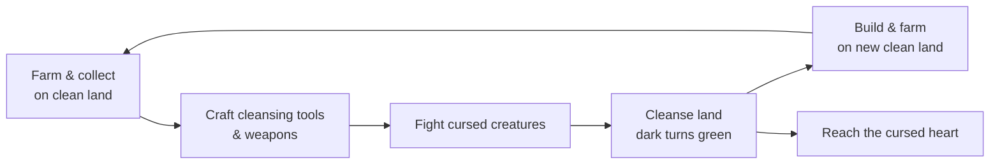
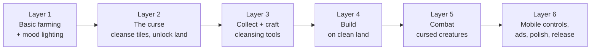

# Game concept: cursed island farm

**Date:** 2026-11-03

## Change of direction

The original plan was a Stardew-like farm with a twist decided later. After seeing the dark-fantasy style reference (`art_source/style_reference.png`), the direction changed to:

> **A moody dark-fantasy farming game where farming heals a cursed island.**

The **Cursed land** twist is now part of the game from the start, not an add-on, because the art style and the twist tell the same story.

## Pitch

> Farm, craft and fight to cleanse a cursed island. Every field you grow pushes the darkness back.

- **Working title:** TBD
- **View:** 2D top-down (3/4), 32×32 pixel art
- **Platforms:** Android first, then Steam
- **Session length:** short (2–5 minutes) for mobile, but rewarding for longer play

## Pillars

Every feature must support at least one of these:

1. **Healing feels good.** Dark, cracked land turning green is the core reward. It must look and sound satisfying.
2. **Moody but cozy.** Dark world, warm light. Your farm is the safe, glowing place in the darkness.
3. **Everything ties to the curse.** Farming, crafting, building and fighting all exist to push the curse back.
4. **Short sessions, long goal.** Each session makes visible progress; the long goal is reaching the cursed heart.

## Setting

You arrive on the **shore of a cursed island**: a small clean patch with a ruined farmhouse and an old lantern. The rest of the island is covered in corruption spreading from the **cursed heart** at the center.

| # | Area | Feel | Unlocks |
|---|---|---|---|
| 1 | **Shore** (start) | Small clean patch, ruined farmhouse | Basic farming |
| 2 | **Old farmlands** | Overgrown fields under light corruption | More farm space, first crafting |
| 3 | **Whispering woods** | Dark twisted forest | Wood, first real enemies |
| 4 | **Sunken marsh** | Foggy wetland | Rare crops, potion ingredients |
| 5 | **Ruined village** | Broken buildings to restore | Shops, upgrades |
| 6 | **Cursed heart** | The source of the curse | Final challenge |

MVP: areas 1–4, with 5–6 as stretch or updates.

## How the curse works

| Rule | Why |
|---|---|
| Crops only grow on **clean land** | Farming is gated by cleansing |
| You can only **build on clean land** | Building pushes you to expand |
| **Cleansing tools** (purifying hoe, holy water, lanterns) clean cursed tiles | Crafting has a clear purpose |
| **Lantern light** keeps nearby land safe | The warm-light-in-darkness look becomes a mechanic |
| **Cursed creatures** guard dark areas, stronger toward the center | Combat has a clear purpose |
| Cleansed land **reveals** resources, ruins and secrets | Exploring feels rewarding |

**Later (update ideas):** the curse creeps back at night unless protected (the Night raids idea), and more islands.

## Build roadmap

The curse comes in early because it's the core of the game.

| Layer | Goal | Plan doc |
|---|---|---|
| 1 ✅ | Farming loop in the dark-fantasy style | [01_2026-11-03_layer-1-farming.md](01_2026-11-03_layer-1-farming.md) |
| 2 ✅ | Cursed tiles, cleansing, unlocking new land | [04_2026-11-04_layer-2-curse.md](04_2026-11-04_layer-2-curse.md) |
| 3 ✅ | Gathering (trees, rocks), crafting recipes | [07_2026-11-04_layer-3-gathering-crafting.md](07_2026-11-04_layer-3-gathering-crafting.md) |
| 4 ✅ | Building structures | [09_2026-11-04_layer-4-building.md](09_2026-11-04_layer-4-building.md) |
| 5 ✅ | Enemies, weapons, combat | [11_2026-11-04_layer-5-combat.md](11_2026-11-04_layer-5-combat.md) |
| 6 | Touch controls, rewarded ads, save polish, store release | [13_2026-11-04_layer-6-release.md](13_2026-11-04_layer-6-release.md) |

## Art direction

- **Style:** moody dark fantasy, muted earthy colors, purple and teal shadows, realistic proportions (see the art prompts doc)
- **Lighting:** assets are drawn in neutral daylight; mood comes from Godot lighting (`CanvasModulate` to darken, `PointLight2D` for lanterns)
- **Color language:** clean land = green and warm; cursed land = dark purple with glowing cracks
- **Player:** a hooded farmer in a dark red cloak

## Income plan

- **Android:** free with **rewarded ads** that fit the theme (for example "faster cleansing" or "double harvest"), and an optional "remove ads" purchase
- **Steam:** paid version later
- AI-generated art must be disclosed on Steam

## Open questions

- Game title
- How much story (light notes and ruins, or characters with dialogue)?
- Does the curse spread back in the MVP, or only in updates? (Its creatures fight back from Layer 5.)
