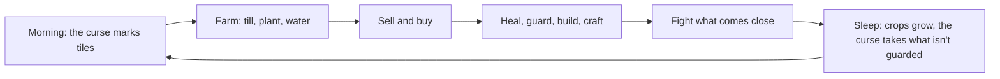

# Game concept: cursed island farm

**Date:** 2026-11-03 (rewritten 2026-11-07 to match the game)

> Farm, craft and fight to cleanse a cursed island. Every field you grow pushes the darkness back.

- **Working title:** none yet, to be picked before the outside test
- **View:** 2D top-down (3/4), 32×32 pixel art
- **Platforms:** Android first, then Steam
- **Session length:** short (2 to 5 minutes) on a phone, but rewarding for longer play

## Pillars

Every feature must support at least one of these:

1. **Healing feels good.** Dark, cracked land turning green is the core reward. It must look and sound satisfying.
2. **Moody but cozy.** Dark world, warm light. Your farm is the safe, glowing place in the darkness.
3. **Everything ties to the curse.** Farming, crafting, building and fighting all exist to push the curse back.
4. **Short sessions, long goal.** Each session makes visible progress, and the long goal is breaking the curse.

## Story

A curse is killing the island, and your farm is the last green land. The people who lived here took from the land and forgot its shrines. When the shrines went dark, a beating heart under the hill began to spread the curse, and the last of them left.

You find their book in the house. Its pages are stained black, and they clear as you heal the land, so the story is earned by playing. A night trader nobody has seen rows in after dark: they take what's in the shipping box, leave coins, and stock the stall, never with more than three bottles of holy water.

The story lives in the old book (`scripts/ui/book_pages.gd`). There are no characters to talk to, which keeps the island lonely.

## How a day plays

Each day asks one question: earn money, heal new land, or protect what you have?

## What's in the game

| System | How it works |
|---|---|
| **Farming** | Till clean grass, plant, water, sleep, harvest. 3 crops, plus the wardthorn. Soil left empty for 3 nights turns back to grass |
| **Water** | The can holds 10, is full each morning, and refills at wells. One well stands by the house. Water is what limits farm size, not soil |
| **Money** | The shipping box pays overnight. The stall sells seeds and 3 holy water a day |
| **Healing** | Holy water heals a 3×3 patch, strong holy water 5×5. The purifying hoe heals one tile, twice a day, for free. A restored shrine heals a huge area |
| **The curse** | From day 4 it marks healed tiles beside it each morning, and takes them that night. It grows as you heal. Food crops on marked tiles are blighted. This is still being tested |
| **Guards** | Lanterns are rare and permanent: 5×5, 6 tiles apart. Wardthorn is cheap, and starts guarding once it sprouts: 3×3 while dry, 7×7 while watered, and 5×5 with no water once ripe, until you burst it with the Heal button. Its light shows about how far it guards |
| **Gathering and crafting** | Healed land reveals trees and rocks. The workbench turns wood, stone and curse shards into tools and buildings |
| **Buildings** | Lanterns, fences and wells. Place from the Bag, and press and hold to move them. The house and stall stay fixed |
| **Combat** | Shades and hollows appear near the curse from day 3, and avoid lantern light. The big button swings the crafted sword. Fainting costs money and the rest of the day |
| **Guidance** | A short story on New Game, then one goal at a time, shown for a moment and kept in Tasks. The old book teaches and tells the story |
| **Saving** | Saves each morning, so a game always resumes at the start of a day |

## Controls

Phones have the joystick, a big Action button that changes with what's in front of you, Heal, Seed, Bag, Pause and a small Tasks button. Computers keep the number keys and tool bar, with R for Action. [The controls doc](24_2026-11-07_controls-comparison.md) explains why, and how it compares with other games.

## The island

| # | Area | Feel | Status |
|---|---|---|---|
| 1 | **Shore** | Your clean start, with the farmhouse | ✅ In the game |
| 2 | **Old farmlands** | Clearings in cursed fields, and the first shrine | ✅ In the game |
| 3 | **Whispering Woods** | Dark forest, darkwood, thornlings | Planned as a free update |
| 4 | **Sunken Marsh** | Foggy wetland, moonreed, potions, the drowned | Planned as a free update |
| 5 | **Ruined village** | Broken buildings to restore | Idea only |
| 6 | **Cursed heart** | The source of the curse | Idea only |

The [areas plan](15_2026-11-04_areas-woods-marsh.md) covers 3 and 4, and ends the first version when all three shrines are restored. Areas 5 and 6 only happen if players want more.

## Art direction

- **Style:** moody dark fantasy, muted earthy colors, purple and teal shadows, realistic proportions. See [the art guide](27_2026-11-07_art-guide.md)
- **Lighting:** art is drawn in neutral daylight, and mood comes from Godot lighting
- **Color language:** clean land is green and warm, cursed land is dark purple with glowing cracks
- **Player:** a hooded farmer in a dark red cloak

## Income plan

- **Android:** free with **rewarded ads** that fit the theme (for example "faster cleansing" or "double harvest"), and an optional "remove ads" purchase
- **Steam:** a paid version later
- AI-generated art must be disclosed on Steam, and checked against Google Play's rules

## Open questions

- The game's real title
- Does the curse taking land back stay? [The curse test](21_2026-11-07_curse-returns-test.md) decides
- Later ideas that wait for real players: building upgrades, a quest board, and Bag tabs (needed before the areas work)
