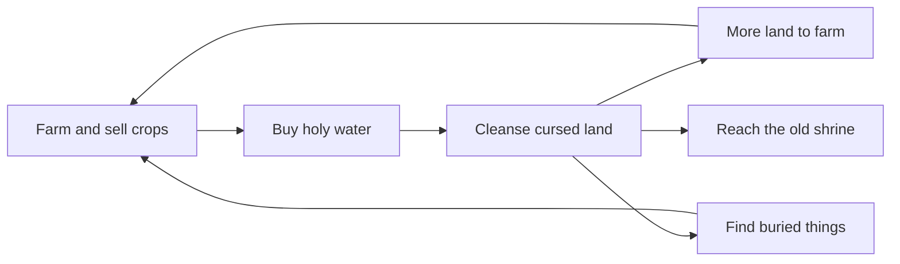

# Layer 2 plan: the curse

**Date:** 2026-11-04

## Goal

Turn the cursed border into something the player can heal. Money from farming buys holy water, holy water cleanses dark land, and clean land gives more room to farm. By the end of this layer the player has crossed the **old farmlands** (area 2 in [the game concept](03_2026-11-03_game-concept.md)) and restored an old shrine.

This layer serves the first pillar: **healing feels good**. The moment dark, cracked land turns green has to be the most satisfying thing in the game so far.

## Core loop

## Design decisions

| Question | Decision | Why |
|---|---|---|
| How does the player cleanse before crafting exists? | Buy **holy water** at the stall | Links farming to cleansing now. Layer 3 can add crafting without changing how cleansing works |
| How much does one use clean? | A **3×3 patch** around the target tile, for about 30 money | One tile at a time would feel slow, and a big patch turning green looks better |
| Where can the player farm? | **Any clean grass**, instead of a fixed farm area | Cleansing should pay off straight away |
| Does the curse fight back? | **No, not in this layer** | Keeps the layer small. Creeping curse stays an update idea, and lantern protection comes with it |
| What's the goal of the layer? | Reach and restore the **old shrine** in the old farmlands | Gives the player somewhere to head, and a big moment at the end |

Prices are starting values, to be tuned once the loop can be played.

## In scope

| Feature | Details |
|---|---|
| **Bigger map** | Adds the old farmlands next to the shore. Shore cells keep their coordinates, so existing saves still fit |
| **Holy water** | Sold at the stall, used with a new tool on key 5. The target highlight shows the 3×3 patch |
| **Healing effect** | The patch turns green tile by tile from the center, with a burst of light. Made in Godot, so it needs no art |
| **Farm on clean land** | The fixed `farm_area` goes away. Grass anywhere can be tilled, except under solid objects |
| **Saving** | Cleansed cells, finds and the shrine are added to the save |
| **Progress** | The HUD shows how much of the island is cleansed |
| **Buried finds** | Some cursed tiles hide seeds, money or holy water, marked by a faint glimmer and found when they're cleansed |
| **Old shrine** | A cursed shrine in the old farmlands. Restoring it cleanses a large area around it |

## Not in Layer 2

Crafting and gathering (Layer 3), building (Layer 4), enemies (Layer 5), the curse spreading back, lanterns as a mechanic, sound, areas 3 to 6.

## Build steps

Each step ends with something you can run in Godot and see working.

1. ✅ **Bigger map:** add the old farmlands, keeping the shore where it is
2. ✅ **Holy water:** buy it at the stall, add the key 5 tool, cleanse a 3×3 patch (never the map's outer ring, which keeps the player inside the map)
3. ✅ **Healing effect:** make the patch heal outward with light
4. ✅ **Farm on clean land:** remove the fixed farm area
5. ✅ **Save cleansed land:** keep healed land between sessions
6. ✅ **Progress and finds:** cleansed percentage on the HUD, buried seeds, money and holy water, marked by a glimmer
7. **Old shrine:** restore it for the big cleanse (needs art)
8. **Soft edges:** smooth the hard square line between grass and curse (needs art)

## Art needed

No art is needed until step 7.

| Step | Art |
|---|---|
| 7 | Old shrine, in a cursed and a restored version |
| 8 | Edge tiles between grass and cursed ground |

The prompts are written when each step starts, in a new Layer 2 art doc.

## Risks

- **Too slow or too fast:** the price of holy water decides how long the layer takes. Test it with real play and tune it.
- **Old saves:** a save made before this layer has no cleansed land, so it must still load. New save fields need default values.
- **Map tool:** rerunning `tools/build_farm_map.gd` overwrites `ground.tscn`, so the old farmlands should be added in that tool rather than painted by hand.
