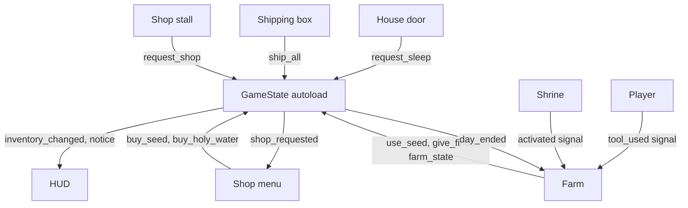

# Build notes: what was built and why

**Date:** 2026-11-04

A learning guide to the code, so you can understand each step and build something similar yourself. The plan docs say what to build; this doc says how it was done and why.

To see the exact code for a step, use the commit in its heading:

```bash
git show 606e250
```

## Godot ideas, compared to Angular

| Godot | Angular | What it means here |
|---|---|---|
| Scene (`.tscn`) | Component | A reusable piece, like `shipping_box.tscn` |
| Node tree | Component tree | `Main` holds `Farm`, `World` and `HUD` |
| Autoload | Service with `providedIn: 'root'` | `GameState`: one shared copy for the whole game |
| Signal | `@Output()` or an RxJS Subject | "Something happened", without knowing who's listening |
| `@export` | `@Input()` | A value you can change in the editor |
| `@onready var x = $Child` | `@ViewChild` | A link to a child, ready once the node is |
| `_ready()` | `ngOnInit()` | Runs once when the node is set up |
| `_physics_process()` | A fixed timer loop | Runs 60 times a second |
| Resource (`.tres`) | A typed config object | Data with no behavior, like `radish.tres` |

## How the pieces talk to each other



The rule behind this picture: **data lives in one place, and nodes announce changes with signals.** The HUD never asks the farm anything. It listens for `inventory_changed`, then redraws. This is why adding the shop needed almost no HUD changes.

## Layer 1: basic farming

### Steps 1–5: the foundation (17d3773, 4b05ef9)

| Step | What was added | Key code |
|---|---|---|
| 1 Setup | Folders, pixel settings, input keys | `project.godot` |
| 2 Player | 8-way walking, 4 facing poses, walk animations | `Player._physics_process()` |
| 3 Farm grid | Tile layers, target tile, highlight | `Farm.target_cell_for()` |
| 4 Till and plant | Tools and crops | `Farm.can_use()`, `Farm.plant()` |
| 5 Water and days | Watering, sleeping, growth | `GameState.end_day()` |

**Best practices to copy**
- **One function decides what's allowed.** `can_use()` drives both the highlight color and the real action, so they can never disagree.
- **Crops are data.** A new crop is a new `.tres` file and one line in `GameState.CROPS`, with no new logic.
- **Input uses named actions.** Code asks for `use_tool`, not the Space key, which will make touch controls much easier later.

### Step 6: harvest and HUD (e0519ec)

| Added | Where |
|---|---|
| Hand tool picks ripe crops | `Farm.harvest()`, a new case in `can_use()` |
| Harvest counts | `GameState.add_harvest()`, `harvest_count()` |
| Money and inventory labels | `hud.gd`, `_inventory_text()` |

**Why this way:** adding a tool only meant one case in `can_use()` and one in `_on_tool_used()`. Good structure makes the next feature small.

### Step 7: shipping box and shop (606e250)

| Added | Where |
|---|---|
| Sell everything, paid overnight | `GameState.ship_all()`, `_pay_shipped()` |
| Shop with Buy buttons | `shop_menu.tscn`, `shop_menu.gd` |
| Pausing during the shop | `get_tree().paused`, plus `process_mode` Always on the menu |

**Best practices to copy**
- **Same pattern for every interactive object.** Each has an `interact()` method, so the player never needs to know what it's touching. In Angular terms, they all implement one interface.
- **Mark an input as handled.** `set_input_as_handled()` stops the F press that closes the shop from reaching the player and reopening it.
- **Rows are built from data.** The shop loops over `GameState.CROPS`, so a new crop appears there by itself.

### Step 8: save and load (538df4e)

| Added | Where |
|---|---|
| Save at the end of each day | `GameState.save_game()` |
| Load on start | `GameState.load_game()` |
| Farm state | `Farm._to_state()`, `Farm._restore()` |

**Best practices to copy**
- **Save a version number.** `SAVE_VERSION` lets a later release recognize an old file.
- **Save only what you can't work out.** Watered soil isn't saved, because it's always dry at save time.
- **Save at a calm moment.** Saving in the morning means nothing is half finished, so loading stays simple.
- **Expect a bad file.** Damaged or missing saves start a new game instead of crashing.

### Step 9: mood lighting (5a8db63)

| Added | Where |
|---|---|
| Darker world | `Mood` CanvasModulate in `main.tscn` |
| Lantern posts | `lantern_post.tscn` with a PointLight2D |

**Why this way:** the art stays in neutral daylight and Godot adds the mood. One color value changes the whole game's feel, with no art redrawn. The HUD stays bright because it's on its own CanvasLayer.

## Layer 2: the curse

### Step 1: bigger map (1faa51e)

| Added | Where |
|---|---|
| Old farmlands and clearings | `_paint_old_farmlands()` in `tools/build_farm_map.gd` |

**Best practices to copy**
- **Generate content with a tool.** The map can be rebuilt at any time.
- **Protect saved data when things change.** Saves store tile positions, so the shore had to stay exactly where it was. All 1,040 shore cells were compared before and after.
- **Read warnings, even when tests pass.** The map tool had quietly removed the tileset's ID. The tests still passed, and a warning in the log was the only clue.

### Step 2: holy water (44f4438)

| Added | Where |
|---|---|
| Buying and using it | `GameState.buy_holy_water()`, `use_holy_water()` |
| Healing a 3×3 patch | `Farm.cleanse()`, `cleansable_cells()` |
| The key 5 tool | `Player.Tool`, `tool_5` in `project.godot` |

**Best practices to copy**
- **Think about what a change breaks.** Curse was also the map's wall, so healing the outer ring would let you walk off the map. `is_cleansable()` protects it.
- **Don't charge for nothing.** `cleanse()` checks that there's something to heal before spending.

### Step 3: healing effect (79960ee)

| Added | Where |
|---|---|
| Fading tiles, light and sparkles | `CleanseEffect.play()` |

**Why this way, and the main lesson of this layer:** keep **game state** separate from **visuals**. The land heals instantly, and the effect only draws old tiles fading on top. If the animation had changed the land, a second key press during it could have spent holy water twice, and saving mid-animation could have stored half a patch. Separating them removes both bugs.

### Step 4: farm on clean land (ea98e35)

| Added | Where |
|---|---|
| Any clean grass can be tilled | `Farm.is_farmable()` |
| No tilling under objects | `_has_solid_object()`, a physics shape query |

**Best practice to copy:** when you remove a rule, ask what else it was doing. The old farm area also kept tilling away from the house, so removing it needed a new check.

### Step 5: save cleansed land (21ff363)

| Added | Where |
|---|---|
| Healed cells are remembered | `Farm.cleansed`, `_heal()` |

**Best practice to copy:** add new save fields with a default, like `state.get("cleansed", [])`, so older saves still load.

### Step 6: progress and finds (b6905c9)

| Added | Where |
|---|---|
| Healing percentage | `Farm._report_progress()` |
| Buried rewards | `Farm.BURIED_FINDS`, `GameState.give_find()` |
| Golden sparkles | `find_glimmer.tscn` |
| On-screen messages | `GameState.notice`, `HUD._show_notice()` |

**Best practice to copy:** if a value can be worked out from saved data, don't save it too. A find is gone once its tile is healed, so finds need no save data, and two saved copies can never disagree.

### Step 7: old shrine (5e674c4)

| Added | Where |
|---|---|
| Shrine with two looks | `Shrine`, `shrine.tscn` |
| The big cleanse | `Farm._on_shrine_activated()`, `_cleanse_cells()` |

**Best practice to copy:** when a second feature needs the same logic, pull it into a shared function. `_cleanse_cells()` serves both holy water and the shrine, so both get finds, effects and progress for free.

### Step 8: soft edges (94760be)

| Added | Where |
|---|---|
| Edge piece generator | `tools/build_curse_edges.gd` |
| Drawing the pieces | `CurseEdges.refresh()`, `_draw()` |

**Why this way:** a tool built the edges from existing art, which saved making 128 small images by hand. Pieces use each tile's position in the texture, so neighbors join up with no visible seam.

## Fixes from the first playtest

The first real play found a problem that every automated test had missed. The crops worked, but the player couldn't tell: after 17 nights, the pumpkins had only been watered twice, and they looked the same as fresh seeds.

| Added | Where |
|---|---|
| A sprout after the first watered night | `Crop._stage_for()` |
| Status when facing a crop | `Farm.crop_status()`, the `target_status_changed` signal, `CropStatusLabel` |
| Lit lantern and flicker | `lantern_post.png`, `scripts/farm/lantern_light.gd` |

**Best practices to copy**
- **Working isn't the same as understood.** Tests check the rules, while only a player can show whether the rules are clear. Always give feedback for anything slow or invisible.
- **Check the evidence before answering.** The save file showed what had really happened, so there was no need to guess whether it was a bug.
- **Light needs a source.** A glow with no visible flame looks wrong, even when the lighting is correct.
- **Update a test for the right reason.** One save test expected the old carrot stage. It changed because the rule changed on purpose, so that was correct. Never edit a test only to make it pass.

## Layer 3: gathering and crafting

### Step 1: cleanup

The player sees no change here. That's the point of a **refactor**: improve the code without changing what it does.

| Added | Where |
|---|---|
| Healing moved out of the farm | `scripts/farm/healing.gd`, a child node of Farm. `farm.gd` went from 306 lines to 217 |
| Prices as data | `GameBalance`, `data/balance.tres` |
| Finds as data | `BuriedFind`, `data/buried_finds.tres` |
| Crash-safe saving | `GameState.save_game()` writes `save.tmp`, then renames it |
| Tests for old saves | `tests/test_old_save.gd`, `tests/fixtures/save_v1.cfg` |

**Best practices to copy**
- **One script, one job.** `Farm` handles soil and crops, and `Healing` handles the curse. When you want to change healing, there's one file to read. In Angular, this is like splitting a large component in two.
- **Make a safety net first.** A real save was captured before any code moved, so the test proves old saves still load. Never regenerate that file just to make the test pass.
- **Write to a temporary file, then rename.** Renaming is close to instant, so a crash leaves either the old save or the new one, never half of each.
- **Keep numbers out of code.** To change the holy water price, edit `data/balance.tres` in Godot's Inspector. No code changes, which will make the balance pass in step 8 much easier.
- **Use typed Resources, not loose dictionaries.** `find.amount` is checked by Godot, while `find["amuont"]` would only fail while the game is running.
- **Prove a change is really connected.** Changing the price to 45 made the tests fail, which showed the game reads the new file.

### Step 2: materials and the bag

| Added | Where |
|---|---|
| Wood and stone | `MaterialData`, `data/materials/`, `GameState.add_material()` |
| The bag screen on key I | `bag_menu.tscn`, `bag_menu.gd` |
| A shorter HUD | `HUD._status_text()` |

**Best practices to copy**
- **Show only what changes often.** The HUD had 6 lines and was about to get longer. Details moved to the bag, so the game view stays clear, which matters even more on a phone screen.
- **Use the same data pattern again.** Materials work like crops, so they were quick to add and easy to understand.
- **Write the test before you trust the screen.** The new test found a real bug: the bag could open with old numbers, because it refreshed before it was visible. Order matters when a function checks a state you're about to change.

### Step 3: trees and rocks

| Added | Where |
|---|---|
| Tree and rock types | `GatherData`, `data/gather/tree.tres`, `rock.tres` |
| Where they stand | `GatherSpot`, `data/gather/spots.tres` |
| One object for both | `Gatherable`, `gatherable.tscn` |
| Placing and hitting | `Gathering`, a child node of Farm |
| Revealing them | The `Healing.land_healed` signal |
| Art made of separate pieces | `--single true` in `tools/pixelize.gd` |

**Best practices to copy**
- **One scene, many kinds.** A tree and a rock are the same code with different data, so a new kind, like a crystal, only needs a new `.tres` file.
- **Let signals connect systems.** `Healing` doesn't know trees exist. It announces `land_healed`, and `Farm` connects that to `Gathering`, so either one can change on its own.
- **Reuse a solved problem.** A tree could be told to update before its own sprite was ready. `Crop` had already met this bug, so the same `is_node_ready()` guard fixed it.
- **Look at the game, not only the tests.** Every test passed, but a screenshot showed trees hiding the farmer. Fading a tree while you're behind it is a common fix in top-down games.

### Step 4: regrowth

| Added | Where |
|---|---|
| Countdown after gathering | `Gatherable.days_until_regrow`, `GatherData.regrow_days` |
| Growing back overnight | `Gathering.advance_day()` |
| Saving it | `Gathering.to_state()`, `restore()` |

**Best practices to copy**
- **Save the changes, not the whole list.** Only gathered objects are saved, since everything else starts whole. Saves stay small, and moving a tree in `spots.tres` won't break them.
- **Check how features meet.** Rubble can be farmed, so a rock could have grown back on top of a crop. Before finishing a feature, ask what else can be on that tile.
- **Pass a function instead of a dependency.** `advance_day(is_tilled)` lets `Gathering` ask "is this cell in use?" without knowing what soil is. In Angular, this is like passing a callback as an input.

### Steps 5 and 6: workbench and crafting

These two were built together, because a crafting menu can't be tested without a recipe in it.

| Added | Where |
|---|---|
| Workbench | `workbench.tscn`, `workbench.gd` |
| Recipes as data | `RecipeData`, `RecipeNeed`, `data/recipes/holy_water.tres` |
| Crafting | `GameState.can_craft()`, `craft()`, `owned()` |
| The menu | `crafting_menu.tscn`, `crafting_menu.gd` |
| Shared menu code | `GameMenu` in `scripts/ui/game_menu.gd`, `data/ui/menu_panel.tres` |

**Best practices to copy**
- **The rule of three.** Two similar menus were fine, but a third was the moment to share the code. `GameMenu` holds pausing and closing, and each menu inherits it, like a base class in TypeScript. Sharing too early can guess wrong; three copies shows what's really the same.
- **Recipes are data.** The menu loops over `GameState.RECIPES`, so a new recipe needs a `.tres` file and one line, and the menu builds its own row.
- **Show the player what they're missing.** `2 Radish (5), 1 Stone (1)` shows both the cost and what you have, so nobody has to open the bag to check.
- **Check, then act, in one place.** `craft()` calls `can_craft()` itself, so a disabled button is only a convenience. The rule still holds if a button is ever wrong.

### Step 7: purifying hoe

| Added | Where |
|---|---|
| The recipe | `data/recipes/purifying_hoe.tres` |
| Made once only | `GameState.already_made()` |
| Daily uses | `GameState.use_purifying_hoe()`, `hoe_daily_uses` in `data/balance.tres` |
| Healing one tile | `Healing.purify()`, using the same `_cleanse_cells()` as everything else |

**Best practices to copy**
- **Upgrade an existing tool instead of adding one.** The hoe simply does more on cursed land, so there's no new key to learn, which keeps touch controls simple.
- **Reuse one code path.** Going through `_cleanse_cells()` meant the hoe got finds, effects, progress and tree reveals with no extra work, and `tests/test_purifying_hoe.gd` proves each one.
- **Don't save what you can work out.** Uses are always full in the morning, and the game only saves in the morning, so only owning the hoe is saved.

### A first balance fix

Crafting holy water used 2 radishes, worth 50 money, while the shop sold it for 30, so crafting was the worse deal. It now uses 1 radish, worth 25, plus 1 stone. Only `data/recipes/holy_water.tres` changed, and no code did.

**Best practice to copy:** check your numbers with simple math before playing. What something costs includes what the player gives up, so a radish spent on crafting is 25 money they didn't earn. `tests/test_crafting.gd` now checks that crafting stays cheaper than the shop.

## Layer 4: building

### Step 1: the Build tool

| Added | Where |
|---|---|
| Buildings as data | `BuildingData`, `data/buildings/lantern_post.tres` |
| Crafting a building | `data/recipes/lantern_post.tres`, `RecipeData.Result.BUILDING` |
| Key 6 and Q / E | `Player.Tool.BUILD`, `Player._change_selection()` |
| Where a building can go | `Farm.can_build()` |
| The live preview | `BuildPreview` |

**Best practices to copy**
- **Show the result before the player commits.** The preview uses the same `can_use()` as the real action, so green always means it will work.
- **Reuse controls players know.** Q and E pick a seed with the Seeds tool and a building with the Build tool, so there's nothing new to learn.
- **Protect important spots with one rule.** `can_build()` also checks interact areas, so one query keeps doors, shops and the player clear. A list of "forbidden tiles" would need updating for every new object.
- **Know your start-up order.** Godot readies nodes in tree order, and `Farm` comes before `World`, so `player.reach` wasn't set yet. This is the second bug with this cause, after the trees. In Angular terms, it's like using a `@ViewChild` before the view exists.

### Step 2: placing and saving

| Added | Where |
|---|---|
| Placing | `Builder.place()`, `GameState.use_building()` |
| Saving | `Builder.to_state()`, `restore()` |

**Best practices to copy**
- **Save ids, not objects.** The save stores a cell and `lantern_post`, and the game looks up the rest. If the lantern's art or scene changes later, old saves still work.
- **Skip what you don't recognize.** `restore()` ignores an unknown id, so removing a building from a future version won't crash old saves.
- **Reuse the normal path on load.** Loading and placing both end in `_spawn()`, so a loaded building can't behave differently from a new one.

### Step 3: removing

| Added | Where |
|---|---|
| Picking up | `Builder.pick_up()`, `GameState.add_building()` |
| Help text | `Builder.status()` |

**Best practices to copy**
- **Make mistakes cheap.** Players try more things when an action can be undone, so picking a building up returns all of it.
- **Keep one place for a rule.** Crafting and picking up both go through `add_building()`, so the count and HUD update the same way.

### Step 4: healing lanterns

| Added | Where |
|---|---|
| Range as data | `heal_radius` in `BuildingData` and `lantern_post.tres` |
| Nearest cursed tile | `Healing.heal_nearest()` |
| Nightly healing | `Farm._heal_from_buildings()` |

**Best practices to copy**
- **Tell the player about what they can't see.** Lanterns work while the screen is black, so the morning message is what makes the feature feel real. No healing means no message, so the game never reports nothing.
- **Build on what exists.** `heal_nearest()` is only a few lines, because it hands the tile to `_cleanse_cells()`, so finds, trees, edges and progress already work.
- **Put behavior on the data.** Any building with a `heal_radius` heals, so a stronger lantern later needs a new `.tres` file and no new code.
- **Test the limits, not only the normal case.** The test runs nights until the curse in range runs out, which proves the lantern stops at its range.

### Step 5: fence

| Added | Where |
|---|---|
| The fence | `data/buildings/fence.tres`, `fence.tscn`, `data/recipes/fence.tres` |
| Cutting a repeating piece from wider art | `--crop-x` and `--crop-w` in `tools/pixelize.gd` |

**Best practices to copy**
- **Good structure pays off.** A whole new building took two data files and one scene, with no new game code, because buildings are data.
- **Art must fit the grid.** The image had two posts and didn't match a tile. Cutting one post with rail on both sides made a piece that repeats with no seam.

### Step 6: well

| Added | Where |
|---|---|
| The well | `data/buildings/well.tres`, `well.tscn`, `data/recipes/well.tres` |
| Range as data | `water_radius` in `BuildingData` |
| Morning watering | `Farm._water_from_buildings()` |

**Best practices to copy**
- **Don't wait for art.** The well uses a plain placeholder image at the same path the real art will use, so swapping it later needs no code.
- **Think about loading when a rule changes.** Watered soil was never saved, because it was always dry in the morning. The well broke that rule, so loading now runs the same watering again. The first version ran it before the soil was restored, which dried everything again. `tests/test_well.gd` caught that, so order matters on load too.

## Layer 5: combat

### Step 1: health

| Added | Where |
|---|---|
| Hearts and damage | `GameState.take_damage()`, `hearts_changed` |
| Hearts on screen | `scripts/ui/hearts_bar.gd`, drawn in code with `_draw()` |
| Fainting | `GameState.fainted`, `HUD._faint()`, `Player.return_home()` |
| Tuning numbers | `max_hearts` and `faint_money_percent` in `data/balance.tres` |

**Best practices to copy**
- **Build the rules before the thing that uses them.** There are no enemies yet, but the test calls `take_damage()` directly, so health is finished and proven first.
- **Share code when two things are nearly the same.** Sleeping and fainting both fade out, end the day and fade back in, so both use `_fade_to_next_day()` and pass in what's different. In Angular, this is like passing a callback to a shared function.
- **Draw simple things in code.** Hearts need no art yet, and `_draw()` works like a canvas. Real art can come later.
- **Guard against repeats.** `take_damage()` does nothing at 0 hearts, so a second hit during the fade can't make the player faint twice.

### Step 2: sword

| Added | Where |
|---|---|
| The swing | `Sword.swing()`, `scenes/player/sword.tscn` |
| Key 7 | `Player.Tool.SWORD`, `tool_7` in `project.godot` |
| The recipe | `data/recipes/sword.tres`, `made_text` in `RecipeData` |
| A scrolling workbench list | The `ScrollContainer` in `crafting_menu.tscn` |

**Best practices to copy**
- **Fake animation in code.** One image swept through an arc looks like a swing, with no frames to draw and match.
- **Agree a method, not a type.** The sword hits anything with `take_hit()`. It knows nothing about creatures, like an interface in TypeScript, so it could be tested against a stand-in before any creature exists.
- **Land the hit mid-swing.** Damage at the moment the blade is in front feels better than at the key press.
- **Add a cooldown.** Without one, holding or mashing the key would hit every frame.
- **Old tests protect old features.** The sword's new hit area counted as "something in the way", so nothing could be built near the player. Three older tests caught it at once, in a feature that seemed unrelated.
- **Move hard-coded text into data.** The menu had the hoe's message in code, and a second one-time recipe showed that was wrong. It's now `made_text`.

### Step 3: shade

| Added | Where |
|---|---|
| Creature types | `CreatureData`, `data/creatures/shade.tres` |
| One scene for all creatures | `Creature`, `scenes/creatures/creature.tscn` |
| Wander and chase | `Creature._update_state()`, a small state machine |
| Its own collision layer | `collision_layer = 2` on the scene, and masks in `Farm` and the sword |

**Best practices to copy**
- **Use a state machine.** A creature is always in one state, `WANDER` or `CHASE`, and `_update_state()` is the only place that changes it. Every new behavior, like stopping at lantern light, gets one clear home.
- **Use two distances.** It starts chasing at 110 and gives up at 170. With one distance, it would flip between states when the player stood right on the line. This is called hysteresis.
- **Use collision layers to say what touches what.** Creatures are on layer 2, so they can't block farming, and the player walks through them, while the sword's hitbox still sees them.
- **Use groups to find things.** `get_first_node_in_group("player")` avoids long node paths. It's a little like asking Angular's injector for a service.

### Step 4: fighting

| Added | Where |
|---|---|
| Hitting creatures | `Creature.take_hit()`, `health`, `defeated` signal |
| Creatures hurting you | `Creature._touch_player()`, `Player.hurt()` |
| A safe moment after a hit | `Player.SAFE_SECONDS`, with blinking |
| No damage between days | `GameState.day_changing` |

**Best practices to copy**
- **Give feedback on every hit.** A white flash, a knockback and a fade tell the player what happened, and they matter more to how combat feels than the damage numbers do.
- **Add a safe moment after a hit.** Without it, a creature touching you would take every heart in a fraction of a second.
- **Choose the right movement mode.** `CharacterBody2D` defaults to side-view "grounded" movement, where something below you is a floor. A shade above the farmer rode along like a passenger on a moving platform, and teleported home with them after fainting. Top-down games need `motion_mode = Floating`.
- **Check the trace, not your guess.** That bug looked like a test timing problem at first. Printing positions frame by frame showed the shade moving 245 pixels in one step, which pointed straight at the cause.

### Step 5: lantern safety

| Added | Where |
|---|---|
| Keeping out of the light | `Creature._avoid_light()` |
| Finding every lantern | The `lantern_light` group on the scene's Light node |
| The safe distance | `lantern_safe_radius` in `data/balance.tres` |

**Best practices to copy**
- **Groups scale for free.** The light is in a group inside the lantern scene, so map lanterns and placed lanterns both count, and `Creature` never needs a list of them.
- **Filter movement instead of rewriting it.** Chasing and wandering still decide where to go, and `_avoid_light()` only corrects the result. A new behavior later gets the same protection.
- **Slide, don't stop.** Removing the part of the movement that points into the light lets a creature curve around it, which looks smarter with very little code. This is vector projection, a useful trick for any game.
- **Plan for being in the wrong place.** A lantern can appear beside a creature, or a hit can knock one in, so "already inside" has its own rule: leave at once.
- **Test setups can be wrong too.** Six checks failed at first because the test's shade started too far away to notice the farmer. Before changing code, ask whether the test matches the rules.

### Step 6: spawning

| Added | Where |
|---|---|
| Choosing spots each morning | `CreatureSpawner.spawn_cells()` |
| How many | `count_for_today()`, with the numbers in `data/balance.tres` |
| Clearing them at night | `CreatureSpawner.clear()` |

**Best practices to copy**
- **Seed your randomness.** The spawner's generator is seeded with the day, so a morning always plays out the same way. Tests stay stable, and a bug report can be repeated.
- **Check that a spot is really usable.** A flood fill from the player finds land they can walk to, so a creature never appears in a cut-off clearing, where it would do nothing. It's the same idea as a paint bucket tool.
- **Cap anything that grows.** More healing means more creatures, but never above `creature_max_count`, which protects phones.
- **Ease new players in.** Creatures start on day 3, so the first days stay calm and cozy.
- **Never ignore a flaky test.** The shade test failed once in three runs, because wandering is random and it checked a point on the edge of the body. A test that sometimes fails teaches you to ignore failures, so fix it, and run it many times to prove it.
- **Order matters on fainting.** The player goes home before the new day starts, so creatures keep their distance from where the player wakes.

### Step 7: curse shards

| Added | Where |
|---|---|
| Drops | `drop` and `drop_amount` in `CreatureData`, `Creature._defeat()` |
| Curse shards | `data/materials/curse_shard.tres` |
| Strong holy water | `data/recipes/strong_holy_water.tres`, `GameState.strong_holy_water` |
| Choosing the kind | Q and E with the Holy water tool, `Player.strong_water` |
| A 5×5 patch | `Healing.radius_for()`, `strong_cleanse_radius` |

**Best practices to copy**
- **Close the loop.** Fighting now feeds healing: shards make stronger water, which heals faster. A system feels pointless when it leads nowhere.
- **Add options to a function with a default.** `cleanse(center, strong = false)` left every older caller working as before.
- **Extend what's there.** A recipe can now use holy water as an ingredient, with one new field on `RecipeNeed`.
- **Run tests more than once after randomness arrives.** Creatures move randomly, so one green run proves less than it used to.

### Step 8: hollow

| Added | Where |
|---|---|
| The hollow | `data/creatures/hollow.tres` |
| New creature options | `float_height`, `body_radius`, `knockback_scale`, `min_cell_x` in `CreatureData` |
| Choosing by area | `CreatureSpawner.creature_for()` |

**Best practices to copy**
- **Data pays off again.** A very different creature, slow and heavy, needed a `.tres` file and a few new fields. Its behavior code didn't change, and every rule, like lantern safety, already applied.
- **Difficulty by place.** Hollows only appear from column 52, so danger grows as the player pushes toward the cursed heart. The player chooses when to face them.
- **Give each creature its own shape.** A shape is a shared resource, so changing it on one creature would change them all. Making a new `CircleShape2D` in `_ready()` keeps each one separate, and a test checks that.

## Layer 6: mobile and release

### Step 1: title menu

| Added | Where |
|---|---|
| The title screen | `title_screen.tscn`, `title_screen.gd`, now the first scene |
| Starting over | `GameState.start_new_game()` |
| Checking for a save | `GameState.has_save()` |

**Best practices to copy**
- **Make the safe choice the default.** On the "Start over?" question, focus starts on No, so pressing Enter by accident can't erase a farm.
- **Say exactly what will be lost.** "Your farm on Day 26 will be gone for good" is clearer than "Are you sure?".
- **Don't ask when there's nothing to lose.** With no save, New Game starts straight away.
- **Keep starting values in one place.** `START_SEEDS` is used by both a fresh launch and New Game, so they can't drift apart. `start_new_game()` must reset every saved value, and a test fills them all in to prove it.
- **Copy before changing shared data.** `START_SEEDS.duplicate()` stops gameplay from changing the starting list by accident. In TypeScript, this is like spreading an object instead of keeping a reference.
- **Don't rename what other things depend on.** The title on screen is separate from `config/name`, because Godot uses that name for the save folder. Changing it would make existing saves disappear.

### Step 2: touch controls

| Added | Where |
|---|---|
| Joystick | Godot's built-in `VirtualJoystick` node in `main.tscn` |
| Tool bar and buttons | `TouchControls`, built from tables in `touch_controls.gd` |
| Button image | `tools/build_touch_art.gd`, `assets/ui/touch_button.png` |

**Best practices to copy**
- **Check what the engine already has.** I wrote a joystick, then a name clash showed Godot 4.7 has one built in. Deleting my code was the right call, because less code means fewer bugs. Search the docs before you build.
- **Touch is just another input.** Every button presses a normal action like `use_tool`, so no game code changed. This is the payoff from using named actions back in Layer 1.
- **Pick the right node for multi-touch.** `TouchScreenButton` works while another finger is down, so the player can walk and act together. A test proves it with two simulated fingers.
- **Clean up when hiding input.** A hidden joystick can't see a finger lift, so the farmer kept walking. `_release_movement()` fixes that.
- **Watch for settings that stack.** A gentle push barely moved the farmer, because the joystick and the input action each have a dead zone, and they multiply. My first guess at the cause was wrong: I thought the action's was 50%, but the file said 20%. A test for the symptom found the real cause.

## Things to do better

Not everything here is best practice. These are real weak spots, most important first.

| Weak spot | Why it matters | Better way |
|---|---|---|
| **Prices and recipes are untested** | No one has played far enough to judge them | Play a full loop, then tune them in the balance pass |
| **Fences only face one way** | Sections placed up and down still show the side view, so a column looks broken | Add a second image, and pick the art from the neighboring fences |
| **Player still uses grounded movement** | Nothing rides on it yet, but it's the wrong mode for a top-down game | Set the player to Floating too, and check that walking along walls still feels right |
| **Only one message shows at a time** | On day 3, the creature warning replaces a lantern's healing message | Queue messages, so each one gets its turn |
| **Touch has only been simulated** | Fake fingers prove the logic, not how it feels on glass, or whether thumbs reach | Try it on a real phone in step 4 |
| **Keyboard words on touch screens** | Text still says "Q / E" and "Enter: buy" on a phone | Fix in step 3 |
| **No way back to the title** | You have to close the game to reach the title screen | Add a pause menu |

## Running the tests

The tests are in `tests/`. This runs them all in a few seconds, without touching your real save:

```bash
tests/run_all.sh
```

Run it before every commit. A test proves a feature still works after you change something else, which is why tests belong in the project and not in a temporary folder. Each new feature should add its own test.

## Try it yourself

The best way to learn this code is to change it:

1. **Easy:** add a fourth crop with a new `.tres` file and one line in `GameState.CROPS`. It's one way to see why data-driven design is useful.
2. **Medium:** add a new buried find in `Farm.BURIED_FINDS`, then add a new reward kind in `GameState.give_find()`.
3. **Harder:** add a new object with an `interact()` method, like a well that gives one free holy water a day. You'll touch a scene, a script and the save file.
