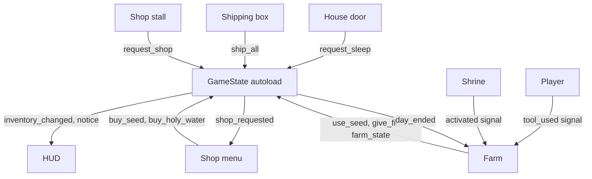

# Build notes: what was built and why

**Date:** 2026-11-04

A learning guide to the code, so you can understand each step and build something similar yourself. The plan docs say what to build; this doc says how it was done and why.

To see the exact code for a step, use the commit in its heading:

```bash
git show 606e250
```

## Godot ideas, compared to Angular

| Godot | Angular | What it means here |
|---|---|---|
| Scene (`.tscn`) | Component | A reusable piece, like `shipping_box.tscn` |
| Node tree | Component tree | `Main` holds `Farm`, `World` and `HUD` |
| Autoload | Service with `providedIn: 'root'` | `GameState`: one shared copy for the whole game |
| Signal | `@Output()` or an RxJS Subject | "Something happened", without knowing who's listening |
| `@export` | `@Input()` | A value you can change in the editor |
| `@onready var x = $Child` | `@ViewChild` | A link to a child, ready once the node is |
| `_ready()` | `ngOnInit()` | Runs once when the node is set up |
| `_physics_process()` | A fixed timer loop | Runs 60 times a second |
| Resource (`.tres`) | A typed config object | Data with no behavior, like `radish.tres` |

## How the pieces talk to each other



The rule behind this picture: **data lives in one place, and nodes announce changes with signals.** The HUD never asks the farm anything. It listens for `inventory_changed`, then redraws. This is why adding the shop needed almost no HUD changes.

## Layer 1: basic farming

### Steps 1–5: the foundation (17d3773, 4b05ef9)

| Step | What was added | Key code |
|---|---|---|
| 1 Setup | Folders, pixel settings, input keys | `project.godot` |
| 2 Player | 8-way walking, 4 facing poses, walk animations | `Player._physics_process()` |
| 3 Farm grid | Tile layers, target tile, highlight | `Farm.target_cell_for()` |
| 4 Till and plant | Tools and crops | `Farm.can_use()`, `Farm.plant()` |
| 5 Water and days | Watering, sleeping, growth | `GameState.end_day()` |

**Best practices to copy**
- **One function decides what's allowed.** `can_use()` drives both the highlight color and the real action, so they can never disagree.
- **Crops are data.** A new crop is a new `.tres` file and one line in `GameState.CROPS`, with no new logic.
- **Input uses named actions.** Code asks for `use_tool`, not the Space key, which will make touch controls much easier later.

### Step 6: harvest and HUD (e0519ec)

| Added | Where |
|---|---|
| Hand tool picks ripe crops | `Farm.harvest()`, a new case in `can_use()` |
| Harvest counts | `GameState.add_harvest()`, `harvest_count()` |
| Money and inventory labels | `hud.gd`, `_inventory_text()` |

**Why this way:** adding a tool only meant one case in `can_use()` and one in `_on_tool_used()`. Good structure makes the next feature small.

### Step 7: shipping box and shop (606e250)

| Added | Where |
|---|---|
| Sell everything, paid overnight | `GameState.ship_all()`, `_pay_shipped()` |
| Shop with Buy buttons | `shop_menu.tscn`, `shop_menu.gd` |
| Pausing during the shop | `get_tree().paused`, plus `process_mode` Always on the menu |

**Best practices to copy**
- **Same pattern for every interactive object.** Each has an `interact()` method, so the player never needs to know what it's touching. In Angular terms, they all implement one interface.
- **Mark an input as handled.** `set_input_as_handled()` stops the F press that closes the shop from reaching the player and reopening it.
- **Rows are built from data.** The shop loops over `GameState.CROPS`, so a new crop appears there by itself.

### Step 8: save and load (538df4e)

| Added | Where |
|---|---|
| Save at the end of each day | `GameState.save_game()` |
| Load on start | `GameState.load_game()` |
| Farm state | `Farm._to_state()`, `Farm._restore()` |

**Best practices to copy**
- **Save a version number.** `SAVE_VERSION` lets a later release recognize an old file.
- **Save only what you can't work out.** Watered soil isn't saved, because it's always dry at save time.
- **Save at a calm moment.** Saving in the morning means nothing is half finished, so loading stays simple.
- **Expect a bad file.** Damaged or missing saves start a new game instead of crashing.

### Step 9: mood lighting (5a8db63)

| Added | Where |
|---|---|
| Darker world | `Mood` CanvasModulate in `main.tscn` |
| Lantern posts | `lantern_post.tscn` with a PointLight2D |

**Why this way:** the art stays in neutral daylight and Godot adds the mood. One color value changes the whole game's feel, with no art redrawn. The HUD stays bright because it's on its own CanvasLayer.

## Layer 2: the curse

### Step 1: bigger map (1faa51e)

| Added | Where |
|---|---|
| Old farmlands and clearings | `_paint_old_farmlands()` in `tools/build_farm_map.gd` |

**Best practices to copy**
- **Generate content with a tool.** The map can be rebuilt at any time.
- **Protect saved data when things change.** Saves store tile positions, so the shore had to stay exactly where it was. All 1,040 shore cells were compared before and after.
- **Read warnings, even when tests pass.** The map tool had quietly removed the tileset's ID. The tests still passed, and a warning in the log was the only clue.

### Step 2: holy water (44f4438)

| Added | Where |
|---|---|
| Buying and using it | `GameState.buy_holy_water()`, `use_holy_water()` |
| Healing a 3×3 patch | `Farm.cleanse()`, `cleansable_cells()` |
| The key 5 tool | `Player.Tool`, `tool_5` in `project.godot` |

**Best practices to copy**
- **Think about what a change breaks.** Curse was also the map's wall, so healing the outer ring would let you walk off the map. `is_cleansable()` protects it.
- **Don't charge for nothing.** `cleanse()` checks that there's something to heal before spending.

### Step 3: healing effect (79960ee)

| Added | Where |
|---|---|
| Fading tiles, light and sparkles | `CleanseEffect.play()` |

**Why this way, and the main lesson of this layer:** keep **game state** separate from **visuals**. The land heals instantly, and the effect only draws old tiles fading on top. If the animation had changed the land, a second key press during it could have spent holy water twice, and saving mid-animation could have stored half a patch. Separating them removes both bugs.

### Step 4: farm on clean land (ea98e35)

| Added | Where |
|---|---|
| Any clean grass can be tilled | `Farm.is_farmable()` |
| No tilling under objects | `_has_solid_object()`, a physics shape query |

**Best practice to copy:** when you remove a rule, ask what else it was doing. The old farm area also kept tilling away from the house, so removing it needed a new check.

### Step 5: save cleansed land (21ff363)

| Added | Where |
|---|---|
| Healed cells are remembered | `Farm.cleansed`, `_heal()` |

**Best practice to copy:** add new save fields with a default, like `state.get("cleansed", [])`, so older saves still load.

### Step 6: progress and finds (b6905c9)

| Added | Where |
|---|---|
| Healing percentage | `Farm._report_progress()` |
| Buried rewards | `Farm.BURIED_FINDS`, `GameState.give_find()` |
| Golden sparkles | `find_glimmer.tscn` |
| On-screen messages | `GameState.notice`, `HUD._show_notice()` |

**Best practice to copy:** if a value can be worked out from saved data, don't save it too. A find is gone once its tile is healed, so finds need no save data, and two saved copies can never disagree.

### Step 7: old shrine (5e674c4)

| Added | Where |
|---|---|
| Shrine with two looks | `Shrine`, `shrine.tscn` |
| The big cleanse | `Farm._on_shrine_activated()`, `_cleanse_cells()` |

**Best practice to copy:** when a second feature needs the same logic, pull it into a shared function. `_cleanse_cells()` serves both holy water and the shrine, so both get finds, effects and progress for free.

### Step 8: soft edges (94760be)

| Added | Where |
|---|---|
| Edge piece generator | `tools/build_curse_edges.gd` |
| Drawing the pieces | `CurseEdges.refresh()`, `_draw()` |

**Why this way:** a tool built the edges from existing art, which saved making 128 small images by hand. Pieces use each tile's position in the texture, so neighbors join up with no visible seam.

## Fixes from the first playtest

The first real play found a problem that every automated test had missed. The crops worked, but the player couldn't tell: after 17 nights, the pumpkins had only been watered twice, and they looked the same as fresh seeds.

| Added | Where |
|---|---|
| A sprout after the first watered night | `Crop._stage_for()` |
| Status when facing a crop | `Farm.crop_status()`, the `target_status_changed` signal, `CropStatusLabel` |
| Lit lantern and flicker | `lantern_post.png`, `scripts/farm/lantern_light.gd` |

**Best practices to copy**
- **Working isn't the same as understood.** Tests check the rules, while only a player can show whether the rules are clear. Always give feedback for anything slow or invisible.
- **Check the evidence before answering.** The save file showed what had really happened, so there was no need to guess whether it was a bug.
- **Light needs a source.** A glow with no visible flame looks wrong, even when the lighting is correct.
- **Update a test for the right reason.** One save test expected the old carrot stage. It changed because the rule changed on purpose, so that was correct. Never edit a test only to make it pass.

## Layer 3: gathering and crafting

### Step 1: cleanup

The player sees no change here. That's the point of a **refactor**: improve the code without changing what it does.

| Added | Where |
|---|---|
| Healing moved out of the farm | `scripts/farm/healing.gd`, a child node of Farm. `farm.gd` went from 306 lines to 217 |
| Prices as data | `GameBalance`, `data/balance.tres` |
| Finds as data | `BuriedFind`, `data/buried_finds.tres` |
| Crash-safe saving | `GameState.save_game()` writes `save.tmp`, then renames it |
| Tests for old saves | `tests/test_old_save.gd`, `tests/fixtures/save_v1.cfg` |

**Best practices to copy**
- **One script, one job.** `Farm` handles soil and crops, and `Healing` handles the curse. When you want to change healing, there's one file to read. In Angular, this is like splitting a large component in two.
- **Make a safety net first.** A real save was captured before any code moved, so the test proves old saves still load. Never regenerate that file just to make the test pass.
- **Write to a temporary file, then rename.** Renaming is close to instant, so a crash leaves either the old save or the new one, never half of each.
- **Keep numbers out of code.** To change the holy water price, edit `data/balance.tres` in Godot's Inspector. No code changes, which will make the balance pass in step 8 much easier.
- **Use typed Resources, not loose dictionaries.** `find.amount` is checked by Godot, while `find["amuont"]` would only fail while the game is running.
- **Prove a change is really connected.** Changing the price to 45 made the tests fail, which showed the game reads the new file.

### Step 2: materials and the bag

| Added | Where |
|---|---|
| Wood and stone | `MaterialData`, `data/materials/`, `GameState.add_material()` |
| The bag screen on key I | `bag_menu.tscn`, `bag_menu.gd` |
| A shorter HUD | `HUD._status_text()` |

**Best practices to copy**
- **Show only what changes often.** The HUD had 6 lines and was about to get longer. Details moved to the bag, so the game view stays clear, which matters even more on a phone screen.
- **Use the same data pattern again.** Materials work like crops, so they were quick to add and easy to understand.
- **Write the test before you trust the screen.** The new test found a real bug: the bag could open with old numbers, because it refreshed before it was visible. Order matters when a function checks a state you're about to change.

### Step 3: trees and rocks

| Added | Where |
|---|---|
| Tree and rock types | `GatherData`, `data/gather/tree.tres`, `rock.tres` |
| Where they stand | `GatherSpot`, `data/gather/spots.tres` |
| One object for both | `Gatherable`, `gatherable.tscn` |
| Placing and hitting | `Gathering`, a child node of Farm |
| Revealing them | The `Healing.land_healed` signal |
| Art made of separate pieces | `--single true` in `tools/pixelize.gd` |

**Best practices to copy**
- **One scene, many kinds.** A tree and a rock are the same code with different data, so a new kind, like a crystal, only needs a new `.tres` file.
- **Let signals connect systems.** `Healing` doesn't know trees exist. It announces `land_healed`, and `Farm` connects that to `Gathering`, so either one can change on its own.
- **Reuse a solved problem.** A tree could be told to update before its own sprite was ready. `Crop` had already met this bug, so the same `is_node_ready()` guard fixed it.
- **Look at the game, not only the tests.** Every test passed, but a screenshot showed trees hiding the farmer. Fading a tree while you're behind it is a common fix in top-down games.

### Step 4: regrowth

| Added | Where |
|---|---|
| Countdown after gathering | `Gatherable.days_until_regrow`, `GatherData.regrow_days` |
| Growing back overnight | `Gathering.advance_day()` |
| Saving it | `Gathering.to_state()`, `restore()` |

**Best practices to copy**
- **Save the changes, not the whole list.** Only gathered objects are saved, since everything else starts whole. Saves stay small, and moving a tree in `spots.tres` won't break them.
- **Check how features meet.** Rubble can be farmed, so a rock could have grown back on top of a crop. Before finishing a feature, ask what else can be on that tile.
- **Pass a function instead of a dependency.** `advance_day(is_tilled)` lets `Gathering` ask "is this cell in use?" without knowing what soil is. In Angular, this is like passing a callback as an input.

## Things to do better

Not everything here is best practice. These are real weak spots, most important first.

| Weak spot | Why it matters | Better way |
|---|---|---|
| **Holy water prices are untested** | No one has played far enough to judge them | Play a full loop before each new layer |
| **No New Game button** | The only way to start over is deleting a file | Add a simple title menu |

## Running the tests

The tests are in `tests/`. This runs them all in a few seconds, without touching your real save:

```bash
tests/run_all.sh
```

Run it before every commit. A test proves a feature still works after you change something else, which is why tests belong in the project and not in a temporary folder. Each new feature should add its own test.

## Try it yourself

The best way to learn this code is to change it:

1. **Easy:** add a fourth crop with a new `.tres` file and one line in `GameState.CROPS`. It's one way to see why data-driven design is useful.
2. **Medium:** add a new buried find in `Farm.BURIED_FINDS`, then add a new reward kind in `GameState.give_find()`.
3. **Harder:** add a new object with an `interact()` method, like a well that gives one free holy water a day. You'll touch a scene, a script and the save file.
