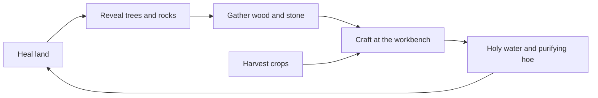

# Layer 3 plan: gathering and crafting

**Date:** 2026-11-04

## Goal

Give healing a second purpose. Land you heal reveals trees and rocks, those give wood and stone, and crafting turns them into better ways to heal. By the end of this layer the player can make their own holy water and a purifying hoe, instead of relying only on the shop.

This layer serves the third pillar: **everything ties to the curse.** Crafting exists to push the curse back, so every recipe in this layer helps with healing.

## Core loop

## Design decisions

| Question | Decision | Why |
|---|---|---|
| How does the player gather? | With the **hand tool** (key 4), a few hits per tree or rock | No new tools to switch between, which also keeps touch controls simple later |
| Where do trees and rocks grow? | Placed around the map, including on cursed land | Reachable only after healing, so "cleansed land reveals resources" needs no extra code |
| Do they run out? | **Regrow** after a few days | The player can't get stuck with no materials |
| Where does crafting happen? | A **workbench** near the house, with a menu like the shop | Reuses a pattern that already works |
| Does the shop keep selling holy water? | **Yes**, but crafting it is cheaper | Crafting is a reward, not a wall |
| What does the purifying hoe do? | Heals **one tile for free, 5 times a day** | Steady free healing without making holy water pointless |
| Where's the inventory shown? | A new panel on a key, with only key numbers left on the HUD | The HUD's top-right list is already 6 lines long |

Recipes and amounts are starting values, to be tuned once the loop can be played.

| Recipe | Needs | Makes |
|---|---|---|
| Holy water | 2 radishes, 1 stone | 1 holy water |
| Purifying hoe | 10 wood, 5 stone | The hoe, once only |

## In scope

| Feature | Details |
|---|---|
| **Code cleanup** | Fixes the weak spots from [the build notes](06_2026-11-04_build-notes.md) before they get harder to fix |
| **Materials** | Wood and stone, stored and saved like crops |
| **Bag screen** | Shows crops, seeds and materials on one screen |
| **Trees and rocks** | Solid objects that take a few hits, then regrow |
| **Workbench** | Opens a crafting menu showing what each recipe needs |
| **Recipes as data** | `RecipeData` resources, the same way crops work, so a new recipe needs no new code |
| **Purifying hoe** | A crafted upgrade with a daily limit |

## Not in Layer 3

Building (Layer 4), lanterns the player can place (Layer 4), enemies and weapons (Layer 5), areas 3 to 6, tool durability, more than 2 materials.

## Build steps

Each step ends with something you can run in Godot and see working.

1. ✅ **Cleanup:** move healing out of `farm.gd`, move prices and finds into Resources, make saving crash-safe
2. ✅ **Materials and inventory:** wood and stone in `GameState`, plus the bag screen on key I
3. **Trees and rocks:** hit them with the hand tool to gather (needs art)
4. **Regrowth:** gathered trees and rocks come back after a few days, and their state is saved
5. **Workbench:** the object and its crafting menu, with `RecipeData` (needs art)
6. **Craft holy water:** the first recipe, using crops and stone
7. **Purifying hoe:** the second recipe, and the free daily healing
8. **Balance pass:** play the full loop and tune prices, recipes and regrowth

## Art needed

No art is needed for steps 1 and 2. The code uses colored placeholders until each image is ready.

| Step | Art |
|---|---|
| 3 | Tree, tree stump, rock, small rubble |
| 5 | Workbench |

The prompts come with the step that needs them.

## Risks

- **Step 1 changes working code:** that's what `tests/run_all.sh` is for. Run it after each small change, so a mistake is easy to find.
- **Unknown holy water balance:** recipes are priced against it, and it hasn't been played yet. Step 8 is there for this, and it needs real play, not only tests.
- **Trees hiding the player:** tall objects must Y-sort correctly, or the player will draw on top of them.
- **Old saves:** new save fields need default values, and moving code must not change the save format.
