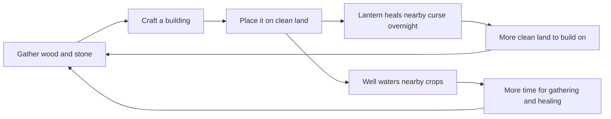

# Layer 4 plan: building

**Date:** 2026-11-04

## Goal

Let the player shape the land they've healed. Wood and stone become things you place in the world, and each one makes the farm better or pushes the curse back on its own. By the end of this layer, healed land feels like yours and not only like more grass.

This layer serves two pillars: **moody but cozy**, because your farm becomes a warm, glowing place in the dark, and **everything ties to the curse**, because lanterns slowly heal the land around them.

## Core loop

## Design decisions

| Question | Decision | Why |
|---|---|---|
| Where can the player build? | **Clean grass only**, with nothing solid on it | Matches the concept's rule, and pushes the player to heal more |
| How do you get buildings? | **Craft them at the workbench**, then place them from the bag | Reuses recipes, so a building is only new data |
| How do you place one? | A **Build tool on key 6**: Q and E pick the building, Space places it | Works like the Seeds tool, which the player already knows |
| How do you see where it goes? | A see-through **preview**, tinted red if it can't go there | The player should never have to guess |
| Can you take one back? | **Yes**, with the hand tool, and you get it back | Mistakes shouldn't cost anything |
| What makes a lantern useful? | It **heals one nearby cursed tile each night** | Turns the warm-light look into a real mechanic, as the concept asks |
| Does the curse fight back? | **Still no** | Keeps this layer small. Enemies arrive in Layer 5 |

Recipes and numbers are starting values, kept in data files so they're easy to tune.

| Building | Needs | Does |
|---|---|---|
| Lantern post | 3 wood, 2 stone | Gives warm light and heals 1 nearby cursed tile each night |
| Fence | 1 wood | Decoration, and blocks walking |
| Well | 5 wood, 8 stone | Waters every crop in a 5×5 area each morning |

## In scope

| Feature | Details |
|---|---|
| **Build tool** | Key 6, with Q and E to pick, and a live preview |
| **Buildings as data** | `BuildingData` resources, the way crops and recipes work |
| **Placing and removing** | Solid objects on clean land, saved with the farm |
| **Lantern healing** | Picks a nearby cursed tile each night, using the existing healing code |
| **Well** | Waters nearby crops at the start of each day |
| **Bag** | Shows the buildings you've crafted and not placed |

## Not in Layer 4

Enemies and weapons (Layer 5), buildings you walk inside, upgrading buildings, the curse spreading back, restoring the ruined village, walls or roofs that join together.

## Build steps

Each step ends with something you can run in Godot and see working.

1. ✅ **Build tool:** key 6, picking a building, and the live preview
2. ✅ **Placing and saving:** buildings go on clean land and survive a restart
3. ✅ **Removing:** the hand tool picks a building back up
4. ✅ **Lantern post:** the first real building, healing the curse each night
5. ✅ **Fence:** a simple building for decoration
6. ✅ **Well:** waters nearby crops each morning
7. ⏸ **Balance pass:** postponed, and moved to the end of [Layer 5](11_2026-11-04_layer-5-combat.md)

## Art needed

No art is needed for steps 1 to 4, because the lantern post already exists.

| Step | Art |
|---|---|
| 5 | ✅ Fence |
| 6 | ✅ Well |

The prompts are in [the Layer 4 art doc](10_2026-11-04_art-prompts-layer-4.md).

## Risks

- **Blocking the player in:** fences could trap the player or block a door. Building must be refused on the door, and on the tile the player stands on.
- **Lantern healing with no effect shown:** healing overnight happens while the screen is black, so the player needs a message in the morning.
- **Untested balance:** Layer 3's numbers haven't been played yet, and this layer adds more on top. Step 7 covers both, and it needs someone to really play.
- **Old saves:** new save fields need default values, and `tests/test_old_save.gd` must keep passing.
