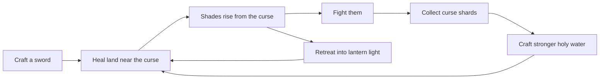

# Layer 5 plan: combat

**Date:** 2026-11-04

## Goal

Make the curse dangerous. Creatures rise from cursed land to threaten the player, a crafted sword fights them back, and lantern light keeps the farm safe. By the end of this layer, healing the land feels like pushing back something alive.

This layer serves two pillars: **moody but cozy**, because your lit farm is now a real safe place in the dark, and **everything ties to the curse**, because creatures drop what you need to heal faster.

## Core loop

## Design decisions

| Question | Decision | Why |
|---|---|---|
| Where do creatures come from? | They **rise from the curse's edge** each morning, on land near it | Players can't walk on cursed land, so creatures have to come to them |
| What keeps the farm safe? | Creatures **can't enter lantern light** | Turns the concept's rule into the main way to defend your land, and makes placing lanterns a real choice |
| How does the player fight? | Craft a **sword**, used on key 7 with Space, hitting in front of the player | Works like every other tool, and maps to one button on a phone |
| What's the health system? | **5 hearts**, refilled by sleeping | Simple to read and fits the existing day loop |
| What happens at 0 hearts? | You **faint and wake at home** the next morning, losing a little money | Short sessions shouldn't end in a harsh punishment, and nothing else is lost |
| Are creatures saved? | **No.** They vanish at night and new ones rise each morning | Keeps saves simple, and every morning is a fresh start |
| Do they get stronger? | A **tougher creature** appears further east | Matches "stronger toward the center" from the concept |
| What do they drop? | **Curse shards**, a new material | Gives fighting a purpose tied to healing |

Numbers are starting values, kept in data files so they're easy to tune.

| Creature | Hearts of damage | Hits to defeat | Where |
|---|---|---|---|
| Shade | 1 | 2 | Along the curse's edge |
| Hollow | 2 | 4 | The far east of the old farmlands |

| Recipe | Needs | Makes |
|---|---|---|
| Sword | 5 wood, 3 stone | The sword, once only |
| Strong holy water | 1 holy water, 2 curse shards | Heals a 5×5 patch |

## In scope

| Feature | Details |
|---|---|
| **Health** | Hearts on the HUD, a short flash and a push back when hit |
| **Sword** | A crafted tool with a short swing and a brief wait between hits |
| **Creatures as data** | `CreatureData` resources for speed, health, damage and drops |
| **Creature behavior** | Wander, chase when the player is near, and stop at lantern light |
| **Spawning** | New creatures each morning near the curse's edge, more as you heal further out |
| **Fainting** | Wake at home the next morning, losing a little money |
| **Curse shards** | A new material, and the strong holy water recipe |

## Not in Layer 5

Bosses, the cursed heart, ranged attacks, armor, more weapons, the curse spreading back, areas 3 to 6, sound.

## Build steps

Each step ends with something you can run in Godot and see working.

1. ✅ **Health:** hearts on the HUD, taking damage, and fainting
2. ✅ **Sword:** the recipe, key 7, and hitting a test dummy
3. **Shade:** a creature that wanders and chases (needs art)
4. **Fighting:** creatures hurt the player, and can be defeated
5. **Lantern safety:** creatures stop at lantern light
6. **Spawning:** new creatures each morning, based on where the curse's edge is
7. **Curse shards:** drops and strong holy water
8. **Hollow:** the tougher creature further east (needs art)
9. **Balance pass:** play it and tune everything, including Layers 3 and 4

## Art needed

No art is needed for step 1. Hearts start as simple drawn shapes.

| Step | Art |
|---|---|
| 2 | ✅ Sword, swung in code so it needs one image |
| 3 | Shade, a few frames of movement |
| 8 | Hollow, a few frames of movement |

The prompts come with the step that needs them. AI art is weak at matching animation frames, so creatures will use few frames, or simple movement made in code.

## Risks

- **Combat feel can't be tested by scripts.** Tests can prove a hit does damage, but not that fighting feels good. This layer depends on real play far more than any layer before it.
- **Too much danger could hurt the cozy mood.** Creatures must stay near the curse, and the farm must feel safe. Step 5 is what protects this.
- **Creatures need to move around obstacles.** Fences, buildings and trees can block them. Simple chasing is fine for now, with proper pathfinding only if it's needed.
- **Phones.** Enemies add more to process, so the number of creatures needs a limit.
- **Untested balance.** Layers 3 and 4 haven't been played yet, and creatures add pressure on top.
