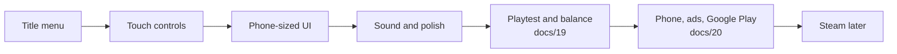

# Layer 6 plan: mobile and release

**Date:** 2026-11-04

> **✅ Finished at step 6 (2026-11-04).** Steps 1 to 6 are built. The rest moved to their own plans: playing and balance to [the playtest](19_2026-11-04_playtest.md), and the phone, ads and Google Play to [the release plan](20_2026-11-04_release.md). This doc stays as the record of what Layer 6 built and why.

## Goal

Turn the working prototype into a game strangers can install and enjoy on an Android phone. This is the final layer: it adds no big new systems, and instead makes everything built so far playable, understandable and ready for a store.

This layer serves the fourth pillar: **short sessions, long goal.** A player should be able to open the game on a phone, make visible progress in a few minutes, and put it down.

## From prototype to release

Layer 6 itself is the first four boxes; the last ones are the next plans.

## Design decisions

| Question | Decision | Why |
|---|---|---|
| How do you move on a phone? | A **virtual joystick**, on the left | It's familiar, and it feeds the existing movement actions |
| How do you pick tools? | A **tool bar** of icons along the bottom | Seven keyboard keys need a touch version, and it also replaces the tool text |
| How do you act? | **Use** and **Interact** buttons, on the right | Matches Space and F, so game code barely changes |
| Do keyboards keep working? | **Yes** | Needed for Steam, and it keeps the tests valid |
| How do players start over? | A **title menu** with Continue and New Game | Deleting a file isn't acceptable for real players |
| When does the game save on a phone? | **Still each morning**, plus a warning that progress saves when you sleep | Phones close apps without asking, so players must know the rule |
| How do ads work? | **Rewarded only**: the player chooses to watch one, as the concept planned | Forced ads would break the mood |
| Which store comes first? | **Google Play**, then Steam | Matches the project's plan |

## In scope

| Feature | Details |
|---|---|
| **Title menu** | Game title, Continue, New Game with a warning, and Settings (added with sound in step 5) |
| **Touch controls** | Joystick, tool bar, Use and Interact buttons, shown only on touch screens |
| **Phone UI** | Touch wording, bigger buttons, tool icons, and menus that work by tapping |
| **UI art** | A pixel font, a game theme for panels and buttons, item icons, hearts, and art for the touch controls and title |
| **Android build** | An installable game, tested on a real phone |
| **Sound** | Music and effects, especially for healing, the first pillar's reward |
| **Polish** | Pause menu, joystick knob art, icons for Use and Act, movable starting objects, queued messages, up-and-down fences, player movement mode, moths, grass wind |
| **Balance** | All numbers from Layers 3 to 5, tuned by real play |
| **Rewarded ads** | Faster cleansing or a double harvest, and a Remove Ads purchase |
| **Release** | Store listing, screenshots, privacy policy and AI art disclosure |

## Not in Layer 6

Areas 5 and 6, the cursed heart, the ruined village, story, more islands. Those are update ideas for after release. Areas 3 and 4 have [their own plan](15_2026-11-04_areas-woods-marsh.md).

## Build steps

Each step ends with something you can run and see working. ✅ means the code is built and passes its automated tests. It doesn't mean it's been tried on a phone or played by a person: that's what the playtest and release plans are for.

1. ✅ **Title menu:** Continue, New Game and a working way to start over
2. ✅ **Touch controls:** joystick, tool bar and action buttons
3. ✅ **Phone UI:** touch wording, thumb-sized buttons and tool icons. This step fixed how the UI works, not how it looks
3b. ✅ **UI art:** pixel font, one game theme, panels, buttons, hearts, coin, item icons and touch button art. Only the title logo is left, waiting for the real name
4. ➡️ **Android build:** moved to [release step 1](20_2026-11-04_release.md)
5. ✅ **Sound and settings:** the `Audio` manager, Music and Effects channels, every sound wired to its action, music for the title and farm, and a settings menu for volume on the title. The 21 effects are made by `tools/make_sounds.gd`, and the farm and title music came from Suno. See [the sound list](18_2026-11-04_sound-list.md)
6. ✅ **Polish:** a pause menu with a way back to the title, joystick knob art, icons for Use and Act, movable starting objects, plus the weak spots listed in the build notes (needs art)
   - ✅ **Part 1, code:** pause menu (Resume, Settings, Back to title, which asks first and reloads the morning's save), a pause button on phones, Use showing the selected tool, and messages that take turns. The player already used floating movement, so that item needed nothing
   - ✅ **Part 2, art:** pause icon, joystick knob, a "!" speech bubble on Act (the open glove looked like the Hand tool, see [the decisions log](17_2026-11-04_decisions-log.md)), and fences that turn: a line going up and down uses the new vertical art. Prompts in [the Layer 6 art doc](14_2026-11-04_art-prompts-layer-6.md). Optional, in code: moths around lanterns, grass in the wind
   - ✅ **Movable starting objects** (asked for after play, built early): the Hand tool picks up the shipping box, workbench and the map's 4 lantern posts, and the Build tool places them again, the same as built objects. Their positions are saved, and old saves keep them where they started. The house and shop stall stay fixed: see [the decisions log](17_2026-11-04_decisions-log.md)
7. ➡️ **Balance pass:** moved to [the playtest](19_2026-11-04_playtest.md), since balance needs playing; a final check on the phone is release step 2
8. ➡️ **Rewarded ads:** moved to [release step 3](20_2026-11-04_release.md)
9. ➡️ **Google Play release:** moved to [release step 4](20_2026-11-04_release.md)

## Still open

Everything left open moved on 2026-11-04: the phone checks are in [release step 1](20_2026-11-04_release.md), and the rest (fence ends and corners, richer `cleanse` and `shrine` sounds, balance) is in the playtest's findings table. Only the title logo stays tied to this layer's art, and it's in release step 4, once the game has its real name.

## Order of work

~~The user chose to add areas 3 and 4 before release.~~ Changed on 2026-11-04: this layer is finished first, and [the woods and marsh plan](15_2026-11-04_areas-woods-marsh.md) comes after release as a free update. The steps ran as 5 (sound), then 6 (polish). Then, also on 2026-11-04, the remaining steps moved out so this layer could close: playtest first, then release. Why: see [the decisions log](17_2026-11-04_decisions-log.md).

## What only you can do

Moved to [the release plan](20_2026-11-04_release.md), "What only you can do": a game title, an Android phone, an ad account, a privacy policy, a Google Play developer account. Real playing is the whole of [the playtest](19_2026-11-04_playtest.md).

## Art and audio needed

| Step | Needed |
|---|---|
| 2 | ✅ Tool icons, in [the Layer 6 art doc](14_2026-11-04_art-prompts-layer-6.md) |
| 3b | ✅ Pixel font, panel and button art, hearts, item icons, seed packets, coin, touch control art. Title logo still to come |
| 5 | ✅ 21 sound effects (made by a script) and the farm and title music (Suno), in [the sound list](18_2026-11-04_sound-list.md) |
| 6 | ✅ Joystick knob, pause icon, "!" Act icon, vertical fence (Use needed none: it shows the selected tool) |
| ➡️ | Title logo, store icon, banner and screenshots: moved to [release step 4](20_2026-11-04_release.md) |

The prompts come with the step that needs them. AI-generated content must be disclosed on Steam, and this project's art docs are the record of how it was made.

## UI art (step 3b)

What this step replaced, from before it started:

| Part of the UI | Before | Now |
|---|---|---|
| All text | Godot's smooth default font, which clashes with pixel art | A pixel font |
| Menu panels | A flat color with a thin line | A dark wood and iron panel, as a 9-slice image |
| Buttons | Godot's default grey | Normal, pressed and disabled art, in one project-wide theme |
| Hearts | Shapes drawn in code | Full and empty heart art |
| Money | The word "Money" | A coin icon |
| Bag, shop, workbench | Words only | Icons for crops, seed packets, materials and holy water |
| Touch buttons | A plain generated circle | Round button art, with a Bag icon. Since step 6: Use shows the selected tool, Act a "!", and pause an iron-bar icon |
| Joystick | Godot's default white ring | Ring uses your art. Since step 6 the knob has its own art too |
| Title | Plain text | Still plain text, until the logo in release step 4 |

One `Theme` resource holds the font, panels and buttons, so every menu changes in one place. New items from the woods and marsh plan add their icons to the same sets.

## Risks

The open risks now live in the next plans: playing and balance in [the playtest](19_2026-11-04_playtest.md); phone speed, text size, ad plugins and closed testing in [the release plan](20_2026-11-04_release.md). Kept here as a record:

- **Nothing has been balanced or properly played.** Layers 3 to 5 have only been tested by scripts. The playtest is required before release, and it may lead to bigger changes than number tweaks.
- **Performance on real phones is unknown.** Everything so far ran on fast computers (a Mac and a Windows PC). Checked on a cheap phone in release step 1.
- **Text is small.** The game draws at 640×360, which may be hard to read on a phone. Step 3 made buttons thumb-sized, but the text size is only checked on a real phone in release step 1.
- **Ad plugins may lag behind Godot.** AdMob needs a plugin that supports Godot 4.7. Check this before release step 3, and leave time for it.
- **Old saves must keep working.** `tests/test_old_save.gd` stays in place. New Game must never delete a save without a warning.
- ~~**Windows hasn't been tested lately.**~~ Checked on 2026-11-04: `tests/run_all.sh` passes on Windows (Git Bash) as well as the Mac.
