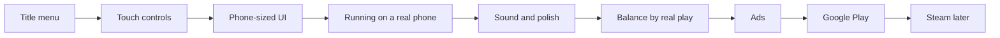

# Layer 6 plan: mobile and release

**Date:** 2026-11-04

## Goal

Turn the working prototype into a game strangers can install and enjoy on an Android phone. This is the final layer: it adds no big new systems, and instead makes everything built so far playable, understandable and ready for a store.

This layer serves the fourth pillar: **short sessions, long goal.** A player should be able to open the game on a phone, make visible progress in a few minutes, and put it down.

## From prototype to release

## Design decisions

| Question | Decision | Why |
|---|---|---|
| How do you move on a phone? | A **virtual joystick**, on the left | It's familiar, and it feeds the existing movement actions |
| How do you pick tools? | A **tool bar** of icons along the bottom | Seven keyboard keys need a touch version, and it also replaces the tool text |
| How do you act? | **Use** and **Interact** buttons, on the right | Matches Space and F, so game code barely changes |
| Do keyboards keep working? | **Yes** | Needed for Steam, and it keeps the tests valid |
| How do players start over? | A **title menu** with Continue and New Game | Deleting a file isn't acceptable for real players |
| When does the game save on a phone? | **Still each morning**, plus a warning that progress saves when you sleep | Phones close apps without asking, so players must know the rule |
| How do ads work? | **Rewarded only**: the player chooses to watch one, as the concept planned | Forced ads would break the mood |
| Which store comes first? | **Google Play**, then Steam | Matches the project's plan |

## In scope

| Feature | Details |
|---|---|
| **Title menu** | Game title, Continue, New Game with a warning. Settings come with sound in step 5, when there's something to set |
| **Touch controls** | Joystick, tool bar, Use and Interact buttons, shown only on touch screens |
| **Phone UI** | Touch wording, bigger buttons, tool icons, and menus that work by tapping |
| **UI art** | A pixel font, a game theme for panels and buttons, item icons, hearts, and art for the touch controls and title |
| **Android build** | An installable game, tested on a real phone |
| **Sound** | Music and effects, especially for healing, the first pillar's reward |
| **Polish** | Pause menu, queued messages, up-and-down fences, player movement mode, soil edges, moths, grass wind |
| **Balance** | All numbers from Layers 3 to 5, tuned by real play |
| **Rewarded ads** | Faster cleansing or a double harvest, and a Remove Ads purchase |
| **Release** | Store listing, screenshots, privacy policy and AI art disclosure |

## Not in Layer 6

Areas 5 and 6, the cursed heart, the ruined village, story, more islands. Those are update ideas for after release. Areas 3 and 4 have [their own plan](15_2026-11-04_areas-woods-marsh.md).

## Build steps

Each step ends with something you can run and see working. ✅ means the code is built and passes its automated tests. It doesn't mean it's been tried on a phone or played by a person: see "Still open" below.

1. ✅ **Title menu:** Continue, New Game and a working way to start over
2. ✅ **Touch controls:** joystick, tool bar and action buttons
3. ✅ **Phone UI:** touch wording, thumb-sized buttons and tool icons. This step fixed how the UI works, not how it looks
3b. ✅ **UI art:** pixel font, one game theme, panels, buttons, hearts, coin, item icons and touch button art. Only the title logo is left, waiting for the real name
4. **Android build:** the game running on a real phone, then checking everything in "Still open" (needs setup by you)
5. **Sound:** music and effects (needs audio)
6. **Polish:** a pause menu with a way back to the title, plus the weak spots listed in the build notes
7. **Balance pass:** play on a real phone and tune everything (needs you to play)
8. **Rewarded ads:** ads and the Remove Ads purchase (needs accounts)
9. **Google Play release:** closed testing first, then the public store (needs you)

Steam comes after Android, and only needs its own build and store page.

## Still open

Work left over from finished steps, and where each piece will be done.

| Open item | Left over from | Done in |
|---|---|---|
| Touch controls on a real phone: thumb reach and feel | Step 2 | Step 4 |
| Swiping to scroll the workbench list | Step 3 | Step 4 |
| Whether text is big enough | Step 3 | Step 4 |
| The title logo | Step 3b | When the game has its real name |
| Joystick knob is still a plain circle, and Use and Act are words | Step 3b | Step 6 |
| Speed on a cheap phone | New | Step 4 |
| Settings, such as sound volume | Step 1 | Step 5 |
| A way back to the title without closing the game | Step 1 | Step 6 |
| Running the tests on Windows | Layer 3 onward | Before step 4, on the Windows computer |
| Balance for Layers 3, 4 and 5, all postponed | Layers 3 to 5 | Step 7 |
| The game's real title | Step 1 | Before step 9 |

## Before step 4

The user chose to add areas 3 and 4 before release, so [the woods and marsh plan](15_2026-11-04_areas-woods-marsh.md) comes next, and this layer continues from step 4 after it.

## What only you can do

These can't be done by code, so they're listed early.

| Needed | For | Notes |
|---|---|---|
| **A game title** | Steps 1 and 9 | Still "working title". Worth checking that it's free to use |
| **An Android phone** | Step 4 | With developer mode turned on |
| **A Google Play developer account** | Step 9 | There's a one-time fee, and new personal accounts may need to run a closed test with real testers before a public release. Check Google's current rules when you get there |
| **An ad account** | Step 8 | AdMob is the usual choice, and it needs payment details |
| **A privacy policy** | Steps 8 and 9 | Required once ads collect data |
| **Real playing** | Step 7 | This can't be skipped before release |

## Art and audio needed

| Step | Needed |
|---|---|
| 2 | ✅ Tool icons, in [the Layer 6 art doc](14_2026-11-04_art-prompts-layer-6.md) |
| 3b | ✅ Pixel font, panel and button art, hearts, item icons, seed packets, coin, touch control art. Title logo still to come |
| 5 | Music and sound effects |
| 9 | Store icon, banner and screenshots |

The prompts come with the step that needs them. AI-generated content must be disclosed on Steam, and this project's art docs are the record of how it was made.

## UI art (step 3b)

What this step replaced, from before it started:

| Part of the UI | Before | Now |
|---|---|---|
| All text | Godot's smooth default font, which clashes with pixel art | A pixel font |
| Menu panels | A flat color with a thin line | A dark wood and iron panel, as a 9-slice image |
| Buttons | Godot's default grey | Normal, pressed and disabled art, in one project-wide theme |
| Hearts | Shapes drawn in code | Full and empty heart art |
| Money | The word "Money" | A coin icon |
| Bag, shop, workbench | Words only | Icons for crops, seed packets, materials and holy water |
| Touch buttons | A plain generated circle | Round button art, with icons for Use, Act and Bag |
| Joystick | Godot's default white ring | A ring and knob that match the game |
| Title | Plain text | A logo, once the game has its real name |

One `Theme` resource holds the font, panels and buttons, so every menu changes in one place. New items from the woods and marsh plan add their icons to the same sets.

## Risks

- **Nothing has been balanced or properly played.** Layers 3 to 5 have only been tested by scripts. Step 7 is required before release, and it may lead to bigger changes than number tweaks.
- **Performance on real phones is unknown.** Everything so far ran on a fast Mac. Lights, particles and creatures need checking on a cheap phone in step 4.
- **Text is small.** The game draws at 640×360, which may be hard to read on a phone. Step 3 might need larger fonts or a different layout.
- **Ad plugins may lag behind Godot.** AdMob needs a plugin that supports Godot 4.7. Check this before step 8, and leave time for it.
- **Old saves must keep working.** `tests/test_old_save.gd` stays in place. New Game must never delete a save without a warning.
- **Windows hasn't been tested lately.** `tests/run_all.sh` has only run on the Mac. Worth checking before building for other platforms.
