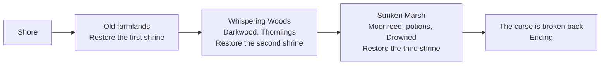

# Areas plan: Whispering Woods and Sunken Marsh

**Date:** 2026-11-04

## Goal

Finish the first version of the island. [The game concept](03_2026-11-03_game-concept.md) promises 4 areas, but only the shore and the old farmlands exist. This plan adds the Whispering Woods and the Sunken Marsh, and gives the game something it doesn't have yet: an ending.

Everything before this plan was built one system at a time. This one mostly reuses those systems with new data, so most of it should be art, data files and tests.

## The journey

## Design decisions

| Question | Decision | Why |
|---|---|---|
| Where do the areas go? | **Further east**, on the same map | Saves store cells by position, so everything built so far stays where it is |
| How does the player reach them? | By **healing a path**, the same as the farmlands | No new travel system, and healing stays the core action |
| What's the goal of each area? | **Restoring its shrine** | The player already knows this goal, and it reuses the code |
| How does the first version end? | Restoring **all 3 shrines** shows an ending, and play can continue | Gives the game a finish without building the cursed heart yet |
| What's new in the woods? | **Darkwood** from dark trees, and a sturdier sword made from it | The concept gives this area wood and its first real enemies |
| What's new in the marsh? | **Moonreed**, a rare crop that only grows there, and **healing potions** | The concept gives this area rare crops and potion ingredients |
| Should new creatures do new things? | **Slightly**: thornlings are fast, and the drowned slow the player | Simple changes that feel different, without ranged attacks |
| Does the curse fight back? | **Still no spreading** | Stays an update idea |

Numbers are starting values, kept in data files, and none of them have been played.

| Area | Columns | New creature | Hits | Damage |
|---|---|---|---|---|
| Old farmlands | 40–75 | Hollow | 4 | 2 |
| Whispering Woods | 76–115 | Thornling (fast) | 3 | 1 |
| Sunken Marsh | 116–155 | Drowned (slows you) | 5 | 2 |

| Recipe | Needs | Makes |
|---|---|---|
| Darkwood sword | 8 darkwood, 5 curse shards | Twice the sword damage |
| Healing potion | 2 moonreed, 1 holy water | Restores 3 hearts |

## In scope

| Feature | Details |
|---|---|
| **Bigger map** | Woods and marsh, in the map tool, with the old map unchanged |
| **Area ground** | New ground art for each area when it's healed, so the land looks different |
| **More shrines** | Three shrines instead of one, saved as a list. Old saves keep their restored shrine |
| **Dark trees** | A new tree that gives darkwood, reusing the gathering system |
| **Darkwood sword** | An upgrade recipe, reusing one-time recipes |
| **Thornling and Drowned** | Two new creatures as data, plus a slow effect |
| **Marsh farming** | Moonreed can only be planted on marsh land |
| **Potions** | A new item, used from the bag or a button |
| **Area names** | A message when the player first enters an area |
| **Ending** | A short ending screen, then the player can keep playing |

## Not in this plan

The ruined village and the cursed heart (areas 5 and 6), bosses, story characters, ranged attacks, the curse spreading back.

## Build steps

Each step ends with something you can run in Godot and see working.

1. **Bigger map:** add both areas, and prove the old map and old saves are unchanged
2. **More shrines:** three shrines, saved as a list, with old saves still working
3. **Woods ground and dark trees:** the area's look, and darkwood (needs art)
4. **Darkwood sword:** the upgrade recipe (needs art)
5. **Thornling:** the fast creature (needs art)
6. **Marsh ground and fog:** the area's look (needs art)
7. **Moonreed:** the rare crop that only grows in the marsh (needs art)
8. **Healing potion:** the recipe and using it (needs art)
9. **Drowned:** the slowing creature (needs art)
10. **Area names and ending:** arrival messages, and the ending screen

This plan starts after Layer 6 step 3b, the UI art, so new menus and items get the finished look. After it, Layer 6 continues from step 4, the Android build.

## Art needed

| Step | Art |
|---|---|
| 2 | Shrines reuse the existing art at first |
| 3 | Woods ground, dark tree, dark tree stump |
| 4 | Darkwood sword |
| 5 | Thornling |
| 6 | Marsh ground |
| 7 | Moonreed growth stages |
| 8 | Healing potion icon |
| 3, 4, 7, 8 | Bag and menu icons for darkwood, the sword, moonreed and the potion, matching the UI art |
| 9 | Drowned |

The prompts come with the step that needs them, in a new art doc.

## Risks

- **This is the biggest piece of work left.** It adds about 8 images and 10 steps, and release moves back to make room.
- **Nothing is balanced yet.** Two more areas sit on top of numbers nobody has played. A long grind to the third shrine would only show up in real play.
- **Holy water cost grows with the map.** Healing a path across 80 more columns could take far too long at today's prices. This should be checked early, with simple math in step 1.
- **The outer ring moves.** Column 75 was the map's edge and could never heal. After step 1 it can, so the rule and its tests must follow the new edge.
- **Phones.** A map about twice as wide means more tiles and more curse edges to redraw. `CurseEdges.refresh()` needs timing on the larger map, and on a real phone in Layer 6 step 4.
- **Save changes.** Shrines move from one value to a list, so `tests/test_old_save.gd` must keep passing, and the fixture must never be regenerated to pass it.
