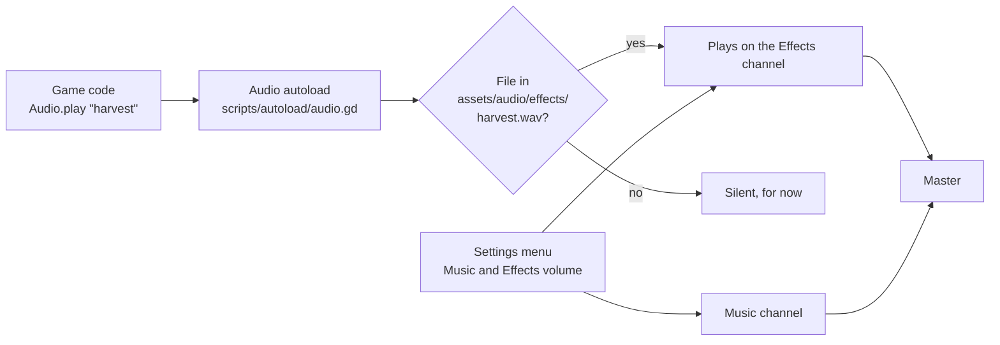

# Sound list and how sound works

**Date:** 2026-11-04

Everything about sound in one place: how it works, every sound the game asks for, where in the code it plays, and where to get the files. Use it to trace what exists before asking for something new, or to plan an improvement. Built in Layer 6 step 5.

## How it works

- **One manager, `Audio`** (an autoload, like `GameState`; in Angular terms, a shared service). Game code only names a sound; it never loads files itself.
- **Files are found by name.** `Audio.play(&"harvest")` looks for `assets/audio/effects/harvest.wav`, then `.ogg`. Music `farm` is `assets/audio/music/farm.ogg`. **To add a sound, save the file with the right name in the right folder, then open Godot (or run `--import`).** No code change is needed.
- **Missing files are silent,** so everything could be wired before any sound exists. `Audio.missing()` lists what's still missing.
- **Three channels (buses):** Master, Music and Effects (`default_bus_layout.tres`). The settings menu sets Music and Effects.
- **Each effect plays slightly higher or lower each time** (±8%), so repeated sounds don't feel robotic. Up to 8 effects can play at once.
- **Every button clicks by itself:** `Audio` watches for new buttons and connects them, so no menu has to ask.
- **Music fades** for 0.5 seconds when it changes. The title asks for `title`, and uses `farm` until a title track exists.
- **Settings are saved in `user://settings.cfg`,** apart from the farm save, so New Game keeps your volume.

## Where the current effects came from

All 21 effects were **made by a script, `tools/make_sounds.gd`**, from simple waves with math, the way the tool sfxr works. Nothing was downloaded, so they're yours, with no license. They're decent retro placeholders; `cleanse` and `shrine` are the ones most worth replacing with something richer later.

| Building block | Sounds like | Used in |
|---|---|---|
| Sine wave | A soft, pure tone | `cleanse`, `shrine`, `sleep`, thumps (`place`, `hit`) |
| Square wave | A buzzy retro beep | `buy`, `ship`, `click`, `hurt` |
| Triangle wave | Between the two, like a chime | `find`, `pick_up` |
| Noise | A hiss or crunch | `till`, `swing`, `hit`, `gather`, `craft` |

Each recipe is a few lines of `layer(start, length, from_hz, to_hz, wave, volume)`: which wave, when it starts, how long it lasts, and how its pitch slides. A rising pitch feels hopeful, a falling one feels like loss.

- **To change one:** edit its `sound_<name>()` recipe, then run `--headless --path . --script tools/make_sounds.gd` and `--import`. The same recipe always makes the same file.
- **To replace one with a better file:** save it over `assets/audio/effects/<name>.wav`, and delete its recipe so the script doesn't overwrite it.
- **Music** can't be made this way, so `farm` and `title` are still missing (the game has no music yet).

## Every sound

"Where" is the code that asks for it, so you can find and change it. Every effect below currently comes from `tools/make_sounds.gd`.

| Name | When it plays | Where | Feel |
|---|---|---|---|
| `till` | Hoe makes soil, or turns empty soil back to grass | `Farm._on_tool_used()` | A soft dig into earth |
| `water` | Watering can on soil | `Farm._on_tool_used()` | A short pour or splash |
| `plant` | Seeds planted | `Farm._on_tool_used()` | A small pat of soil |
| `harvest` | Hand picks a ripe crop | `Farm._on_tool_used()` | A pop, rewarding |
| `cleanse` | Holy water, or the purifying hoe, heals land | `Healing._cleanse_cells()` | **The most important sound.** A warm, bright shimmer, like the curse lifting |
| `shrine` | The shrine is restored | `Healing._on_shrine_activated()` | A bigger, longer version of cleanse, like a bell or choir |
| `find` | Healing digs up a buried find | `Healing._dig_up()` | A sparkle or coin chime |
| `swing` | Sword swing | `Sword.swing()` | A quick whoosh |
| `hit` | Sword hits a creature | `Creature.take_hit()` | A dull thud |
| `defeat` | A creature is defeated | `Creature.take_hit()` | A fading hiss, the shadow breaking apart |
| `hurt` | A creature hurts you | `Player.hurt()` | A short grunt or a low hit |
| `gather` | Hand hits a tree or rock | `Farm._on_tool_used()` | A chop or chip |
| `place` | Build tool places an object | `Farm._on_tool_used()` | A wooden thunk |
| `pick_up` | Hand picks up an object | `Farm._on_tool_used()` | A lighter lift sound |
| `ship` | Crops go in the shipping box | `ShippingBox.interact()` (`scripts/farm/shipping_box.gd`) | A wooden lid, or coins |
| `buy` | Buying at the shop | `ShopMenu._add_row()` | Coins |
| `craft` | Crafting at the workbench | `CraftingMenu` (`scripts/ui/crafting_menu.gd`) | Hammer or tools |
| `sleep` | Entering the house to sleep | `Door.interact()` (`scripts/farm/door.gd`) | A door closing, calm |
| `click` | Any button | `Audio._on_node_added()` | A tiny wooden tick |
| `menu_open` | Shop, bag or workbench opens | `GameMenu.open()` | A soft paper or wood slide |
| `menu_close` | The same menus close | `GameMenu.close()` | The reverse of menu_open |

| Music | When | Where | Feel |
|---|---|---|---|
| `farm` | In the game | `Farm._ready()` | Calm, slightly sad, hopeful. Loops. A few minutes long, so it doesn't get tiring |
| `title` | Title screen (uses `farm` until it exists) | `TitleScreen._ready()` | The same mood, or just reuse `farm` |

## Where to get the files

All of these allow selling a game, but **always check the license on the page you download from**, and write down where each file came from (a store release needs it).

| Kind | Source | Notes |
|---|---|---|
| Effects you make yourself | **jsfxr** (sfxr.me) or **ChipTone** (by SFB Games, on itch.io) | Free websites: click a preset (pickup, hit, blip), adjust, download WAV. You own what you make. Retro style, which suits pixel art |
| Ready-made effects | **Kenney** audio packs (kenney.nl) | CC0: free for anything, no credit needed |
| More effects or music | **OpenGameArt** and **Freesound**, filtered to CC0 | Check each file's license; some ask for credit (CC-BY), which is fine if you list it |
| Music by AI | Suno or similar | Usually only a **paid** plan lets you sell what you make. Read the current terms first |

**File tips:** effects as WAV (short, instant on phones), music as OGG (small). In Godot, select a music file, then in the Import tab turn **Loop** on and click Reimport.

## Ideas for later (not built)

- Footsteps, different on grass and soil
- Night ambience: wind, crickets, and something eerie near the curse
- Music that changes when you're near the curse, or at night
- A sound when a crop ripens overnight, or when a lantern heals land
- Vibration on phones when you're hurt
