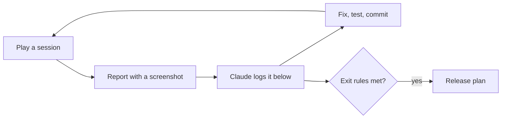

# Playtest plan: play, find, fix

**Date:** 2026-11-04

## Goal

Every feature is built and passes its automated tests, but almost nothing has been **played**. Tests prove the code does what it was told; only playing shows whether the game is fun, clear and fair. This phase is that playing: you play on the computer, report what feels wrong, Claude fixes it, and the numbers get tuned.

It comes before [the release plan](20_2026-11-04_release.md). Studios call this phase **alpha** or **playtesting**.



## Where we are

**2026-11-09:** the curse test passed and its rules stay; the new controls (modes, bag, storage, combat buttons, weapons) were played on the phone and the computer and work. **Next:** the animation plan ([`29_...`](29_2026-11-09_animation-plan.md)), then the outside test. Sessions 2 to 7 run during the outside test, so we don't tune a game that's still changing.

## How a session works

1. **Play** for a while, on the computer. Try a different goal each time (see "Sessions" below).
2. **Report** anything odd, the way you already do: a screenshot and one line ("I can't remove soil", "this square looks bad"). No need to know why.
3. **Claude** adds it to the findings table, says whether it's a bug, an improvement, missing, or balance, and suggests the best fix. You decide.
4. **Fix:** Claude fixes it with a test, logs it in [the fixes log](16_2026-11-04_fixes-log.md) (or [the decisions log](17_2026-11-04_decisions-log.md) for a choice), and updates the table.

## Sessions

Each one has a goal, so the whole game gets played, not just the first minutes.

| # | Goal | Watch for |
|---|---|---|
| 1 | **New game, first 3 days**, as if you'd never seen it | Do you know what to do? Which text or control is confusing? |
| 2 | **Earn money and buy holy water** | Do prices feel fair? Is anything boring to repeat? |
| 3 | **Heal toward the old farmlands** | Does healing feel good (look and sound)? How slow is it? |
| 4 | **Craft and build:** sword, purifying hoe, lantern, well, fence | Are recipes clear? Is anything too cheap or too expensive? |
| 5 | **Fight:** shades and hollows, at night and near the curse | Too easy, too hard, unfair? Do lanterns help? |
| 6 | **Restore the shrine** | How many days did it take? Did it feel like a reward? |
| 7 | **Leave and come back:** quit, Continue, New Game, pause, settings | Did anything get lost or reset wrongly? |

## Checklist: what to watch for

| Area | Questions |
|---|---|
| **Clear** | Do you always know what to do next? Is any text unclear or missing? |
| **Fun** | What's the best moment? When did you get bored? |
| **Pace** | Is anything too slow (healing, growing, earning) or too fast? |
| **Fair** | Do creatures, fainting and prices feel fair? |
| **Look** | Anything that looks wrong, ugly or out of place? |
| **Sound** | Any sound too loud, annoying or missing? Does the music get tiring? |
| **Bugs** | Stuck, can't do something, something disappears, the game misbehaves? |

## Balance pass

Balance was postponed in Layers 3 to 5, and moved here from the old Layer 6 step 7, because it can only be done by playing. The numbers live in data files, so changing them needs no code:

| What | Where |
|---|---|
| Holy water price and daily limit, healing sizes, hoe uses, creatures, hearts, fainting, shrine, soil, the curse's speed, blighted crop money | `data/balance.tres` |
| Crop growth days, seed and sell prices, the wardthorn's reach | `data/crops/` |
| Recipes | `data/recipes/` |
| Gathering amounts and regrowth | `data/gather/` |

**Targets to aim for.** These are guesses to start from, and **yours to change**:

| Question | Starting target |
|---|---|
| How long until the first holy water feels affordable? | Day 2 or 3 |
| How long to restore the first shrine? | About 10 to 15 game days at first. With the curse test's harder rules, the estimate is day 17 to 31, on purpose. Set a new target after the play test |
| How long until a day's work is done and you sleep? (There's no clock: a day ends when you sleep) | A few minutes, so a phone session is one or two days |
| How often should the player faint? | Rarely, and only by taking risks |

**Math check first:** `tools/balance_check.gd` reads the real map and data, and simulates a sensible player's days (plant, sell, reinvest, buy holy water, heal forward, collect finds). Rerun it after changing numbers:

```bash
"C:\Program Files\Godot\Godot_v4.7.2-stable_win64_console.exe" --headless --path . --script tools/balance_check.gd
```

Results on 2026-11-07: the shortest path from the house to the shrine has **27 cursed tiles**, needing **14 holy water, plus 3 for the shrine**. "Close" means one holy water mends 9 lost tiles, and "scattered" means 3.

| Plots watered each day | No curse | 3 a night, close | 3 a night, scattered |
|---|---|---|---|
| 8 | Day 16 | Day 19 | Day 26 |
| 12 | Day 16 | Day 17 | Day 23 |
| 20 | Day 17 | Day 19 | Day 24 |
| 40 | Day 21 | Day 24 | Day 31 |

**The pace is an open question.** Every row misses the 10 to 15 day target, even with no curse, and the curse makes it slower. The estimate leaves out the curse growing, lanterns, the hoe, wardthorn bursts and the limited can, so judge it from the curse play test, then change the target or the numbers. Rerun the tool after any change.

The final check of these numbers happens on a real phone, in release step 2.

## Findings

Only open findings are listed. Findings 1 to 104 that are finished were removed on 2026-11-09 (they're in [the fixes log](16_2026-11-04_fixes-log.md), [the decisions log](17_2026-11-04_decisions-log.md) and git history). Numbers are never reused: **the next finding is 108.**

Kinds: bug, look, sound, balance, improvement, code. Status: **open**, **later** (with the plan it waits for), or **recheck** (built, needs a person to play it).

| # | Finding | Kind | Status |
|---|---|---|---|
| 4 | Day 12 with 0% healed and no money on the first screenshot | Balance | Recheck with outside players: the goals now teach selling and holy water |
| 5 | Fence row ends and corners show a bit of rail sticking out | Look | Later: needs end and corner pieces (art) |
| 6 | The `cleanse` and `shrine` sounds are simple generated ones | Sound | Later: replace before release if they feel thin |
| 21 | The joystick ring and round buttons have rough, blocky edges on the phone | Look | Open: the user hasn't said whether it bothers them. It comes from resizing the art |
| 23 | The game felt too simple after a while (before the curse fought back, modes and weapons) | Improvement | Recheck in the outside test: does it still feel too simple? |
| 24 | Sleeping is free, so a player could sleep and collect crops (wells water them) | Balance | Recheck: the returning curse now makes each night cost something |
| 29 | Tilled soil beside the curse shows only as a small brown patch under the edge pieces | Look | Open: small |
| 31 | Healing can feel too fast with lots of money (seen on a day 53 save) | Balance | Later: release step 2, final balance |
| 33 | It's hard to find how to get and plant the wardthorn | Improvement | Recheck: the goals and the Modes page now show it |
| 45 | Objects could have upgrades | Improvement | Later: after the outside test, since upgrades change the balance |
| 98 | The six basic weapons aren't balanced | Balance | Later: release step 2; numbers in `scripts/farm/basic_weapons.gd` |
| 105 | Things to watch in play: crowded right side, two taps per attack, caught in Farm mode | Controls | Recheck: see "Watch for when playing" in [the controls doc](28_2026-11-08_storage-controls.md) |
| 106 | The right-hand buttons felt crowded and small on the phone | Controls | ✅ Built 2026-11-09: a bigger big button (76), bigger combat buttons (44) in an even curve around it with gaps (`TouchControls._lay_out_right_thumb()`, `ARC_RADIUS`, `ARC_ANGLES`), the mode button above, Bag higher up. Recheck on the phone |
| 107 | The big button still flickered while carrying a building (finding 102 fixed the picture, not the dimming) | Bug | ✅ Fixed 2026-11-09: carrying or placing a building, the button stays bright with its picture; the green or red preview shows where it fits, and a tap on a red spot says why (`TouchControls._building_in_hand()`). Recheck on the phone |

## When this phase is done

Move on to [the release plan](20_2026-11-04_release.md) when:

- You've played every session above at least once, including restoring the shrine
- 5 to 10 outside players have tried it, and some came back on their own the next day (see [the release plan](20_2026-11-04_release.md), "Outside test")
- No open finding stops you from playing or loses progress
- The balance targets feel right to you, or you've changed them on purpose
- You still want to play a little more when you stop (the best sign it's ready)

Everything else left open moves to the release plan or a later update, so this phase can't go on forever.
