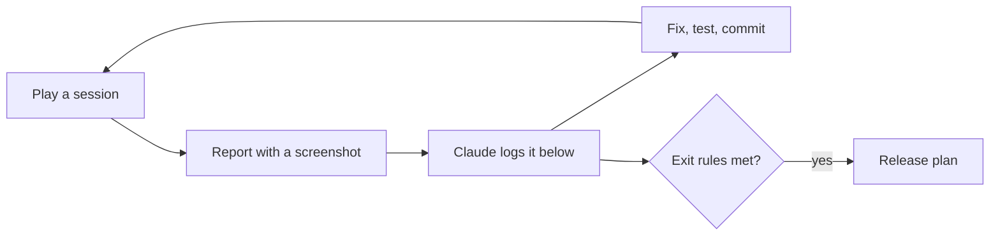

# Playtest plan: play, find, fix

**Date:** 2026-11-04

## Goal

Every feature is built and passes its automated tests, but almost nothing has been **played**. Tests prove the code does what it was told; only playing shows whether the game is fun, clear and fair. This phase is that playing: you play on the computer, report what feels wrong, Claude fixes it, and the numbers get tuned.

It comes after [Layer 6](13_2026-11-04_layer-6-release.md) and before [the release plan](20_2026-11-04_release.md). Studios call this phase **alpha** or **playtesting**.



## Where we are

**2026-11-07:** the order changed (see [the decisions log](17_2026-11-04_decisions-log.md)). Sessions 2 to 7 now wait until the curse test, simpler controls and the first 15 minutes are done, because playing them sooner would mean tuning a game that's about to change. They run during the outside test. Finding 4 moves to the first 15 minutes step. Small polish (findings 5, 6, 7 and 21) waits unless it bothers you.

**2026-11-05:** session 1 is in progress, and findings 1 to 3 and 8 to 13 are fixed. **Next:** start a New Game, try the 2 free holy water, and report anything unclear, especially what holy water is for and that crops go in the shipping box (finding 4). Then sessions 2 to 7.

## How a session works

1. **Play** for a while, on the computer. Try a different goal each time (see "Sessions" below).
2. **Report** anything odd, the way you already do: a screenshot and one line ("I can't remove soil", "this square looks bad"). No need to know why.
3. **Claude** adds it to the findings table, says whether it's a bug, an improvement, missing, or balance, and suggests the best fix. You decide.
4. **Fix:** Claude fixes it with a test, logs it in [the fixes log](16_2026-11-04_fixes-log.md) (or [the decisions log](17_2026-11-04_decisions-log.md) for a choice), and updates the table.

## Sessions

Each one has a goal, so the whole game gets played, not just the first minutes.

| # | Goal | Watch for |
|---|---|---|
| 1 | **New game, first 3 days**, as if you'd never seen it | Do you know what to do? Which text or control is confusing? |
| 2 | **Earn money and buy holy water** | Do prices feel fair? Is anything boring to repeat? |
| 3 | **Heal toward the old farmlands** | Does healing feel good (look and sound)? How slow is it? |
| 4 | **Craft and build:** sword, purifying hoe, lantern, well, fence | Are recipes clear? Is anything too cheap or too expensive? |
| 5 | **Fight:** shades and hollows, at night and near the curse | Too easy, too hard, unfair? Do lanterns help? |
| 6 | **Restore the shrine** | How many days did it take? Did it feel like a reward? |
| 7 | **Leave and come back:** quit, Continue, New Game, pause, settings | Did anything get lost or reset wrongly? |

## Checklist: what to watch for

| Area | Questions |
|---|---|
| **Clear** | Do you always know what to do next? Is any text unclear or missing? |
| **Fun** | What's the best moment? When did you get bored? |
| **Pace** | Is anything too slow (healing, growing, earning) or too fast? |
| **Fair** | Do creatures, fainting and prices feel fair? |
| **Look** | Anything that looks wrong, ugly or out of place? |
| **Sound** | Any sound too loud, annoying or missing? Does the music get tiring? |
| **Bugs** | Stuck, can't do something, something disappears, the game misbehaves? |

## Balance pass

Balance was postponed in Layers 3 to 5, and moved here from the old Layer 6 step 7, because it can only be done by playing. The numbers live in data files, so changing them needs no code:

| What | Where |
|---|---|
| Holy water price, healing sizes, hoe uses, creatures, hearts, fainting, shrine, soil | `data/balance.tres` |
| Crop growth days, seed and sell prices | `data/crops/` |
| Recipes | `data/recipes/` |
| Gathering amounts and regrowth | `data/gather/` |

**Targets to aim for.** These are guesses to start from, and **yours to change**:

| Question | Starting target |
|---|---|
| How long until the first holy water feels affordable? | Day 2 or 3 |
| How long to restore the first shrine? | About 10 to 15 game days |
| How long until a day's work is done and you sleep? (There's no clock: a day ends when you sleep) | A few minutes, so a phone session is one or two days |
| How often should the player faint? | Rarely, and only by taking risks |

**Math check first:** `tools/balance_check.gd` reads the real map and data, and simulates a sensible player's days (plant, sell, reinvest, buy holy water, heal forward, collect finds). Rerun it after changing numbers:

```bash
"C:\Program Files\Godot\Godot_v4.7.2-stable_win64_console.exe" --headless --path . --script tools/balance_check.gd
```

Results on 2026-11-05, with the 2 free holy water: the shortest path from the house to the shrine has **27 cursed tiles**, needing **14 holy water, plus 3 for the shrine** (510 money before finds).

| Plots watered each day | First holy water | Shrine restored |
|---|---|---|
| 8 | Day 1 | Day 16 |
| 12 | Day 1 | Day 14 |
| 20 | Day 1 | Day 14 |
| 40 | Day 1 | Day 19 (reinvests in plots first) |

So the shrine target of 10 to 15 days looks about right. Before the free holy water, the first one came on day 5 (finding 12). This is a best case: it leaves out walking, creatures and mistakes, so real play will be slower, and gathering, crafting and lanterns aren't counted either. It says nothing about how it *feels*, which is what the sessions are for.

The final check of these numbers happens on a real phone, in release step 2.

## Findings

Newest at the bottom. Status: **open**, **fixed** (with the commit), **won't fix** (with the reason), or **later** (moved to another plan).

| # | Found | Kind | Status |
|---|---|---|---|
| 1 | Tilled soil could never be removed | Missing | ✅ Fixed in 62ab3b9 |
| 2 | Hard grass squares around objects after tilling | Look | ✅ Fixed in 62ab3b9 |
| 3 | The map's shipping box, workbench and lanterns couldn't be moved | Missing | ✅ Fixed in 68e1c8b |
| 4 | Day 12 with 0% of the island healed and no money (from the first screenshot) | Balance? | Open, probably not balance: the math check reaches the shrine by about day 15, so day 12 with no money means nothing was sold. Check in session 1 whether it's clear that crops must go in the shipping box |
| 5 | Fence row ends and corners show a bit of rail sticking out | Look | Open: needs end and corner pieces (art) |
| 6 | `cleanse` and `shrine` sounds are simple generated ones | Sound | Open: replace with richer ones before release if they feel thin |
| 7 | Moths around lanterns, grass in the wind | Improvement | Open, optional (code only) |
| 8 | Watered soil has hard straight edges where it meets dry soil (session 1) | Look | ✅ Fixed in 2db4004: a light ragged edge, half as deep as the grass edge, so each watered tile stays readable |
| 9 | On the computer the tool is only text ("Tool: Watering can"); should it show icons? (session 1) | Improvement | ✅ Fixed in 2db4004: a tool bar with icons and number keys at the bottom, like the phone's; click a slot to pick it. The tool text moved up under the hearts |
| 10 | The target highlight (white or red square) is a plain thin rectangle drawn in code (session 1) | Look | ✅ Fixed in c956331: an art cursor (four bone-white corners, tinted red where the tool can't be used, stretched for holy water's patch) with a gentle pulse |
| 11 | Lining up with a rock, tree or soil takes several nudges and turns before the cursor lands on it; it doesn't feel smooth (session 1) | Feel | ✅ Fixed in e10528b: smart targeting. If the tile ahead has nothing for the tool, the tiles beside it are tried (nearer side first) and the cursor moves there; the Hoe and Build stay exact. Then sticky facing: walking diagonally keeps a facing that still points your way. Why it felt clumsy: the target was only the tile right ahead of the feet, diagonal walking always faced sideways, and objects look bigger than their tile |
| 12 | Nothing to buy for the first 4 days: no starting money, and the first crop pays on the night of day 4, so the first holy water (the game's main reward) comes on day 5 (math check) | Balance | ✅ Fixed: new games start with 2 free holy water (`start_holy_water` in `data/balance.tres`), so healing happens on day 1. The shrine date doesn't change. Check in session 1 that it feels right |
| 13 | Crop needs are shown as text at the bottom, only for the tile you face; better to show an icon on each tile (session 1) | Improvement | ✅ Fixed: a water drop over crops that need water and a sparkle over ripe ones, nothing otherwise; the "Empty soil" text only on its last night |
| 14 | On a real phone the game had black bars on all sides, not full screen (first Android test) | Look | ✅ Fixed: the view now matches the screen at a whole-number scale, and the controls follow the edges. Checked at the phone's shape on the computer; recheck on the phone |
| 15 | Joystick too close to the edge and fixed in place, so walking left was hard (phone test) | Feel | ✅ Fixed: the stick starts where the thumb lands, and the right-hand buttons moved in on wide screens. Recheck on the phone |
| 16 | The Android export reports no project icon | Missing | Open: the build still works; needs the store icon art in release step 4 |
| 17 | Menus sat left of center with the phone controls on | Look | ✅ Fixed: menus are centered, and only shift left when they would cover Act |
| 18 | The pause button looked odd alone at the top center (phone controls) | Look | ✅ Fixed: moved to the top right corner (tried beside the hearts first); the day, money and status text move left on phones. It still looked weird, because the dark bars were too big, so the icon is now half size and bone-white |
| 19 | Too much empty space above the hearts on phones | Look | ✅ Fixed: the space was the computer's help line; on phones the hearts and tool text move up into it |
| 20 | Long bottom messages ran under the joystick and the seed arrow (phone controls) | Bug | ✅ Fixed: on phones they stay between those controls and wrap onto two lines |
| 21 | The joystick ring and round buttons have rough, blocky edges (seen in the user's phone screenshots) | Look | Open: waiting for the user to say if it bothers them. It comes from resizing the art to uneven sizes |
| 22 | The thumb went past the area where the joystick works, on the Redmi Turbo 4 Pro (phone test) | Feel | ✅ Fixed: the touch area now covers the left side up to the tool bar, and the ring follows the thumb (Following mode). The stick sleeps under menus. Recheck on the phone |
| 23 | The game feels boring and too simple after a short time; what makes it different from games like Hay Day? (phone test) | Improvement | Open: the curse never fights back, so no day has a hard choice. Being tested in `docs/21_...` |
| 24 | Sleeping is free, so a player could keep sleeping and collecting crops (wells water them) | Balance | Open: not tried in the game yet. `docs/21_...` makes sleeping risk healed land, but only partly closes this |
| 25 | Too many buttons on the phone: 13 plus the joystick | Improvement | Open: redesign around one smart action button, after the curse test |
| 26 | `GameState` is getting big: 41 functions, used 149 times in 22 files | Code | Open: split it into parts like inventory, progress and saving before the areas work |

## When this phase is done

Move on to [the release plan](20_2026-11-04_release.md) when:

- You've played every session above at least once, including restoring the shrine
- 5 to 10 outside players have tried it, and some came back on their own the next day (see [the release plan](20_2026-11-04_release.md), "Outside test")
- No open finding stops you from playing or loses progress
- The balance targets feel right to you, or you've changed them on purpose
- You still want to play a little more when you stop (the best sign it's ready)

Everything else left open moves to the release plan or a later update, so this phase can't go on forever.
