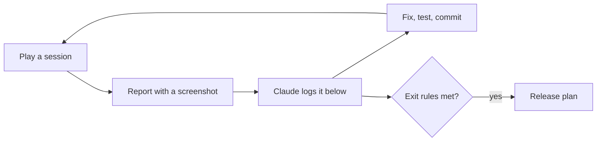

# Playtest plan: play, find, fix

**Date:** 2026-11-04

## Goal

Every feature is built and passes its automated tests, but almost nothing has been **played**. Tests prove the code does what it was told; only playing shows whether the game is fun, clear and fair. This phase is that playing: you play on the computer, report what feels wrong, Claude fixes it, and the numbers get tuned.

It comes after [Layer 6](13_2026-11-04_layer-6-release.md) and before [the release plan](20_2026-11-04_release.md). Studios call this phase **alpha** or **playtesting**.

## How a session works

1. **Play** for a while, on the computer. Try a different goal each time (see "Sessions" below).
2. **Report** anything odd, the way you already do: a screenshot and one line ("I can't remove soil", "this square looks bad"). No need to know why.
3. **Claude** adds it to the findings table, says whether it's a bug, an improvement, missing, or balance, and suggests the best fix. You decide.
4. **Fix:** Claude fixes it with a test, logs it in [the fixes log](16_2026-11-04_fixes-log.md) (or [the decisions log](17_2026-11-04_decisions-log.md) for a choice), and updates the table.

## Sessions

Each one has a goal, so the whole game gets played, not just the first minutes.

| # | Goal | Watch for |
|---|---|---|
| 1 | **New game, first 3 days**, as if you'd never seen it | Do you know what to do? Which text or control is confusing? |
| 2 | **Earn money and buy holy water** | Do prices feel fair? Is anything boring to repeat? |
| 3 | **Heal toward the old farmlands** | Does healing feel good (look and sound)? How slow is it? |
| 4 | **Craft and build:** sword, purifying hoe, lantern, well, fence | Are recipes clear? Is anything too cheap or too expensive? |
| 5 | **Fight:** shades and hollows, at night and near the curse | Too easy, too hard, unfair? Do lanterns help? |
| 6 | **Restore the shrine** | How many days did it take? Did it feel like a reward? |
| 7 | **Leave and come back:** quit, Continue, New Game, pause, settings | Did anything get lost or reset wrongly? |

## Checklist: what to watch for

| Area | Questions |
|---|---|
| **Clear** | Do you always know what to do next? Is any text unclear or missing? |
| **Fun** | What's the best moment? When did you get bored? |
| **Pace** | Is anything too slow (healing, growing, earning) or too fast? |
| **Fair** | Do creatures, fainting and prices feel fair? |
| **Look** | Anything that looks wrong, ugly or out of place? |
| **Sound** | Any sound too loud, annoying or missing? Does the music get tiring? |
| **Bugs** | Stuck, can't do something, something disappears, the game misbehaves? |

## Balance pass

Balance was postponed in Layers 3 to 5, and moved here from the old Layer 6 step 7, because it can only be done by playing. The numbers live in data files, so changing them needs no code:

| What | Where |
|---|---|
| Holy water price, healing sizes, hoe uses, creatures, hearts, fainting, shrine, soil | `data/balance.tres` |
| Crop growth days, seed and sell prices | `data/crops/` |
| Recipes | `data/recipes/` |
| Gathering amounts and regrowth | `data/gather/` |

**Targets to aim for.** These are guesses to start from, and **yours to change**:

| Question | Starting target |
|---|---|
| How long until the first holy water feels affordable? | Day 2 or 3 |
| How long to restore the first shrine? | About 10 to 15 game days |
| How long until a day's work is done and you sleep? (There's no clock: a day ends when you sleep) | A few minutes, so a phone session is one or two days |
| How often should the player faint? | Rarely, and only by taking risks |

**Claude can help with math first:** a script that simulates a player's days (money in, holy water bought, cells healed) can estimate "days to the first shrine" before you play, so play time goes on how it *feels*. Ask for it when you start this pass.

The final check of these numbers happens on a real phone, in release step 2.

## Findings

Newest at the bottom. Status: **open**, **fixed** (with the commit), **won't fix** (with the reason), or **later** (moved to another plan).

| # | Found | Kind | Status |
|---|---|---|---|
| 1 | Tilled soil could never be removed | Missing | ✅ Fixed in 62ab3b9 |
| 2 | Hard grass squares around objects after tilling | Look | ✅ Fixed in 62ab3b9 |
| 3 | The map's shipping box, workbench and lanterns couldn't be moved | Missing | ✅ Fixed in 68e1c8b |
| 4 | Day 12 with 0% of the island healed and no money (from the first screenshot) | Balance? | Open: check in sessions 2 and 3 whether healing and earning are too slow |
| 5 | Fence row ends and corners show a bit of rail sticking out | Look | Open: needs end and corner pieces (art) |
| 6 | `cleanse` and `shrine` sounds are simple generated ones | Sound | Open: replace with richer ones before release if they feel thin |
| 7 | Moths around lanterns, grass in the wind | Improvement | Open, optional (code only) |
| 8 | Watered soil has hard straight edges where it meets dry soil (session 1) | Look | ✅ Fixed: a light ragged edge, half as deep as the grass edge, so each watered tile stays readable |
| 9 | On the computer the tool is only text ("Tool: Watering can"); should it show icons? (session 1) | Improvement | ✅ Fixed: a tool bar with icons and number keys at the bottom, like the phone's; click a slot to pick it. The tool text moved up under the hearts |

## When this phase is done

Move on to [the release plan](20_2026-11-04_release.md) when:

- You've played every session above at least once, including restoring the shrine
- No open finding stops you from playing or loses progress
- The balance targets feel right to you, or you've changed them on purpose
- You still want to play a little more when you stop (the best sign it's ready)

Everything else left open moves to the release plan or a later update, so this phase can't go on forever.
