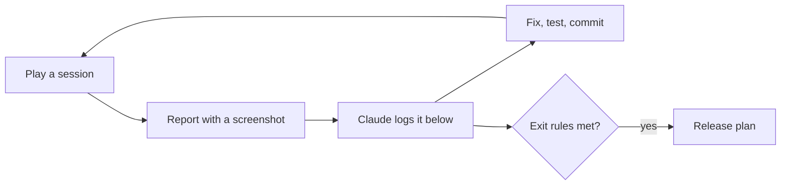

# Playtest plan: play, find, fix

**Date:** 2026-11-04

## Goal

Every feature is built and passes its automated tests, but almost nothing has been **played**. Tests prove the code does what it was told; only playing shows whether the game is fun, clear and fair. This phase is that playing: you play on the computer, report what feels wrong, Claude fixes it, and the numbers get tuned.

It comes before [the release plan](20_2026-11-04_release.md). Studios call this phase **alpha** or **playtesting**.



## Where we are

**2026-11-07:** simpler controls, the guided start, the old book, Tasks, the watering can, the new guards and the rare wardthorn are built. **Next:** [the curse test](21_2026-11-07_curse-returns-test.md), played on a New Game. Sessions 2 to 7 run during the outside test, so we don't tune a game that's still changing. Small polish (findings 5, 6, 7 and 21) waits unless it bothers you.

## How a session works

1. **Play** for a while, on the computer. Try a different goal each time (see "Sessions" below).
2. **Report** anything odd, the way you already do: a screenshot and one line ("I can't remove soil", "this square looks bad"). No need to know why.
3. **Claude** adds it to the findings table, says whether it's a bug, an improvement, missing, or balance, and suggests the best fix. You decide.
4. **Fix:** Claude fixes it with a test, logs it in [the fixes log](16_2026-11-04_fixes-log.md) (or [the decisions log](17_2026-11-04_decisions-log.md) for a choice), and updates the table.

## Sessions

Each one has a goal, so the whole game gets played, not just the first minutes.

| # | Goal | Watch for |
|---|---|---|
| 1 | **New game, first 3 days**, as if you'd never seen it | Do you know what to do? Which text or control is confusing? |
| 2 | **Earn money and buy holy water** | Do prices feel fair? Is anything boring to repeat? |
| 3 | **Heal toward the old farmlands** | Does healing feel good (look and sound)? How slow is it? |
| 4 | **Craft and build:** sword, purifying hoe, lantern, well, fence | Are recipes clear? Is anything too cheap or too expensive? |
| 5 | **Fight:** shades and hollows, at night and near the curse | Too easy, too hard, unfair? Do lanterns help? |
| 6 | **Restore the shrine** | How many days did it take? Did it feel like a reward? |
| 7 | **Leave and come back:** quit, Continue, New Game, pause, settings | Did anything get lost or reset wrongly? |

## Checklist: what to watch for

| Area | Questions |
|---|---|
| **Clear** | Do you always know what to do next? Is any text unclear or missing? |
| **Fun** | What's the best moment? When did you get bored? |
| **Pace** | Is anything too slow (healing, growing, earning) or too fast? |
| **Fair** | Do creatures, fainting and prices feel fair? |
| **Look** | Anything that looks wrong, ugly or out of place? |
| **Sound** | Any sound too loud, annoying or missing? Does the music get tiring? |
| **Bugs** | Stuck, can't do something, something disappears, the game misbehaves? |

## Balance pass

Balance was postponed in Layers 3 to 5, and moved here from the old Layer 6 step 7, because it can only be done by playing. The numbers live in data files, so changing them needs no code:

| What | Where |
|---|---|
| Holy water price and daily limit, healing sizes, hoe uses, creatures, hearts, fainting, shrine, soil, the curse's speed, blighted crop money | `data/balance.tres` |
| Crop growth days, seed and sell prices, the wardthorn's reach | `data/crops/` |
| Recipes | `data/recipes/` |
| Gathering amounts and regrowth | `data/gather/` |

**Targets to aim for.** These are guesses to start from, and **yours to change**:

| Question | Starting target |
|---|---|
| How long until the first holy water feels affordable? | Day 2 or 3 |
| How long to restore the first shrine? | About 10 to 15 game days at first. With the curse test's harder rules, the estimate is day 17 to 31, on purpose. Set a new target after the play test |
| How long until a day's work is done and you sleep? (There's no clock: a day ends when you sleep) | A few minutes, so a phone session is one or two days |
| How often should the player faint? | Rarely, and only by taking risks |

**Math check first:** `tools/balance_check.gd` reads the real map and data, and simulates a sensible player's days (plant, sell, reinvest, buy holy water, heal forward, collect finds). Rerun it after changing numbers:

```bash
"C:\Program Files\Godot\Godot_v4.7.2-stable_win64_console.exe" --headless --path . --script tools/balance_check.gd
```

Results on 2026-11-07: the shortest path from the house to the shrine has **27 cursed tiles**, needing **14 holy water, plus 3 for the shrine**. "Close" means one holy water mends 9 lost tiles, and "scattered" means 3.

| Plots watered each day | No curse | 3 a night, close | 3 a night, scattered |
|---|---|---|---|
| 8 | Day 16 | Day 19 | Day 26 |
| 12 | Day 16 | Day 17 | Day 23 |
| 20 | Day 17 | Day 19 | Day 24 |
| 40 | Day 21 | Day 24 | Day 31 |

**The pace is an open question.** Every row misses the 10 to 15 day target, even with no curse, and the curse makes it slower. The estimate leaves out the curse growing, lanterns, the hoe, wardthorn bursts and the limited can, so judge it from the curse play test, then change the target or the numbers. Rerun the tool after any change.

The final check of these numbers happens on a real phone, in release step 2.

## Findings

In number order. Status: **open**, **fixed** (with the commit), **won't fix** (with the reason), or **later** (moved to another plan).

| # | Found | Kind | Status |
|---|---|---|---|
| 1 | Tilled soil could never be removed | Missing | ✅ Fixed in 62ab3b9 |
| 2 | Hard grass squares around objects after tilling | Look | ✅ Fixed in 62ab3b9 |
| 3 | The map's shipping box, workbench and lanterns couldn't be moved | Missing | ✅ Fixed in 68e1c8b |
| 4 | Day 12 with 0% of the island healed and no money (from the first screenshot) | Balance? | Probably not balance: nothing was sold. The new goals now teach holy water and the shipping box. Recheck with a New Game |
| 5 | Fence row ends and corners show a bit of rail sticking out | Look | Open: needs end and corner pieces (art) |
| 6 | `cleanse` and `shrine` sounds are simple generated ones | Sound | Open: replace with richer ones before release if they feel thin |
| 7 | Moths around lanterns, grass in the wind | Improvement | Open, optional (code only) |
| 8 | Watered soil has hard straight edges where it meets dry soil (session 1) | Look | ✅ Fixed in 2db4004: a light ragged edge, half as deep as the grass edge, so each watered tile stays readable |
| 9 | On the computer the tool is only text ("Tool: Watering can"); should it show icons? (session 1) | Improvement | ✅ Fixed in 2db4004: a tool bar with icons and number keys at the bottom, like the phone's; click a slot to pick it. The tool text moved up under the hearts |
| 10 | The target highlight (white or red square) is a plain thin rectangle drawn in code (session 1) | Look | ✅ Fixed in c956331: an art cursor (four bone-white corners, tinted red where the tool can't be used, stretched for holy water's patch) with a gentle pulse |
| 11 | Lining up with a rock, tree or soil takes several nudges and turns before the cursor lands on it; it doesn't feel smooth (session 1) | Feel | ✅ Fixed in e10528b: smart targeting. If the tile ahead has nothing for the tool, the tiles beside it are tried (nearer side first) and the cursor moves there; the Hoe and Build stay exact. Then sticky facing: walking diagonally keeps a facing that still points your way. Why it felt clumsy: the target was only the tile right ahead of the feet, diagonal walking always faced sideways, and objects look bigger than their tile |
| 12 | Nothing to buy for the first 4 days: no starting money, and the first crop pays on the night of day 4, so the first holy water (the game's main reward) comes on day 5 (math check) | Balance | ✅ Fixed: new games start with 2 free holy water (`start_holy_water` in `data/balance.tres`), so healing happens on day 1. The shrine date doesn't change. Check in session 1 that it feels right |
| 13 | Crop needs are shown as text at the bottom, only for the tile you face; better to show an icon on each tile (session 1) | Improvement | ✅ Fixed: a water drop over crops that need water and a sparkle over ripe ones, nothing otherwise; the "Empty soil" text only on its last night |
| 14 | On a real phone the game had black bars on all sides, not full screen (first Android test) | Look | ✅ Fixed: the view now matches the screen at a whole-number scale, and the controls follow the edges. Checked on the phone: okay (2026-11-07) |
| 15 | Joystick too close to the edge and fixed in place, so walking left was hard (phone test) | Feel | ✅ Fixed: the stick starts where the thumb lands, and the right-hand buttons moved in on wide screens. Checked on the phone with finding 22: okay (2026-11-07) |
| 16 | The Android export reports no project icon | Missing | Open: the build still works; needs the store icon art in release step 4 |
| 17 | Menus sat left of center with the phone controls on | Look | ✅ Fixed: menus are centered, and only shift left when they would cover Act |
| 18 | The pause button looked odd alone at the top center (phone controls) | Look | ✅ Fixed: moved to the top right corner (tried beside the hearts first); the day, money and status text move left on phones. It still looked weird, because the dark bars were too big, so the icon is now half size and bone-white |
| 19 | Too much empty space above the hearts on phones | Look | ✅ Fixed: the space was the computer's help line; on phones the hearts and tool text move up into it |
| 20 | Long bottom messages ran under the joystick and the seed arrow (phone controls) | Bug | ✅ Fixed: on phones they stay between those controls and wrap onto two lines |
| 21 | The joystick ring and round buttons have rough, blocky edges (seen in the user's phone screenshots) | Look | Open: waiting for the user to say if it bothers them. It comes from resizing the art to uneven sizes |
| 22 | The thumb went past the area where the joystick works, on the Redmi Turbo 4 Pro (phone test) | Feel | ✅ Fixed: the touch area now covers the left side up to the tool bar, and the ring follows the thumb (Following mode). The stick sleeps under menus. Checked on the phone: okay (2026-11-07) |
| 23 | The game feels boring and too simple after a short time; what makes it different from games like Hay Day? (phone test) | Improvement | Open: the curse never fights back, so no day has a hard choice. Being tested in `docs/21_...` |
| 24 | Sleeping is free, so a player could keep sleeping and collecting crops (wells water them) | Balance | Open: not tried in the game yet. `docs/21_...` makes sleeping risk healed land, but only partly closes this |
| 25 | Too many buttons on the phone: 13 plus the joystick | Improvement | ✅ Built in controls steps 3 to 5: 5 buttons plus the joystick, and a few more only while building. Not tried on the phone yet |
| 26 | `GameState` is getting big: 41 functions, used 149 times in 22 files | Code | Fixed 2026-11-07 (controls step 1): split into `Inventory`, `Progress` and `SaveGame`, and a small `GameState` stays. See the fixes log |
| 27 | Bottom messages sat right on top of the tool bar (curse test) | Look | ✅ Fixed: messages moved up 8 pixels on computers and phones, and tests check the gap |
| 28 | One hoe tap saves a marked tile for free, so a lantern isn't needed (curse test) | Balance | Open: works as the plan says, but the plan's risk came true. ✅ Changed for the second curse try: bare soil and food crops no longer save a tile. Buildings, lanterns and watered wardthorns do. Recheck in play |
| 29 | Tilled soil beside the curse shows only as a small brown patch, because edge pieces cover most of it (curse test) | Look | Open: decide after finding 28, which may change how often this appears |
| 30 | `test_shade` failed twice in about 20 runs of the tests ("reaches the player"), before any curse code runs in that test | Code | ✅ Fixed: the chase started wherever the shade had wandered, which could put the player beside a lantern or object. It now starts from the shade's home, and passed 25 of 25 runs. The cause is likely, not proven |
| 31 | No pressure or challenge: healing is so fast that the curse can be beaten in one sitting (curse test, played on a day 53 save with 4,695 money) | Balance | Open: money buys unlimited holy water at a fixed price, so the curse rate alone cannot fix this. Being tested in the second curse try: 3 holy water a day at the stall, and a curse that grows as land heals. Recheck from a New Game |
| 32 | A plant shouldn't protect the land just by being there, unless it's something like poison (user's idea) | Improvement | ✅ Built: the curse blights food crops, and a new wardthorn guards land and can burst to heal. Art added. Recheck in play |
| 33 | The user could not tell how to switch to the wardthorn seed, or that it must be bought first, and a planted crop cannot be removed | Improvement | Partly done: the goals now teach the Hoe first, planting and buying a wardthorn, and the tool text shows Q and E. Still open: should a young crop be removable? |
| 34 | The curse warning ran off the right side of a computer screen, and "nearby" was cut off (curse test) | Bug | ✅ Fixed: shorter text, and a test checks that it fits |
| 35 | The joystick ring could slide up close to the hearts, and off the screen at the left and bottom (computer, with phone controls) | Feel | ✅ Fixed: a new joystick keeps the ring on screen and clear of the hearts. Recheck on the phone |
| 36 | At the start of a game, the user does not know how to play or what the purpose is | Missing | ✅ Built: a short story on New Game, then one goal at a time, then the long goal. Recheck with a New Game, and with outside players |
| 37 | Action beside the door would end the day with no question, and the chart didn't count that as a risk | Improvement | ✅ Built in controls step 3: Action asks "Sleep?" first, and F still sleeps at once. Not tried on the phone yet |
| 38 | The purifying hoe has no row in the Action chart, so phones lose it when the tool bar goes in controls step 4 | Missing | ✅ Built in controls step 4: the Heal button uses it on one cursed tile, before holy water. Not tried on the phone yet |
| 39 | Action's swing fires for a creature in any direction, but the sword only hits in front | Improvement | ✅ Built in controls step 3: Action turns and swings straight at the creature. Not tried on the phone yet |
| 40 | After playing, the Action button feels strange, and the user would rather tap the tile or object, like Hay Day (phone, controls step 3). They also asked if checking all the time is slow: measured at about 4 microseconds a frame on the computer, far under the 16,667 available | Improvement | Settled 2026-11-07: after more play the Action button felt good, so it stays. Recheck in the outside test, and add tapping if new players struggle (`docs/24_...`) |
| 41 | With a creature close and a sword owned, Action only swings, so farming waits. The user asks if that's a problem | Design | Keep for now: one tap does one thing, and the icon shows the sword. Watch in the phone test and outside test |
| 42 | The user wants to move objects by tapping or holding them, like Hay Day | Improvement | ✅ Built 2026-11-07: press and hold a building, drag it, and let go. The user likes it on the phone |
| 43 | The user asks if the goal text near the hearts is the best place, and suggests a story in an ancient book and a board to help players understand and play | Improvement | ✅ Book built 2026-11-07: story and lessons, with pages that clear as the land heals. The user likes it on the phone. Goals moved to Tasks (finding 53). A quest board only if the outside test shows players want it |
| 44 | The user wants to select a tile, see the crops, and pick one to plant, like Hay Day. This is the third Hay Day style request, so direct touch may suit this player better than the plan assumed | Improvement | Decided 2026-11-07: no tile tapping, because the character does the work in this game. If picking seeds feels slow, show seed icons beside the big button when facing empty soil |
| 45 | The user wants objects to have more options, like upgrades | Improvement | Open: the user's choice. Advice: wait until after the curse test and outside test, because upgrades change the balance those tests measure. Then start with the lantern and the well, as data |
| 46 | Build mode isn't intuitive on the phone: the hammer and < > arrows are unclear, and "Lantern post: 0" shows something you can't place | Improvement | ✅ Built 2026-11-07: tap Build, pick from a list of what you own, the big button places it, and one X leaves. Not tried on the phone yet |
| 47 | The purifying hoe's 5 free heals a day beat the curse's 3 tiles a night, so early on nothing else is needed (the user's catch). The curse only catches up at 10 to 15% healed | Balance | ✅ Changed 2026-11-07: `hoe_daily_uses` is now 2, so the hoe alone never beats the curse. Judge it in the curse play test. Watch lanterns too: each heals a free tile every night |
| 48 | The purifying hoe's icon in the Bag is the ordinary digging hoe, only smaller, so it doesn't look special | Art | ✅ Fixed 2026-11-07: its own art, and the Bag says "Purifying hoe" |
| 49 | Near the workbench, house or shop, Action kept opening them instead of farming | Bug | ✅ Fixed 2026-11-07: Action only uses objects you're facing. See the fixes log. Not tried on the phone yet |
| 50 | Soil, planting and watering have no limit, so a farm can grow forever (the user's question) | Balance | ✅ Changed 2026-11-07: the can holds 10, is full each morning, and refills at wells. Soil stays free |
| 51 | The well feels unneeded: why build it? | Balance | ✅ Changed 2026-11-07: wells refill the watering can, and one stands by the house |
| 52 | Who runs the shop, and who buys from the shipping box? The island is cursed and empty, so neither is explained | Story | ✅ Added 2026-11-07: a book page about a night trader, who rows in after dark, explains both, and the stall's daily limit |
| 53 | The yellow goal text takes up screen space. The user wants goals in a tasks board, one tap away | Improvement | ✅ Built 2026-11-07: a Tasks menu, and a new goal shows for 6 seconds, then fades. Recheck with new players in the outside test. Not tried on the phone yet |
| 54 | Farming beside the workbench still sometimes opens it, which is annoying | Improvement | ✅ Built 2026-11-07: for half a second after a farming tap, Action won't use objects (`action_object_pause`). Not tried on the phone yet |
| 55 | Will the seed popup and the Bag last with more crops? No: `PickMenu` has no scrolling, so about 7 rows fill a phone, and a full Bag already fills the screen | Improvement | Partly built 2026-11-07: `PickMenu` scrolls past 5 rows. Still open: give the Bag tabs (Crops, Items, Buildings) before the areas work adds items |
| 56 | Build mode's X button is plain text, and should have its own art | Art | ✅ Fixed 2026-11-07: a wooden cross, on the button |
| 57 | Wardthorn feels useless next to lanterns: it guards only 2 tiles while watered and costs 60, while a lantern guards 4 tiles for good, heals a tile each night, and costs 3 wood and 2 stone | Balance | ✅ Changed 2026-11-07: a wardthorn guards a 7×7 square and costs 30, a lantern guards a 5×5 square and costs curse shards, and facing either shows the area. Judge in the curse play test |
| 58 | Lanterns can be built without limit, so the land fills with them and looks messy | Balance | ✅ Changed 2026-11-07: lanterns must stand 6 tiles apart, and need 2 curse shards |
| 59 | The top right corner was lines of text, unlike the coin beside them | Improvement | ✅ Built 2026-11-07: icons and numbers, with a new healing icon. Not tried on the phone yet |
| 60 | A ripe wardthorn guarded nothing on phones, so the land around it was lost. The user asked for it to guard a little until burst | Bug | ✅ Fixed 2026-11-07: ripe needs no water and guards 5×5, and a dry one guards 3×3. See the fixes log. Not tried on the phone yet |
| 61 | The ripe star on crops isn't wanted, and a ripe wardthorn should be lively and stand out | Look | ✅ Built 2026-11-07: the star is gone, so only the water drop shows, and a ripe wardthorn glows with rising motes, and plays its 4-frame animation. Not tried on the phone yet |
| 62 | A wardthorn seed guarded land the moment it was planted, which isn't logical | Balance | ✅ Fixed 2026-11-07: a seed guards only its own tile, until it sprouts |
| 63 | Farming beside a ripe wardthorn burst it by accident | Bug | ✅ Fixed 2026-11-07: buttons leave it alone, and you walk up and tap the plant to burst it. Not tried on the phone yet |
| 64 | The guard square near a wardthorn or lantern gets in the way, and light could show the area instead | Look | ✅ Built 2026-11-07: the square only shows while placing a lantern, and a wardthorn's glow grows with its guard. Check it's clear enough on the phone |
| 65 | The ripe wardthorn should stand taller | Look | ✅ Built 2026-11-07: rebuilt from the art at 40×50 |
| 66 | Wardthorn was too cheap and could unlock the curse too soon, and the user wants it rare and to take more space | Balance | ✅ Built 2026-11-07: see the decisions log |
| 67 | The claimed tiles need to show, and the plant should feel more alive | Look | ✅ Built 2026-11-07: facing a claimed tile explains it, and the plant sways. Not tried on the phone yet |
| 68 | The wardthorn's roots look like a bad thing, more like the curse than a protecting plant | Look | ✅ Fixed 2026-11-07: roots and a flower ring were tried and removed, because they distracted. Nothing marks the ground now |

## Controls check

Go through these during the curse play test, and mark each one okay or not. Rows 10 to 12 need a sword, the hoe and strong holy water, so they can wait for a later save.

| # | Try this | It's okay if |
|---|---|---|
| 1 | Read the story, then follow the goals | Each goal can be done as written |
| 2 | Till, plant and water with the big button | Its icon always matches what happens |
| 3 | Walk around the field and tap often | Nothing is tilled or spent by mistake |
| 4 | Tap the big button at the door | It asks first, and No is easy to tap |
| 5 | Pick another seed with the seed bag | The popup is quick, and the button shows the new seed |
| 6 | Tap the bottle facing the curse | It heals, it's dim when it can't, and you never hit it by accident |
| 7 | Harvest, then ship at the box | Both work with the big button |
| 8 | Shop and workbench: open, buy, close with ! | Nothing covers the buttons you need |
| 9 | Open the bag, tap Build, pick something, place it with the big button, and take it back | It's easy to find, and the X is clearly the way out |
| 10 | With a sword, fight a creature from each side | The player turns and hits it |
| 11 | Own the purifying hoe, tap the bottle on a cursed tile | One tile heals, and holy water is kept |
| 12 | Own both kinds of water, tap the bottle | It asks which, and the popup looks right |
| 13 | Overall: does one thumb on each side feel right? | You'd keep these controls |
| 14 | Press and hold a building, drag it, let go | It lifts when you expect, and never by accident |
| 15 | Open the Book in the bag and read it | It's easy to read, and you'd want the next page |
| 16 | Tap Tasks, and watch a new goal fade | You always know what to do next, and the screen feels clearer |
| 17 | Walk around a wardthorn and a lantern | Their light shows about what they guard, and nothing gets in the way of farming |
| 18 | Water until the can is empty, then refill at the well by the house | The trip feels like a fair limit, not a chore |
| 19 | Face a tile beside a wardthorn | The red cursor and message make it clear why you can't use it |
| 20 | Walk up to a ripe wardthorn and tap the plant | The tap is easy, your thumb doesn't hide it, and the question feels right |
| 21 | Tap the big button fast along a row, near the workbench | No menu opens by accident, and a slower tap still opens it |
| 22 | Scroll a long popup, if you own many buildings | Swiping feels right |

## When this phase is done

Move on to [the release plan](20_2026-11-04_release.md) when:

- You've played every session above at least once, including restoring the shrine
- 5 to 10 outside players have tried it, and some came back on their own the next day (see [the release plan](20_2026-11-04_release.md), "Outside test")
- No open finding stops you from playing or loses progress
- The balance targets feel right to you, or you've changed them on purpose
- You still want to play a little more when you stop (the best sign it's ready)

Everything else left open moves to the release plan or a later update, so this phase can't go on forever.
