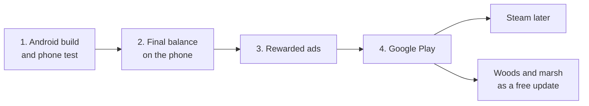

# Release plan: phone, ads and Google Play

**Date:** 2026-11-04

## Goal

Put the game on Google Play, where strangers can install it. This starts after [the playtest](19_2026-11-04_playtest.md), when the game feels good on the computer. These steps used to be Layer 6 steps 4, 7, 8 and 9 in [the Layer 6 plan](13_2026-11-04_layer-6-release.md); they moved here on 2026-11-04 so Layer 6 could close as finished. The new numbers are this plan's own: say "release step 1", not "Layer 6 step 4".



## Where this fits

The order changed on 2026-11-07: step 1's phone checks come first, then the [curse test](21_2026-11-07_curse-returns-test.md), simpler controls, the first 15 minutes and the outside test. Steps 2 to 4 follow those. The [roadmap in `CLAUDE.md`](../CLAUDE.md) has the full order.

## Build steps

Each step ends with something you can run and see working.

| # | Step | Was | Needs from you |
|---|---|---|---|
| 1 | **Android build and phone test:** an installable game on your phone, then every check below | Layer 6 step 4 | An Android phone with developer mode on |
| 2 | **Final balance on the phone:** the playtest's numbers, checked in short phone sessions | Layer 6 step 7 (the main balance pass moved to the playtest) | Playing on the phone |
| 3 | **Rewarded ads:** optional ads for faster cleansing or a double harvest, and a Remove Ads purchase | Layer 6 step 8 | An ad account (AdMob) and a privacy policy |
| 4 | **Google Play release:** the real title and logo, store listing, closed testing, then the public store | Layer 6 step 9 | A developer account, the real title, real testers |

Steam comes after Android, and only needs its own build and store page. The [woods and marsh plan](15_2026-11-04_areas-woods-marsh.md) follows as a free update.

### Making a test build

The Android preset is in `export_presets.cfg`. Export from the Godot editor, or on Windows from the project folder:

```bash
"/c/Program Files/Godot/Godot_v4.7.2-stable_win64_console.exe" --headless --path . --export-debug "Android" builds/cursed-island-test.apk
```

The APK and debug keystore in `builds/` aren't in git. The export prints an error about the missing project icon, but the build still works (finding 16). Turn off Emulate Touch From Mouse first.

### Step 1 checks on a real phone

These can't be tested on a computer. Each was left open by an earlier step:

| Check | Left over from |
|---|---|
| Touch controls: thumb reach and feel | Layer 6 step 2 |
| Swiping to scroll the workbench list | Layer 6 step 3 |
| Whether text is big enough (the game draws at 640×360) | Layer 6 step 3 |
| The game fills the screen, and a camera hole or notch covers nothing important | First Android test |
| Speed on a cheap phone: lights, sound, music, creatures | New |
| Help text still says "then Use", though the Use button shows a tool icon; menus say "Tap ! to close" | Layer 6 step 6 |
| The pause button, the Use icon and the "!" Act button feel clear | Layer 6 step 6 |
| Phones close apps without asking: the "saves when you sleep" warning is enough | Layer 6 design |

## Outside test

Before steps 2 to 4, 5 to 10 people who aren't you play the game on their own phones. You know the game too well to see what confuses a new player, or whether it makes someone want to come back.

- **Who:** friends, family or online game communities, ideally people who like farming games
- **What they get:** an APK, or a Google Play test link if the account is ready
- **What to ask:** where they got stuck, when they stopped, and whether they'd play tomorrow. Don't explain the game first
- **Move on when:** some of them come back on their own the next day. If nobody does, fix that before release

If Google requires a closed test for your account, use it for this test too, so the same people and the same weeks count for both.

## What only you can do

| Needed | For | Notes |
|---|---|---|
| **A game title** | Step 4 (and the title screen) | Still "working title". Worth checking it's free to use. Pick it before the outside test |
| **An Android phone** | Steps 1 and 2 | With developer mode turned on. Claude will walk you through it |
| **An ad account** | Step 3 | AdMob is the usual choice, and it needs payment details |
| **A privacy policy** | Steps 3 and 4 | Required once ads collect data |
| **A Google Play developer account** | Step 4, and start it before the outside test | There's a one-time fee, and new personal accounts may need to run a closed test with real testers before a public release. Check Google's current rules when you get there |

## Art needed

| Step | Needed |
|---|---|
| 4 | Title logo (once the game has its real name), store icon, banner and screenshots |

AI-generated content must be disclosed on Steam (and checked against Google Play's rules); the art docs and [the sound list](18_2026-11-04_sound-list.md) are the record of how everything was made, including the Suno music.

## Risks

- **Performance on real phones is unknown.** Everything so far ran on fast computers. Step 1 checks a cheap phone.
- **Ad plugins may lag behind Godot.** AdMob needs a plugin that supports Godot 4.7. Check this before step 3, and leave time for it.
- **Closed testing takes time.** Google may require a test period with real testers before the public release, so start finding testers early.
- **Old saves must keep working.** `tests/test_old_save.gd` stays in place, and New Game never deletes a save without a warning.
