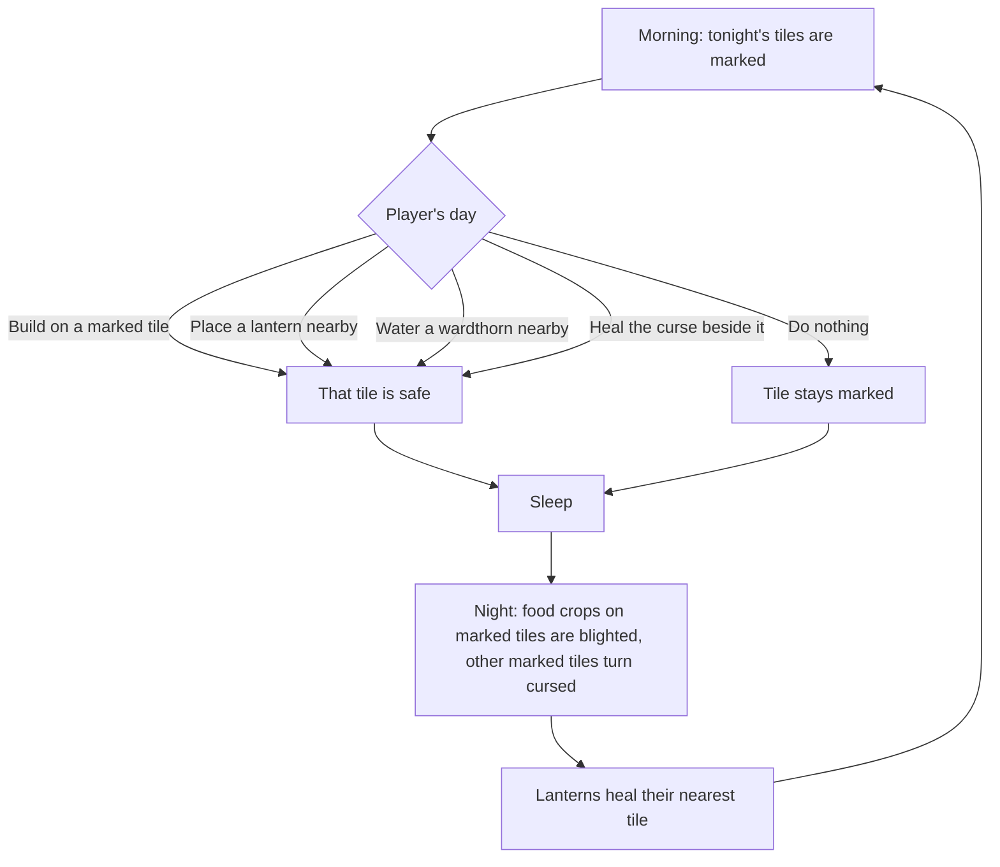

# Curse test plan: the land fights back

**Date:** 2026-11-07

## Goal

Find out, cheaply, whether the game is more fun when the curse takes healed land back at night. This is a test: we keep it only if playing it feels better.

Right now the curse waits forever and sleeping costs nothing, so no day has a hard choice (findings 23 and 24). With this change, each day asks: earn money, heal new land, or protect what you've healed?

## The rules to test

These are the rules in the game now, after the first play (see "Second try" below for what changed and why).

| Rule | Why |
|---|---|
| Only land the player healed can return | The shore and the map's clean clearings stay safe, so nobody can lose their home |
| Only healed tiles beside the curse are at risk | The curse creeps from its edge, so the player can see where it's coming from |
| The curse takes 3 tiles a night, plus 1 for every 5% of the island healed | The more land the player holds, the harder it pushes back |
| Bare soil is lost with its tile | A hoe tap alone shouldn't stop the curse |
| A food crop on a marked tile is blighted, and its land stays clean that night | A normal plant can't protect itself, but losing it outright could make players quit |
| Buildings, gatherable spots and ward plants are never taken | Nothing the player built is destroyed |
| A lantern guards a 5×5 square, must stand 6 tiles from another, and costs curse shards | Rare, permanent safe spots |
| A wardthorn seed guards only its own tile. Once sprouted it guards 3×3 while dry and 7×7 while watered, and 5×5 once ripe, with no water | Guarding takes planning ahead, care makes it strong, and ripe means choosing: keep guarding, or burst |
| Guards remove marks in their area, but don't heal the curse. Only a burst does | Guarding and healing stay two different jobs |
| Tiles within 9 of a restored shrine are safe | Makes the shrine feel like a real victory |
| Tonight's tiles are marked in the morning, and land healed that day is safe tonight | A loss you can see coming feels fair; a surprise doesn't |
| Starts on day 4 | The first days stay calm while the player learns |

**The wardthorn:** seed 150 money, one a day, 6 watered days to ripen, and it claims the 8 tiles around it. It can't be blighted. Ripe, it guards without water until the player walks up and taps it to burst it, which heals cursed land in a 5×5 square and uses the plant up. That's up to 12 tiles, and about 5 or 6 at the curse's edge. It's planted on clean tilled soil, like any crop.

**Starting numbers, first guesses:** all of them are in `data/balance.tres` and `data/crops/wardthorn.tres`. Setting `curse_return_per_night` to 0 turns the returning curse off.

## What this does and doesn't fix

- **Boring days:** this is the main thing we're testing.
- **Sleeping for free:** sleeping now risks healed land and crops near the curse. A player who has healed nothing, or protected everything, still loses nothing. That's fine in a single-player game, because they aren't moving towards the goal.

## Traps found in the code

| Trap | What would go wrong | Fix |
|---|---|---|
| A find counts as gone when its cell is in `cleansed` | Land that returns would bring its find back, so healing it again pays again: free money | Save a new `dug_finds` list in `farm_state`. For older saves, any find already in `cleansed` counts as dug |
| Gatherable spots on healed land | An object could end up on cursed ground, or vanish | Never take a gatherable spot's tile |
| Crops on returning land | A crop would sit on cursed ground | The curse blights the crop instead, and leaves the tile clean that night |
| Saves | Older saves must keep loading | `cleansed` just gets shorter, and `dug_finds` defaults to empty, so `SAVE_VERSION` stays at 1. `tests/fixtures/save_v1.cfg` must still pass |
| Fainting | The player could stand on a tile that turns cursed | Already safe: `return_home()` runs before `end_day()`, and a test checks it |
| Blocked paths | Returning land could cut off a building or the way east | Allowed: this is the threat, and the player can heal back through. The house, shop and shipping box must never be cut off from each other |
| Existing tests | Tests that heal land and pass day 4 may see it return | Set the nightly number to 0 in those tests, before the main scene loads, instead of weakening their checks |

## Build steps

Say "curse step N" so these aren't mixed up with other plans.

| Step | Work | Done when |
|---|---|---|
| 1 ✅ | Land returns: `Healing` picks and takes tiles at night (before lanterns heal), with the two numbers, the find fix and curse edge refresh. Picks are seeded by the day, like creatures. Empty-tile protection came forward from step 2, so no step can lose the player's work | Tests show tiles return, finds don't pay twice, and it survives a restart |
| 2 ✅ | Protection: lanterns and the restored shrine | Tests show each protected tile stays clean |
| 3 ✅ | Warning: mark tonight's tiles each morning, and show a morning notice with how many tiles were lost | A screenshot shows marks that are easy to read on a phone |
| 4 ✅ | Update `tools/balance_check.gd` for land lost each night, tune the numbers, and make a test APK | The shrine is still reachable at a sensible pace |
| 5 | The user starts a New Game, plays 5 to 7 game days, then we decide | A decision is in `docs/17_...` |

The marks use a tinted `tile_cursor.png` and a purple stain for the test, so **no new art is needed**. Facing a marked tile explains what saves it. If we keep the feature, it should get proper art and a sound.

## Pace check (2026-11-07)

`tools/balance_check.gd` now counts holy water spent mending lost land. Tiles close together are mended 9 per use, and scattered tiles 3 per use.

| Plots watered each day | No curse | 3 a night, close together | 3 a night, scattered |
|---|---|---|---|
| 8 | Day 16 | Day 16 | Day 19 |
| 12 | Day 14 | Day 14 | Day 14 |
| 20 | Day 14 | Day 14 | Day 16 |
| 40 | Day 19 | Day 19 | Day 19 |

The shrine stays reachable, at most 3 days later. **The numbers stay at 3 tiles from day 4.** The math says this is safe, and may even be gentle, but it's a best case and can't show how it feels. Playing decides that.

## Second try (2026-11-07)

The first play, on a day 53 save with 4,695 money, had no pressure: one hoe tap saved any tile (finding 28), and money could buy enough holy water to heal the island in one sitting (finding 31). The second and last try changes the rules above like this:

| Change | Rule |
|---|---|
| Daily holy water limit | The stall sells 3 a day (`holy_water_daily_limit`). The workbench recipe isn't limited, so crafting becomes a way past it |
| The curse grows | 3 tiles a night, plus 1 for every 5% of the island healed (`curse_growth_percent`) |
| What saves a tile | A building, a lantern's reach, a watered wardthorn's reach, or healing beside it. Bare soil doesn't, and it's lost with its tile |
| Food crops | They can't protect themselves (the user's idea). The curse blights a marked crop: it stops growing, and clearing it gives 5 money and a curse shard. The land under it stays clean that night |
| Wardthorn | A plant that is poison to the curse. Seed 150 money, one a day, 6 watered days to ripen. While watered that day, it guards a 7×7 square (changed from the first numbers on 2026-11-07, see finding 57). Ripe, it needs no water, and the player walks up and taps it to burst it, which heals a 5×5 square |
| How to test | Start a **New Game**, because a rich old save can't show the pace |

Pace check with these rules, shrine restored at 3 tiles a night:

| Plots watered each day | Tiles close together | Tiles scattered |
|---|---|---|
| 8 | Day 19 | Day 26 |
| 12 | Day 17 | Day 23 |
| 20 | Day 19 | Day 24 |
| 40 | Day 24 | Day 31 |

That's slower than the old 10 to 15 day target, on purpose. It's a rough estimate: it leaves out the curse growing, crafting, lanterns and creatures.

The wardthorn's healing isn't in that estimate either. Its seeds have no daily limit, so watch whether bursts make the holy water limit pointless.

## How we decide

After playing a New Game, answer these:

1. Did you make different choices because of the curse?
2. Did you look forward to the next day more than before?
3. Did losing land feel fair, or just annoying? Did the daily limit feel like a real choice, or just a wall?
4. Did you still feel you were making progress?
5. Was the wardthorn worth buying, or did it make the game too easy?
6. Are lanterns and wardthorn each worth using, for different reasons?
7. Did the watering can's limit feel fair, or like a chore?
8. Is the hoe's 2 uses a day fair, and do a few lanterns beat the curse by themselves?
9. Do all the limits together (water, holy water, wardthorn, lantern spacing, the hoe) feel like good choices, or like too many walls?
10. Is a 150 money wardthorn, one a day, something you look forward to buying?

| Result | What we do |
|---|---|
| Mostly yes | Keep it, add art and sound, then start the outside test |
| Good idea, wrong pace | Change the numbers and play again, but only once: two tries in total |
| Annoying or no better | Set the nightly number to 0, log why, and try another idea |

## Risks

- **Too punishing:** this game is meant to be calm and short per session. Losing land must feel like a push, never like losing your work.
- **Busywork:** if protecting land becomes a daily chore, it swaps boredom for chores.
- **Pace:** the release gets later by the length of this test.
