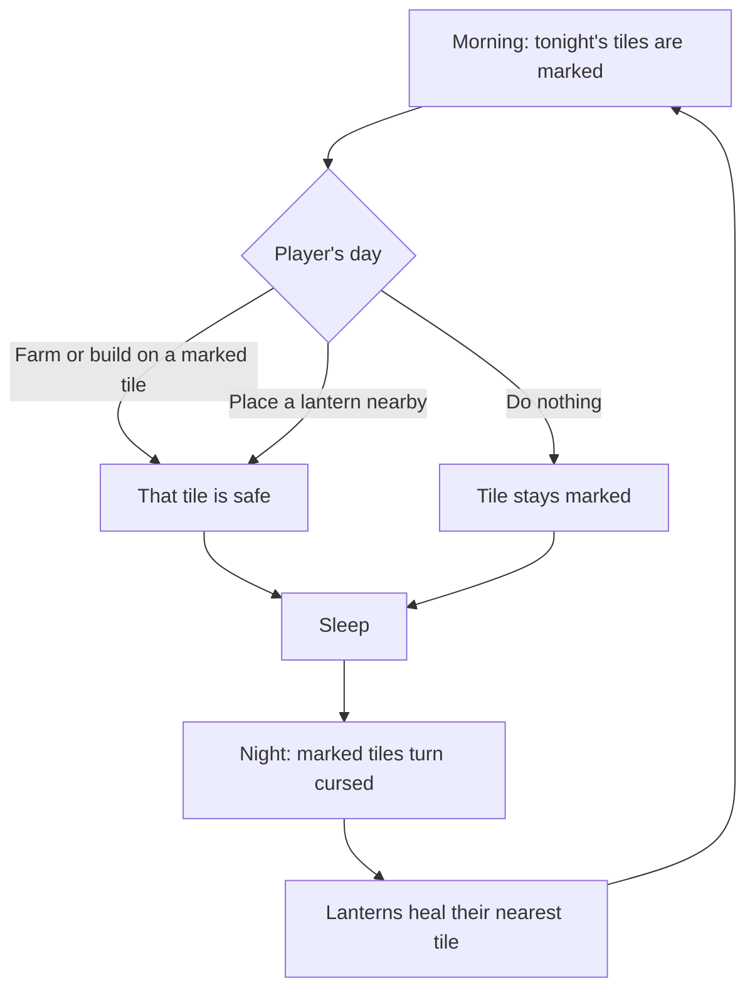

# Curse test plan: the land fights back

**Date:** 2026-11-07

## Goal

Find out, cheaply, whether the game is more fun when the curse takes healed land back at night. This is a test: we keep it only if playing it feels better.

Right now the curse waits forever and sleeping costs nothing, so no day has a hard choice (findings 23 and 24). With this change, each day asks: earn money, heal new land, or protect what you've healed?

## The rules to test

| Rule | Why |
|---|---|
| Only land the player healed can return | The shore and the map's clean clearings stay safe, so nobody can lose their home |
| Only healed tiles beside the curse are at risk | The curse creeps from its edge, so the player can see where it's coming from |
| Only empty tiles are taken | Nothing is destroyed: no crop, soil, building or object is lost in this test |
| Tiles within 4 of a healing lantern are safe (about 50 tiles) | Gives lanterns a clear job |
| Tiles within 9 of a restored shrine are safe | Makes the shrine feel like a real victory |
| Tonight's tiles are marked in the morning | A loss you can see coming feels fair; a surprise doesn't |
| Starts on day 4 | The first days stay calm while the player learns |

**Starting numbers, first guesses:** 3 tiles a night, starting on day 4. One holy water heals up to 9 tiles for 30 money, so holding your ground costs about one holy water every 3 nights. Both numbers go in `data/balance.tres`, and setting the tiles to 0 turns the whole feature off.

## What this does and doesn't fix

- **Boring days:** this is the main thing we're testing.
- **Sleeping for free:** sleeping now risks healed land. A player who has healed nothing, or protected everything, still loses nothing. That's fine in a single-player game, because they aren't moving towards the goal. If it spoils the game, the next idea is the curse also harming crops.
- **Too many buttons:** not part of this test (finding 25).

## Traps found in the code

| Trap | What would go wrong | Fix |
|---|---|---|
| A find counts as gone when its cell is in `cleansed` | Land that returns would bring its find back, so healing it again pays again: free money | Save a new `dug_finds` list in `farm_state`. For older saves, any find already in `cleansed` counts as dug |
| Gatherable spots on healed land | An object could end up on cursed ground, or vanish | Never take a gatherable spot's tile |
| Saves | Older saves must keep loading | `cleansed` just gets shorter, and `dug_finds` defaults to empty, so `SAVE_VERSION` stays at 1. `tests/fixtures/save_v1.cfg` must still pass |
| Fainting | The player could stand on a tile that turns cursed | Already safe: `return_home()` runs before `end_day()`, and a test checks it |
| Blocked paths | Returning land could cut off a building or the way east | Allowed: this is the threat, and the player can heal back through. The house, shop and shipping box must never be cut off from each other |
| Existing tests | Tests that heal land and pass day 4 may see it return | Set the nightly number to 0 in those tests, before the main scene loads, instead of weakening their checks |

## Build steps

Say "curse step N" so these aren't mixed up with other plans.

| Step | Work | Done when |
|---|---|---|
| 1 ✅ | Land returns: `Healing` picks and takes tiles at night (before lanterns heal), with the two numbers, the find fix and curse edge refresh. Picks are seeded by the day, like creatures. Empty-tile protection came forward from step 2, so no step can lose the player's work | Tests show tiles return, finds don't pay twice, and it survives a restart |
| 2 ✅ | Protection: lanterns and the restored shrine | Tests show each protected tile stays clean |
| 3 | Warning: mark tonight's tiles each morning, and show a morning notice with how many tiles were lost | A screenshot shows marks that are easy to read on a phone |
| 4 | Update `tools/balance_check.gd` for land lost each night, tune the numbers, and make a test APK | The shrine is still reachable at a sensible pace |
| 5 | The user plays 5 to 7 game days, then we decide | A decision is in `docs/17_...` |

The marks can use a tinted `tile_cursor.png` for the test, so **no new art is needed**. If we keep the feature, it should get proper art and a sound.

## How we decide

After playing, answer these:

1. Did you make different choices because of the curse?
2. Did you look forward to the next day more than before?
3. Did losing land feel fair, or just annoying?
4. Did you still feel you were making progress?

| Result | What we do |
|---|---|
| Mostly yes | Keep it, add art and sound, then start the button redesign (finding 25) |
| Good idea, wrong pace | Change the numbers and play again, but only once: two tries in total |
| Annoying or no better | Set the nightly number to 0, log why, and try another idea |

## Risks

- **Too punishing:** this game is meant to be calm and short per session. Losing land must feel like a push, never like losing your work.
- **Busywork:** if protecting land becomes a daily chore, it swaps boredom for chores.
- **Hand-tilling everything:** tilling a marked tile saves it, with no energy cost. Empty soil turns back to grass after 3 nights, which may be enough. Watch for this in play.
- **Pace:** the release gets later by the length of this test.
