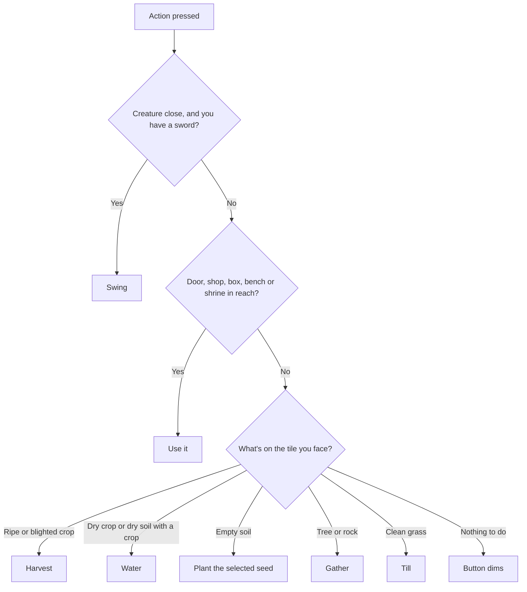

# Simpler controls plan

**Date:** 2026-11-07

## Goal

Make the phone game easy to play with one thumb on each side. It has 13 buttons plus the joystick today (finding 25). This plan brings that down to **5 buttons plus the joystick**, by letting the game work out what you mean from what you're facing.

**When:** next, before the curse play test (`docs/21_...`). That's the user's choice on 2026-11-07. If the play test later removes a tool, update the Action button's order to match.

## The new phone layout

| Today | After |
|---|---|
| 7 tool buttons | Gone: the Action button picks the tool |
| Use and Act | One big **Action** button, showing what it will do |
| `<` and `>` seed arrows | One **Seed** button, showing the selected seed. Tapping it opens a small popup |
| Bag | **Bag**, which also holds the Build tool |
| Pause | **Pause** |
| Nothing | One **Heal** button for holy water, kept apart so it's never spent by accident |

The sword doesn't need its own button: Action swings it when a creature is close.

## How the Action button decides

The first row that fits wins. The button's icon always shows what will happen, so there are no surprises. An object only counts as in reach if using it would do something, so an empty box or a restored shrine doesn't stop you tilling beside it.

**Actions that never happen by accident:**

| Action | Why | How to do it |
|---|---|---|
| Holy water | It's limited, and a wrong tap wastes it | The Heal button |
| Picking up a building | It would undo the player's layout | Build mode, from the Bag |
| Hoeing soil back to grass | Rarely needed | Empty soil turns back by itself |

## Computer controls

Keep the number keys and tool bar as they are, and add the Action button's logic to one key. People at a keyboard lose nothing, and the same code serves both. `Player.Tool` stays as the way tools are really used, so Action only chooses which one to run.

## Build steps

Say "controls step N" so these aren't mixed up with other plans.

| Step | Work | Done when |
|---|---|---|
| 1 ✅ | Split `GameState` (finding 26) into `Inventory`, `Progress` and `SaveGame`, with no change to how the game plays. Built 2026-11-07. A small `GameState` stays for what fits none of the three (see the decisions log) | All tests pass with only their paths updated |
| 2 ✅ | `Farm.smart_action(cell)`: returns what Action would do, with one test per row of the chart. Nothing on screen changes yet. Built 2026-11-07 | Tests cover every row and the order between them |
| 3 ✅ | Action button: replaces Act and takes Use's big spot, and its icon follows the player's target. At the door it asks "Sleep?" first. Built 2026-11-07, on key R too. A small Use stays in Act's old spot, because holy water, Build and the purifying hoe need it until steps 4 and 5. **Still to try on the phone** | Playing a full day on the phone needs no tool button |
| 4 | Seed popup and Heal button; remove the arrows and tool bar on phones | 5 buttons plus the joystick (6 until step 5 removes Use). Menus still clear the buttons |
| 5 | Move the Build tool into the Bag, as a Build mode, and remove Use | Placing and picking up buildings works on the phone |
| 6 | Rewrite `GoalGuide.STEPS` and all help text for the new buttons | `tests/test_phone_ui.gd` passes, and goals match the buttons |
| 7 | The user plays on the phone, then the plan's checks | Findings are logged, and the old buttons are gone |

Each step keeps the game playable, so we can stop or change direction between steps.

## Decisions for the user

| Question | My advice |
|---|---|
| Should Action till grass by itself? | Yes, but only with the button's icon showing the hoe. It's the most likely place for mistakes, so watch it in play |
| Should the tool bar stay on computers? | Yes, because it costs nothing there, and it helps with Steam later |
| What should Seed show when you have none left? | The seed's icon, dimmed, and tapping it opens the popup |
| The door ends the day at once. Should Action do that? (finding 37) | **Decided 2026-11-07: no.** Action asks "Sleep?" first, because one tap beside the house could lose the rest of a day. Built in step 3 |
| How do phones use the purifying hoe after step 4? (finding 38) | **Decided 2026-11-07:** the Heal button uses it on a single cursed tile when you own it, before holy water |

## Art needed

Most icons already exist: the tool icons, Act "!", Bag and pause. It may need a small icon for the Heal button if the holy water bottle doesn't read well at that size. Decide at step 3, and Claude will give complete prompts if so.

## Risks

- **The wrong action:** this is the main risk with any smart button. The changing icon and the "never by accident" table are the defense.
- **Two things on one tile:** a chosen order can't suit every moment, so the row order may change after play.
- **Big change:** it touches every tool on the phone, which is why step 1 and step 2 change nothing on screen, and each step is tested alone.
- **Rewriting lessons:** the guided start must change with the buttons, so step 6 can't be skipped.
