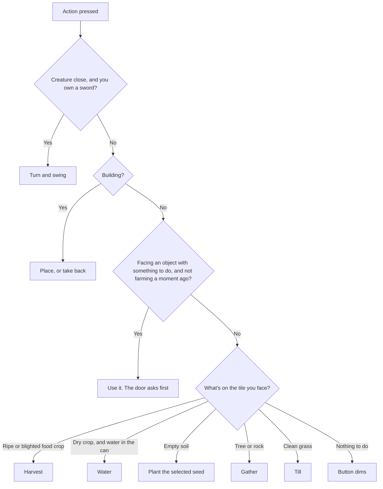
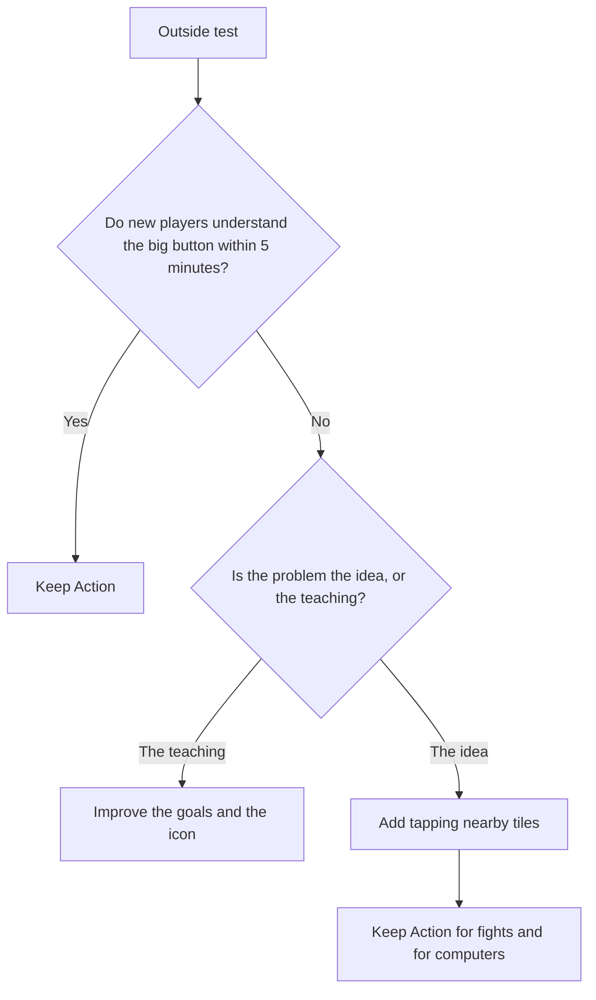

# Controls: our choice next to Hay Day and others

**Date:** 2026-11-07

## Why this doc exists

After playing the Action button, you asked why we don't tap tiles like Hay Day. Then, after more play, it felt good, and you chose to keep it (finding 40). This doc explains that choice, what to keep, and what to do if it stops being the right one.

## The short answer

**The right controls depend on the game, not on which game is the most popular.** Hay Day's controls are excellent for Hay Day. Ours has a walking character, creatures and a sword, so it needs something else.

## How the big button decides

The first row that fits wins, and the icon always shows what will happen.

**Things that never happen by accident:**

| Action | How to do it |
|---|---|
| Spending holy water, or the hoe's uses | The Heal button, kept away from Action. It uses the hoe first, and asks which water if you own both |
| Bursting a ripe wardthorn | Walk up, tap the plant itself, and say yes. It's the only tap on the world, because a burst is rare and personal |
| Picking up a building | Build mode, from the Bag |
| Hoeing soil back to grass | Empty soil turns back by itself |
| Sleeping | The door asks "Sleep?" first. F on a computer sleeps at once |

## How the main styles compare

These are from general knowledge of the games, so check the current versions before copying any detail.

| | Hay Day | Stardew Valley on phones | Zelda style | **Ours** |
|---|---|---|---|---|
| Is there a walking character? | No, you are the hand | Yes | Yes | Yes |
| How you move | Drag the camera | Joystick or tapping | Stick | Joystick |
| How you act | Tap the thing, and drag across crops | Tap near you, plus a button | One button that changes job | One button that changes job |
| Fighting | None | Yes | Yes | Yes |
| Best for | Short visits, many fields at once | Long sessions | Action and exploring | Short sessions with some danger |

## Each style's strengths and costs

| Style | Good | Bad | For our game |
|---|---|---|---|
| **Action button** (ours) | One thumb, works while walking, and works the same in a fight. The icon tells you what's next | Must face the tile. Feels strange at first. Can do the wrong thing near two things | ✅ Chosen |
| **Tap nearby tiles** | Direct and natural. No need to face anything | A thumb hides what it taps. Wrong taps can till grass. Hard in a fight, and can clash with the joystick | Our fallback |
| **Full Hay Day** | The simplest of all, and great for many crops | No character, so no walking, dodging or sword. The camera, combat and curse would need new designs | ❌ A different game |

## Why Action suits this game

- **The player is in the world.** The dark mood comes from walking into the curse yourself. Hay Day's god's-eye view is calm, which is the opposite of our mood.
- **Danger needs your hands free.** With a creature close, a thumb on the joystick and a thumb on one big button is quicker than aiming taps at a moving target.
- **Small screens.** A 32-pixel tile is small under a thumb. A big button is never missed.
- **It's the same on every device.** One rule works for phones, keyboards and later controllers on Steam.

## What Hay Day does better, and what we can borrow

| Idea from Hay Day | Why it's good | Should we add it? |
|---|---|---|
| Drag across many crops at once | Far fewer taps in a big field | **Maybe later.** Holding Action while walking could do the same. Try this first if farming feels slow |
| Everything is quick and forgiving | Mistakes cost little | **Yes, already partly:** "Sleep?", and Heal kept apart |
| You always see what's ready | No hunting around | **Have it:** the water and ripe icons on crops |
| Sessions are short | Suits phones | **Check it** in the outside test |

## What to keep

These are the rules we should protect, whichever controls we use:

1. **Ask first, then act.** `smart_action()` only answers a question, and `run_action()` does the work. This is what makes changing the controls cheap.
2. **Show what will happen** before it happens, through the icon and the cursor.
3. **Limited things are never spent by accident:** holy water has its own button, far from Action.
4. **Things that can't be undone ask first,** like sleeping.
5. **Free things go before paid things:** the hoe's daily uses before holy water.
6. **Input is separate from rules.** Buttons only press input actions, so game rules never know about touch. That's like keeping logic out of an Angular template.

## Tile tapping was considered and dropped

On 2026-11-07 the user asked for Hay Day style tile selection, then decided against it: with a walking character, tapping a tile makes the character stand idle. Pressing and holding to move buildings stays, because that's arranging the farm, not the character's work. The flowchart below only applies if outside players really struggle.

## When to change our minds

The feeling that changed after a while is useful, but you know the game well. New players won't have that time, so the outside test (`docs/19_...`) decides.

Adding tapping later is cheap: a tap only needs to turn into a cell, then call the same `smart_action(cell)` and `run_action()`. Nothing built so far is wasted.

**What to watch for in the outside test:**

| Question | Warning sign |
|---|---|
| Do they find the big button? | They tap the ground first |
| Do they trust the icon? | They look surprised at what happens |
| Does anything happen by accident? | Tilled grass they didn't want |
| Do they use Heal? | They forget it, or tap it near Action by mistake |

## Performance

You asked whether checking all the time is slow. It isn't: the check took about 4 microseconds on the computer, out of 16,667 in each frame at 60 frames a second. A phone is slower, but this is still very small. Computers now skip the check, because they have no icon to update.

**A good rule:** games check things every frame all the time, and that's normal. Measure before you worry, because guesses about speed are often wrong. The things that really slow a phone are usually drawing, lights and creating many objects, not small checks like this one.
