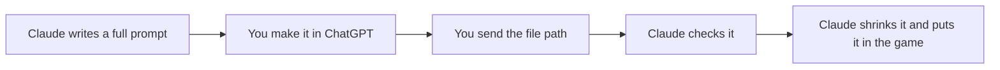

# Art guide

**Date:** 2026-11-07

How to make new art for the game, in one place. All art for the current game is done. **Next:** the title logo, store icon, banner and screenshots, once the game has its real title. The areas update lists its art in [its plan](15_2026-11-04_areas-woods-marsh.md).

The prompts for finished art were merged out of the old per-layer docs. They're in git history, up to commit `9237087`, if an image ever needs remaking.

## How it works



1. Claude gives a complete, ready-to-paste prompt with any feature that needs a sprite, and never leaves a placeholder without saying so.
2. Attach `art_source/style_reference.png` to every prompt.
3. Originals go in `art_source/`, with a clear name. Game-ready files go in `assets/`, at real pixel size.

## The style block

Start every prompt with one of these, then describe the one object.

**For things in the world:**

```
Match the style of the attached reference exactly.

Pixel art game asset for a 2D top-down farming game, 3/4 top-down view.
Designed for a 32x32 pixel grid: chunky, clearly visible pixels, no anti-aliasing,
no blur. Moody dark-fantasy style: muted, desaturated earthy colors, deep purples
and teals in the shadows. 3-tone shading, light from the top-left, neutral
daylight (not night, no glow effects). Realistic proportions, not chibi.
Transparent background. No text.
```

**For icons and buttons:**

```
Match the style of the attached reference exactly.

Pixel art game asset for a 2D top-down farming game, seen straight on.
Designed for a 32x32 pixel grid: chunky, clearly visible pixels, no anti-aliasing,
no blur. Moody dark-fantasy style: muted, desaturated earthy colors, deep purples
and teals in the shadows. 3-tone shading, light from the top-left, neutral
daylight (not night, no glow effects). Fully transparent background, with no glow
or shadow around the object. No text, no letters, no numbers.
```

End with: "The shape must be simple, bold and easy to read at a very small size. One object only, centered, filling most of the image, with a little empty space around it."

## Ripe wardthorn animation

✅ In the game (2026-11-07), and a good model for any new animation. `tools/build_ward_ripe.gd` cuts its 4 frames on a fixed grid, because `pixelize.gd` would count the fleck above frame 3 as a fifth sprite. It's set as `ripe_animation` in `data/crops/wardthorn.tres`.

```
Match the style of the attached reference exactly. Also attach the wardthorn growth
stages image, and keep the last stage's plant exactly the same in every frame.

Pixel art game asset for a 2D top-down farming game, 3/4 top-down view.
Designed for a 32x32 pixel grid: chunky, clearly visible pixels, no anti-aliasing,
no blur. Moody dark-fantasy style: muted, desaturated earthy colors, deep purples
and teals in the shadows. 3-tone shading, light from the top-left. Fully transparent
background, with no glow or shadow outside the plant. No text.

A horizontal row of 4 animation frames of one ripe magical wardthorn plant, evenly
spaced with clear empty space between them, all standing on the same baseline, the
same size and in the same position, so they loop smoothly. Draw only the plant, with
no soil, pot or ground.

The ripe plant has a thorny stem, pale silver-green leaves and a large open pale bud
at the top, with a bright teal-white light inside it.

Frame 1: the bud is open and the light inside is dim. The leaves rest.
Frame 2: the bud opens a little more, the light is brighter, and the leaves lift
slightly.
Frame 3: the bud is at its widest, the light is at its brightest, and one small
bright fleck sits just above it.
Frame 4: the bud closes a little, the light fades, and the leaves settle back down.
```

## Checks before using any image

| Check | Why |
|---|---|
| Measure its transparency, and look at it on a bright background | The book's parchment looked solid, but had a see-through ring |
| Look at it at real game size, zoomed in | The hoe lost its cloth and bead when first shrunk |
| Compare a few ways of shrinking | Crisp and smooth shrinking suit different art |
| Size icons to show at 1:1 | Uneven scaling makes uneven pixels. A round button shows its icon at 78% of its size |
| Look at a screenshot in the game | Faint art can look fine alone, and vanish on grass |

## Shrinking

`tools/pixelize.gd` does most art. `CLAUDE.md` lists its options and the sizes for each kind of object.

| Tool | For |
|---|---|
| `tools/pixelize.gd` | Most art |
| `tools/build_book_page.gd` | The book's parchment: solid inside its torn edge |
| `tools/build_hoe_icon.gd` | The purifying hoe: just its head, shrunk smoothly |
| `tools/build_ward_ripe.gd` | The ripe wardthorn's animation frames, cut on a fixed grid so they don't jitter |
| `tools/build_ward_packet.gd` | The wardthorn seed packet |
| `tools/build_curse_edges.gd` | The ragged edges of curse, grass and wet soil |
