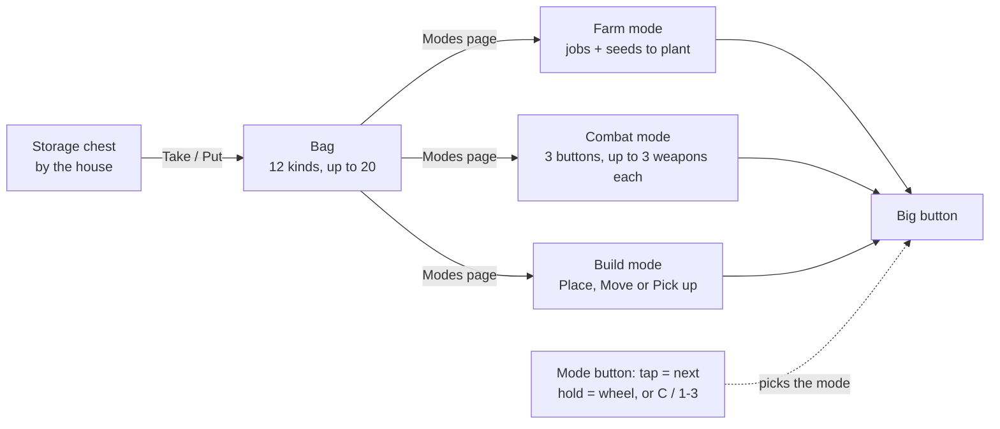

# Controls: modes, bag and storage

**Date:** 2026-11-08 (rewritten 2026-11-09, once these became the game's only controls)

How the player controls the game now, and why. The code side is in [the code map](30_2026-11-09_code-map.md) ("Controls" to "Phone buttons"). Built as a prototype on 2026-11-08 (findings 69 to 104), played on the phone and the computer and accepted on 2026-11-09.

## How it plays

- **One big button** does the job of the mode you're in. Objects (door, stall, box, workbench, wells, shrine, chest) are **tapped** when you stand close, or clicked on a computer; the big button never uses them.
- **Mode button:** a tap goes to the next mode (Farm, Combat, Build); holding it opens a wheel to slide to one. Computers: C, or 1 to 3. Every morning starts in Farm mode.
- **Bag and storage:** the bag holds 12 kinds of items (the stall sells +4, up to 20), each stacking without limit. Only carried things can be used or shipped; the rest waits in the storage chest. Crafting uses everything owned, since the workbench is by the chest. A full bag sends new things to storage with a notice.
- **The bag menu** (Bag button or I) has two pages. **Bag** shows what's carried by kind, with what each item does. **Modes** has a tab per mode with its switches and items.
- **Farm mode:** the big button does the farm jobs that are switched on (Till, Plant, Water, Harvest, Gather, Heal), planting only the seeds you picked, first first. Holy water is only used on a cursed tile straight ahead. The can holds 100 water.
- **Combat mode:** up to three combat buttons beside the big button, each with up to three weapons; a weapon goes on one button only. Tap a button to pick it, tap it again to switch to its next weapon; dots show which. The big button attacks with it. Set them on Modes → Combat mode: each button has three places, and a plus offers your free weapons.
- **Build mode:** one tool at a time, picked with the button beside the big one (V on computers): **Place** from the bag, **Move** (lift a building, walk, put it down; it never goes through the bag), or **Pick up** into the bag.
- **Every menu** closes with its X and sits centered; the phone buttons wait under it.
- **Phone buttons:** the big button, the mode button, Bag, Tasks, the old book and pause, plus the combat buttons or the build tool button in their modes.

## Why

- **One button, no tool switching:** phones have no keyboard, and a smart button with modes keeps one thumb on movement and one on actions.
- **Modes instead of guessing:** the classic button had to guess between farming, fighting and building; a mode makes every tap predictable, and Combat mode leaves room for the fighting on later islands.
- **Carrying and storage:** what you carry becomes a choice you plan each morning, which fits a farming game and gives the bag upgrade a reason.
- **One button per job in Build mode, one weapon per combat button:** a tap should never surprise you.

## Watch for when playing

1. Is fetching from storage fun planning, or a chore? If a chore, let the bag take from storage when standing by the house.
2. Does a creature catch you in Farm mode before you can switch? If so, let the big button swing at a creature that's very close, in any mode.
3. Is picking a weapon, then tapping the big button, fast enough in a fight? If not, let each combat button attack straight away.
4. In Combat mode, do the buttons on the right feel crowded? If so, put the combat buttons in an even curve around the big button, and keep Bag and pause farther away.
5. Does holy water ever get spent when you didn't mean it?

## Open

- The classic controls' code still exists, only for the older tests (`--classic-controls`). Next cleanup: move those tests to these controls, then delete the classic code (Heal, Seed and Build X buttons, the tool bar, `BuildingMover`, the row menus).
- Shooting and throwing use the swing sound (`tools/make_sounds.gd` can make a new one).
- The six basic weapons aren't balanced yet: their numbers are in `scripts/farm/basic_weapons.gd`.
