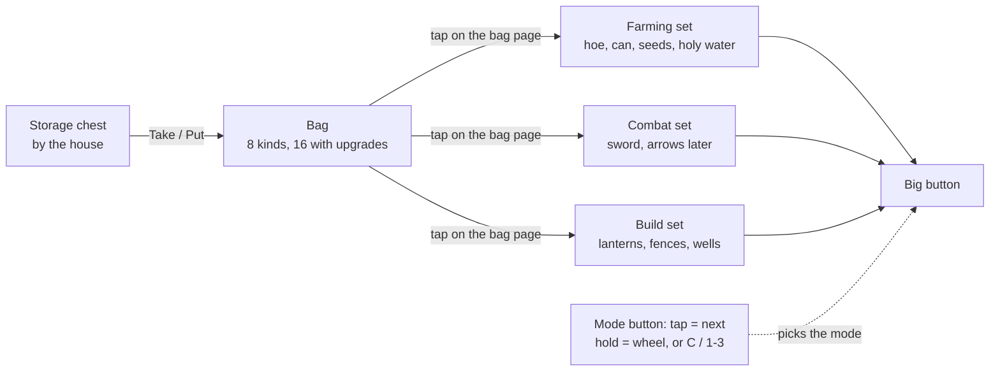

# Storage controls (a prototype)

**Date:** 2026-11-08

The user's idea after playing (findings 69 to 72): keep things in a storage chest, carry a limited bag, plan what the big button may use, and switch between Farm, Combat and Build modes. It's built on the `storage-prototype` branch behind a Settings switch, so both control schemes can be compared. The classic controls stay as they were, and the old tests still check them. The user plays it on the computer with Emulate Touch From Mouse, and tries the phone once it settles.

## How it plays



- **Item menus** (`ItemGridMenu`, `scripts/ui/item_grid_menu.gd`): the workbench (`WorkbenchMenu`), stall (`StallMenu`) and storage (`StorageMenu`) share tabs by kind, a scrolling grid of tiles and a details side with a description and big buttons. A menu only gives `_entries()` and `_details()`. Descriptions and kinds are in `ItemInfo` (`scripts/ui/item_info.gd`). The old row menus (`CraftingMenu`, `ShopMenu`) stay for the older tests only
- **Storage chest** (`scenes/farm/storage_chest.tscn`, placeholder art) beside the shipping box: tap it while standing close to open `StorageMenu`. Each owned item has a row with Take (all into the bag) and Put (all into storage)
- **Bag:** holds 12 kinds of items, each stacking without limit. The stall sells a bigger bag (+4 kinds for 150, up to 20). Every game starts with a sword in the combat set and a lantern post in the build set (`Inventory.give_starter_kit()`, once per game, older saves too). Holy water isn't shown in the top right corner, since the bag page shows it. New things go into the bag if there's room, or else to storage with a notice. Only carried crops are shipped, and only carried seeds, holy water and buildings can be used. Crafting uses everything owned, because the workbench stands by the chest
- **Farm jobs:** six switches on the bag page, Till, Plant, Water, Harvest, Gather and Heal (`Inventory.farm_jobs`, `toggle_job()`, `Farm._can_do()`). The big button does only the jobs that are on, so a player can water only, or leave ripe crops in the ground. The hoe, can and holy water just need to be carried. The can holds 100 water (finding 83)
- **Seeds to plant:** `Inventory.plant_set`, as many as the player picks. The big button plants only these, first first, and new seeds never join on their own. Tools stay in `farm_set`
- **Bag page** (`SetsMenu`, key I or the Bag button): the same layout as the item menus. It opens on the **Ready** tab, grouped by mode under headings: Farm jobs (one tap flips a job; an off one is dimmed and says Off), Seeds to plant, Combat, Build jobs, and Buildings to place, each in order. `ItemGridMenu` entries take a `section` heading and an `on_tap` action for this. The other tabs show what's carried by kind. The details side says what an item does, with buttons to add it to its set, take it out, or move it sooner (`Inventory.move_sooner()`)
- **Farm mode:** the big button works like the classic smart Action button, but only with the farming set: harvest and gather always, then water, plant the first seed in the set that fits, till, purify with the hoe, and heal with holy water. **Holy water is only used on a cursed tile straight ahead,** never on a patch beside you while farming (the cursor grows to show the area first). Leave it out of the set to keep it safe
- **Combat mode:** uses the combat set's first weapon with something left, so when arrows exist the sword takes over as they run out. With no weapon it says so. Kept as its own mode, because later islands are about fighting. The bow (crafted once: 8 wood, 2 curse shards) goes first in the combat set and shoots arrows (crafted 2 wood and 1 stone for 10). A shot draws the bow through its 3 frames (`Bow`, `scenes/player/bow.tscn`, `assets/objects/bow_frames.png` from `tools/build_bow_frames.gd`), then an `Arrow` flies up to `bow_range` (170 px) at `arrow_speed`, hurting the first creature and stopping at trees and houses, but not at the curse. With no arrows the sword is used
- **Build mode:** the big button picks up the building ahead, or places the build set's first building on the tile ahead, with the ghost preview and guard square showing. Moving is picking up, then placing: a picked-up building goes to the front of the build set. New buildings join the set when crafted. To store one, pick it up and tap Put at the chest. Holding a building to drag it is off with these controls, so walking past one can't grab it. Build jobs (`Inventory.build_jobs`, on the Ready tab) switch Place and Pick up. A picked-up building goes in the bag and is carried, to the chest too
- **Mode button** (in the old Heal spot): a tap goes to the next mode, Farm → Combat → Build, so a weapon is one tap away while farming. Holding it for 0.3 seconds opens a wheel of the three modes up and to the left; slide onto one and let go. Letting go elsewhere changes nothing. Computers: C for the next mode, 1, 2 and 3 for each. Every morning starts in Farm mode
- **Objects are tapped,** or clicked on a computer, standing close: door, stall, box, workbench, wells, shrine and chest. Too far away says "Walk closer". The big button never uses objects. F still works on computers
- **Phone buttons:** the big button, the mode button, Bag, Tasks, the old book (under Tasks, in both control schemes) and pause. Seed, Heal and the Build X are gone. The Bag is small, above the mode button (finding 74), and every menu closes with an X on its corner (finding 73)
- **New kinds join their set:** a kind of item that enters the bag joins its set, so the big button can use it at once (crafted strong holy water, new buildings, the sword). Seeds never do: the player picks which to plant. Something taken out of a set and later used up rejoins when more is gained
- **Texts:** goals, the book and the shrine and box notices say what to do with these controls (tap the door and box, heal with the big button, add wardthorn on the bag page)
- **No switch:** the Settings switch was removed on 2026-11-08 (finding 84), so players always have these controls. The classic code stays only for the older tests, which run with `--classic-controls` (unless their name starts with `test_storage_`), until they move over

## Code

| Part | Where |
|---|---|
| The switch | `Audio.storage_controls` (in settings.cfg), `GameState.carry_mode`, `apply_controls_setting()` (called first in `Farm._ready`) |
| Bag and sets | `Inventory.bag`, `bag_slots`, `farm_set`, `combat_set`, `build_set`, `carried()`, `stored()`, `take()`, `put()`, `toggle_in_set()`, `to_front()`, `ready_now()`, `upgrade_bag()`. The totals stay the single truth; the bag only says how much is carried. Saved as an ordered list, because a saved dictionary comes back sorted |
| Big button | `Farm._carry_action()`, `_farm_action()`, `weapon()`, `_run_carry()` |
| Modes | `Player.Mode`, `mode`, `set_mode()`, `next_mode()`, `pick_building()`, `mode_changed`, input action `switch_mode` |
| Mode wheel | `TouchControls._input()`, `_open_wheel()`, `wheel_choice_at()` |
| Tapping objects | `WardTap.tap_object()`, `object_at()` |
| Menus | `scripts/ui/sets_menu.gd`, `scripts/ui/storage_menu.gd` |
| Test | `tests/test_storage_controls.gd` |

## What to judge when playing

1. Is fetching from storage fun planning, or a chore? If a chore: start the bag at 12, or let the bag take from storage when standing by the house
2. Does the smart farming set feel as quick as the classic button?
3. Is Combat one tap away in time when a creature comes? If not: switch to Combat on its own when a creature is close, and back after
4. Is the hold wheel easy to use, and does a tap ever open it by accident?
5. Does Build mode make moving lanterns easier than holding and dragging did?
6. Is tapping objects easy, and are the "Walk closer" notices clear?
7. Does holy water ever get spent when you didn't mean it?

## Open

- Art: the chest and mode icons are in (2026-11-08). The bow, arrow and arrow bundle are shrunk in `assets/items/` and `assets/objects/arrow.png`, ready for when shooting is coded; the bow's 3 frames need cutting then, lined up so the bow doesn't move between frames
- A shooting sound: the bow uses the swing sound for now (`tools/make_sounds.gd` can make one)
- On later islands, fighting and healing happen in the same place: if switching feels slow there, let the combat set hold holy water too
- Not tried on the phone yet
- The curse play test still comes first in the roadmap; this prototype doesn't change the curse

## Art prompts

**Storage chest** (world object; shrink to about 40×36 with `tools/pixelize.gd`):

```
Match the style of the attached reference exactly.

Pixel art game asset for a 2D top-down farming game, 3/4 top-down view.
Designed for a 32x32 pixel grid: chunky, clearly visible pixels, no anti-aliasing,
no blur. Moody dark-fantasy style: muted, desaturated earthy colors, deep purples
and teals in the shadows. 3-tone shading, light from the top-left, neutral
daylight (not night, no glow effects). Realistic proportions, not chibi.
Transparent background. No text.

A sturdy old wooden storage chest with a closed, slightly rounded lid, dark iron
bands and corner caps, and a heavy iron latch in front. Weathered oak planks with
a few scratches, a little moss at the bottom edge. It should look clearly different
from an open shipping crate: closed, heavier, banded with iron.
The shape must be simple, bold and easy to read at a very small size. One object
only, centered, filling most of the image, with a little empty space around it.
```

**Mode icons** (three icons, the same size and style, for the mode button and its wheel):

```
Match the style of the attached reference exactly.

Pixel art game asset for a 2D top-down farming game, seen straight on.
Designed for a 32x32 pixel grid: chunky, clearly visible pixels, no anti-aliasing,
no blur. Moody dark-fantasy style: muted, desaturated earthy colors, deep purples
and teals in the shadows. 3-tone shading, light from the top-left, neutral
daylight (not night, no glow effects). Fully transparent background, with no glow
or shadow around the object. No text, no letters, no numbers.

Three icons in one row, the same size, with clear empty space between them.
Left: "farm mode", a small green sprout growing from a mound of dark soil.
Middle: "combat mode", a short sword crossed over a small round wooden shield.
Right: "build mode", a wooden mallet resting on a short wooden plank.
They must look different from the hoe, watering can and sword tool icons, so the
mode button and the big action button never show the same picture.
The shape must be simple, bold and easy to read at a very small size. Each object
centered in its third, filling most of it, with a little empty space around it.
```

**Bow and arrows** (for later: the combat set is ready, the code isn't built yet). Like the sword, the bow is one picture moved in code, not new player sheets: the bow's three frames play as the player shoots, and the arrow flies as one picture turned in code. That's three images instead of a full shooting sheet for every direction.

Bow, three frames in a row (shrink to 32×32 frames with `--frame-w 32 --frame-h 32`):

```
Match the style of the attached reference exactly.

Pixel art game asset for a 2D top-down farming game, seen from the side.
Designed for a 32x32 pixel grid: chunky, clearly visible pixels, no anti-aliasing,
no blur. Moody dark-fantasy style: muted, desaturated earthy colors, deep purples
and teals in the shadows. 3-tone shading, light from the top-left, neutral
daylight (not night, no glow effects). Fully transparent background, with no glow
or shadow around the object. No text, no letters, no numbers.

A simple short hunting bow of dark curved wood with a leather grip, held upright
with the string on the left and the bow bending to the right. Three frames in one
row, the same size, with clear empty space between them, the bow in exactly the
same place in each:
Frame 1: at rest, string straight, no arrow.
Frame 2: half drawn, string pulled a little to the left, an arrow nocked and pointing right.
Frame 3: fully drawn, string pulled far to the left, the bow bent deeply, the arrow pointing right.
The shape must be simple, bold and easy to read at a very small size.
```

Arrow in flight (one image pointing right, about 24×8; the game turns it for every direction):

```
Match the style of the attached reference exactly.

Pixel art game asset for a 2D top-down farming game, seen from the side.
Designed for a 32x32 pixel grid: chunky, clearly visible pixels, no anti-aliasing,
no blur. Moody dark-fantasy style: muted, desaturated earthy colors, deep purples
and teals in the shadows. 3-tone shading, light from the top-left, neutral
daylight (not night, no glow effects). Fully transparent background, with no glow
or shadow around the object. No text, no letters, no numbers.

A single wooden arrow flying straight to the right: a dark iron arrowhead on the
right, a thin light wooden shaft, and grey-white feather fletching on the left.
Long and thin, perfectly horizontal.
The shape must be simple, bold and easy to read at a very small size. One object
only, centered, filling most of the width, with a little empty space around it.
```

Arrows item icon, for the bag and the combat set (32×32):

```
Match the style of the attached reference exactly.

Pixel art game asset for a 2D top-down farming game, seen straight on.
Designed for a 32x32 pixel grid: chunky, clearly visible pixels, no anti-aliasing,
no blur. Moody dark-fantasy style: muted, desaturated earthy colors, deep purples
and teals in the shadows. 3-tone shading, light from the top-left, neutral
daylight (not night, no glow effects). Fully transparent background, with no glow
or shadow around the object. No text, no letters, no numbers.

A small bundle of three wooden arrows tied together with a leather strap, standing
diagonally from the bottom left to the top right, iron heads at the top, grey-white
feathers at the bottom.
The shape must be simple, bold and easy to read at a very small size. One object
only, centered, filling most of the image, with a little empty space around it.
```

Bow item icon, for the bag and the combat set (32×32):

```
Match the style of the attached reference exactly.

Pixel art game asset for a 2D top-down farming game, seen straight on.
Designed for a 32x32 pixel grid: chunky, clearly visible pixels, no anti-aliasing,
no blur. Moody dark-fantasy style: muted, desaturated earthy colors, deep purples
and teals in the shadows. 3-tone shading, light from the top-left, neutral
daylight (not night, no glow effects). Fully transparent background, with no glow
or shadow around the object. No text, no letters, no numbers.

A short hunting bow of dark curved wood with a leather grip and a taut string,
standing diagonally from the bottom left to the top right, with no arrow.
The shape must be simple, bold and easy to read at a very small size. One object
only, centered, filling most of the image, with a little empty space around it.
```

**Replacements for two icons the user didn't like (finding 75)**, so the healed icon and the Farm mode icon stop being the same sprout.

Island healed icon, top right corner (shrink to 24×24):

```
Match the style of the attached reference exactly.

Pixel art game asset for a 2D top-down farming game, seen straight on.
Designed for a 32x32 pixel grid: chunky, clearly visible pixels, no anti-aliasing,
no blur. Moody dark-fantasy style: muted, desaturated earthy colors, deep purples
and teals in the shadows. 3-tone shading, light from the top-left, neutral
daylight (not night, no glow effects). Fully transparent background, with no glow
or shadow around the object. No text, no letters, no numbers.

A tiny round island seen slightly from above, split down the middle: the left half
is cursed ground, dark purple with cracks; the right half is healed, fresh green
grass with one small white flower. A thin line of light where the two halves meet.
The shape must be simple, bold and easy to read at a very small size. One object
only, centered, filling most of the image, with a little empty space around it.
```

Farm mode icon, the first of the three mode icons (32×32; it replaces the sprout in `assets/ui/mode_icons.png`):

```
Match the style of the attached reference exactly.

Pixel art game asset for a 2D top-down farming game, seen straight on.
Designed for a 32x32 pixel grid: chunky, clearly visible pixels, no anti-aliasing,
no blur. Moody dark-fantasy style: muted, desaturated earthy colors, deep purples
and teals in the shadows. 3-tone shading, light from the top-left, neutral
daylight (not night, no glow effects). Fully transparent background, with no glow
or shadow around the object. No text, no letters, no numbers.

A small sheaf of golden wheat, five or six stalks with full heads of grain, tied in
the middle with a band of twine, standing upright with the heads fanning out at the
top. It must look different from a sprout, a seed packet, a hoe and a watering can.
The shape must be simple, bold and easy to read at a very small size. One object
only, centered, filling most of the image, with a little empty space around it.
```

**Farm job icons** (finding 82): six icons in one row, in the order Till, Plant, Water, Harvest, Gather, Heal. They become a 192×32 strip, `assets/ui/job_icons.png`, and `SetsMenu.JOB_ICONS` loads it. Please send the large version.

```
Match the style of the attached reference exactly.

Pixel art game asset for a 2D top-down farming game, seen straight on.
Designed for a 32x32 pixel grid: chunky, clearly visible pixels, no anti-aliasing,
no blur. Moody dark-fantasy style: muted, desaturated earthy colors, deep purples
and teals in the shadows. 3-tone shading, light from the top-left, neutral
daylight (not night, no glow effects). Fully transparent background, with no glow
or shadow around the object. No text, no letters, no numbers.

Six small action icons in one row, all the same size, with clear empty space
between them. Each shows an action, not a tool on its own, so it looks different
from the hoe, watering can, seed bag and hand tool icons:
1. Till: a short row of freshly dug dark soil furrows with a small hoe blade biting into it.
2. Plant: a single seed dropping into a small hole in dark soil.
3. Water: three blue water drops falling onto a tiny green sprout.
4. Harvest: a small woven basket full of a radish, a carrot and a little pumpkin.
5. Gather: a small axe stuck in a cut log, with a little grey stone beside it.
6. Heal: a small corked bottle of pale blue holy water tipping drops onto a patch of
   cracked purple ground that turns green where they land.
The shapes must be simple, bold and easy to read at a very small size. Each icon
centered in its sixth, filling most of it, with a little empty space around it.
```

**Build job icons** (finding 88): two icons in one row, in the order Place, Pick up. They become a 64×32 strip next to the farm job icons. Please send the large version.

```
Match the style of the attached reference exactly.

Pixel art game asset for a 2D top-down farming game, seen straight on.
Designed for a 32x32 pixel grid: chunky, clearly visible pixels, no anti-aliasing,
no blur. Moody dark-fantasy style: muted, desaturated earthy colors, deep purples
and teals in the shadows. 3-tone shading, light from the top-left, neutral
daylight (not night, no glow effects). Fully transparent background, with no glow
or shadow around the object. No text, no letters, no numbers.

Two small action icons in one row, all the same size, with clear empty space
between them. Each shows an action, so it looks different from the mallet and
glove pictures already in the game:
1. Place: a small wooden fence post being set down onto a patch of grass, with a
   short downward arrow-shaped streak of dust above it.
2. Pick up: a small wooden lantern post lifted a little off the grass, with a
   faint shadow left on the ground below it.
The shapes must be simple, bold and easy to read at a very small size. Each icon
centered in its half, filling most of it, with a little empty space around it.
```
