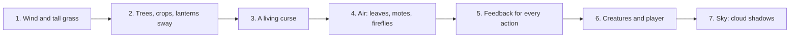

# Animation plan: make the island feel alive

**Date:** 2026-11-09

## Goal

Everything works, but the world stands still: grass, trees, crops and the curse never move, so the island feels dead. This plan adds life in small steps, the most noticeable first. Each step is something you can see on the phone the same day.

**Rules:**
- **Code first, art second.** Most movement comes from shaders, tweens and particles in code, with no new art. Art is asked for only where code can't fake it, with full prompts below.
- **One wind for everything.** Grass, trees, crops, lanterns and leaves all read the same wind, so they move together, like real wind. Gusts roll across the map from one side.
- **Phones first.** Everything must keep 60 frames per second on the Redmi Turbo 4 Pro. Particles use `CPUParticles2D` (the Compatibility renderer), with small counts. A Settings switch, **Effects: full / less**, turns the extras down.
- **Lighting rule stays:** art is neutral daylight; glow comes from lights and `CanvasModulate`, never from the sprites.
- Each step gets a test and a screenshot, and a short line in the build notes.



## Step 1: wind and tall grass (the biggest change)

- **A `Wind` autoload** holds the wind's strength and direction, with slow gusts that roll across the map (a gust is a wave moving east to west, so nearby things bend a moment apart). Everything that sways reads it.
- **Tall grass tufts:** small clumps scattered over clean grass (not on soil, paths or buildings), drawn with a **sway shader**: the top of the sprite moves with the wind, the bottom stays rooted. They're placed from a seed, like the gather spots, so they're the same every game, and healing land grows new ones.
- **Walking through grass bends it down:** when the player (or a creature) walks into a tuft, it bends away from them and springs back after they pass, with a tiny rustle sound and a puff of 2 or 3 grass bits. The bend is a value per tuft, eased back with a tween.
- **Cursed ground has dead grass** that barely moves, so healed land looks alive next to it.
- Tufts never block walking or farming; tilling a tile removes its tuft.

**Art needed:** grass tufts (prompt below).

## Step 2: trees, crops and lanterns sway

- **Trees:** the same sway shader, but only on the leafy top (the trunk stays still), slower and smaller.
- **Crops:** every crop sways gently (the wardthorn already does); ripe ones a little more. Watering makes them shake once.
- **Lanterns:** the hanging lamp swings a little in gusts, and its light moves with it (the flicker already exists).
- **The shop stall's cloth** flutters in gusts.

**Art needed:** none.

## Step 3: a living curse

- **Pulsing veins:** the purple cracks in cursed ground glow brighter and dimmer slowly, as if breathing (a shader on the cursed tiles, no new art).
- **Curse motes:** a few dark-purple specks drift up from the curse's edge.
- **Marked tiles** (where the curse returns tonight) shimmer, so the threat is easy to see.
- **Healing:** the existing heal effect gets a soft wave of new grass tufts popping up on healed tiles.

**Art needed:** none.

## Step 4: life in the air

- **Falling leaves** from trees now and then, carried by the wind.
- **Dust motes** floating in lantern light.
- **Fireflies** near lanterns and the shrine late in the day.
- **Moths or butterflies** around lanterns (you asked for these earlier).

**Art needed:** a leaf and a moth (prompts below). Fireflies and motes are plain dots made in code.

## Step 5: feedback for every action

- **Till:** dirt bits fly up. **Water:** a few drops splash. **Plant:** a small puff.
- **Harvest:** the crop pops up and a little copy flies to the Bag button.
- **Ship:** coins pop out of the box at night's payout.
- **Hits:** a tiny screen shake and a white flash on creatures; the player flashes when hurt.
- **Menus:** open with a quick scale-up, buttons squash a little when pressed.

**Art needed:** none (bits and drops are coloured squares).

## Step 6: creatures and the player

- **Creatures** bob while floating, rise out of the curse when they appear, and dissolve into purple bits when defeated.
- **The player** gets small dust puffs when walking, and a gentle breathing bob when standing still.

**Art needed:** none for now. Proper attack and hurt frames for the player can come later, before release.

## Step 7: the sky

- **Cloud shadows:** big soft dark shapes drift slowly across the ground with the wind. Cheap and very effective at making the world feel big and alive.
- **Day turns to dusk:** the light warms slowly over the day, so evenings feel different (only if it doesn't fight the curse's mood; try it, keep it if it feels right).

**Art needed:** none (soft shapes made in code).

## Art prompts

**Grass tufts** (step 1): four small clumps in one row, shrunk to about 16×16 each (`assets/tiles/grass_tufts.png`). Attach the grass ground texture as the reference, and send the large version.

```
Match the style of the attached reference exactly.

Pixel art game asset for a 2D top-down farming game, 3/4 top-down view.
Designed for a 32x32 pixel grid: chunky, clearly visible pixels, no anti-aliasing,
no blur. Moody dark-fantasy style: muted, desaturated earthy colors, deep purples
and teals in the shadows. 3-tone shading, light from the top-left, neutral
daylight (not night, no glow effects). Realistic proportions, not chibi.
Transparent background. No text.

Four small clumps of tall wild grass in one row, all the same size, with clear
empty space between them. Each is a tuft of thin blades rooted at the bottom
center, growing upward and slightly outward, in muted greens that match the
reference grass:
1. A short, round tuft.
2. A taller tuft with a few longer blades.
3. A tuft leaning a little to one side.
4. A tuft with two or three tiny pale seed heads at the tips.
The bottom of each tuft must be flat and at the same height, so they can sway from
the root. Simple, bold and easy to read at a very small size.
```

**Falling leaf and moth** (step 4): two small pictures in one row, shrunk to about 8×8 each (`assets/objects/leaf_moth.png`). Attach the tree as the reference.

```
Match the style of the attached reference exactly.

Pixel art game asset for a 2D top-down farming game, seen straight on.
Designed for a 32x32 pixel grid: chunky, clearly visible pixels, no anti-aliasing,
no blur. Moody dark-fantasy style: muted, desaturated earthy colors, deep purples
and teals in the shadows. 3-tone shading, light from the top-left, neutral
daylight (not night, no glow effects). Fully transparent background, with no glow
or shadow around the object. No text, no letters, no numbers.

Two tiny objects in one row, the same size, with clear empty space between them:
1. A single small leaf from the reference tree, slightly curled, olive and
   yellow-green.
2. A small pale dusty moth seen from above with its wings open, soft grey-beige
   with darker wing tips.
Simple, bold and easy to read at a very small size.
```

## When this is done

Walk around the farm for a minute without doing anything: if something is always gently moving somewhere on screen, and walking through grass feels good, the island is alive. Then check the phone still runs smoothly with Effects on full.
