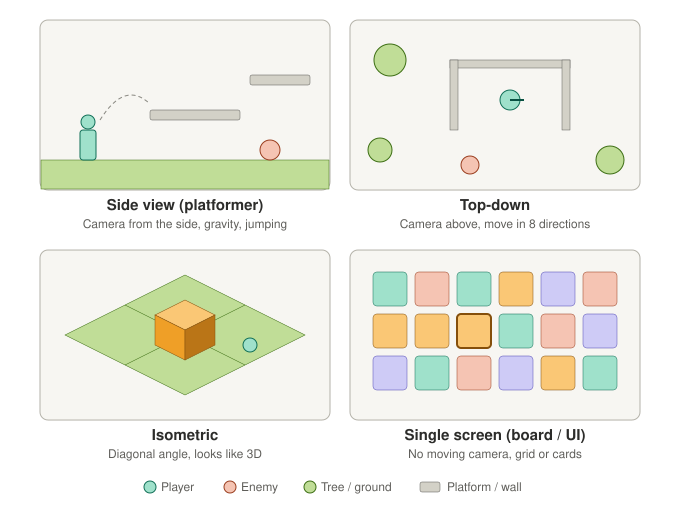

# 2D view styles (camera angles)

**Date:** 2026-11-03

> "Indie" is **not** a view style. It just means a game made by a small independent team.

## The 4 main 2D views

## What each view feels like

| View | Famous examples | Difficulty in Godot | Good for |
|---|---|---|---|
| **Side view** | Mario, Hollow Knight, Terraria, Celeste | Easy | Action, jumping, physics, building towers |
| **Top-down** | Zelda (classic), Stardew Valley, Vampire Survivors | Easy | Exploring, farming, survival, base building |
| **Isometric** | Age of Empires II, Hades, Diablo II | Harder | City builders, strategy (looks great, trickier to code, art harder to find) |
| **Single screen** | Candy Crush, Balatro, card and merge games | Easiest | Puzzle, cards, idle (mostly UI) |

### Art styles (not views)
- **Pixel art**: retro blocky look
- **Flat / vector**: clean shapes
- **Hand-drawn**: illustrated look

Any art style works with any view.

## How the building game ideas fit the views

| Idea | Best view | Why |
|---|---|---|
| Sky Balance (tilting floating island) | Side view | You need to see the island tip over |
| Walking Fortress (base on a giant creature) | Side view | See the creature walking with rooms on its back |
| Build It, Break It (build, then disaster) | Side view | Physics collapse looks best from the side |
| Down Below (dig underground colony) | Side view | Digging downward, like Terraria |
| Colony / farm builders | Top-down | Lay out land and buildings from above |
| City builders | Isometric | Pretty, but harder |

## Recommendation

For a first game, use **side view or top-down**: easy in Godot, lots of free assets, fast to prototype.

**How to decide:** watch a 1-minute gameplay video of **Terraria** (side view) and **Stardew Valley** (top-down) on YouTube. Pick the one that makes you think "I want to make something like that."
