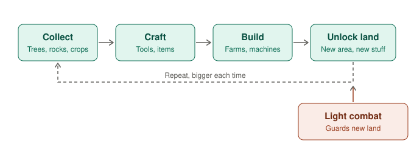

# Top-down farming / crafting / survival sim

**Date:** 2026-11-03

A game about collecting things, farming, fighting, gathering resources and building. The genre is usually called a **farming / crafting / survival sim** (or "life sim"), and it's one of the best fits for **2D top-down**.

## Confirmed 2D top-down examples

| Game | What it mixes |
|---|---|
| **Stardew Valley** | Farming, mining, light combat, crafting, building, relationships |
| **Forager** | Collecting, crafting, building, buying new land, light combat, in very short loops |
| **Don't Starve** | Gathering, crafting, survival, combat (darker tone) |

All three are **2D** and were made by **very small teams** (Stardew was mostly one person).

## Why it's a good choice

- It's genuinely **2D top-down** (no 3D problem, unlike Archero, which uses 3D models).
- It covers the **building** interest, plus farming, fighting and collecting.
- Players stay for a long time (the "one more day" feeling), and that's where income comes from.
- It's **systems-heavy** (inventory, crafting recipes, resources, saving), which plays to a developer's strengths.
- **Spring Boot** skills fit later for cloud saves, events and trading.

## The big danger: scope

"Farming + fighting + collecting + building + more" is how solo games never get finished. Stardew took about **4 years**. In 6 months we have to pick a **small core loop** and cut everything else.

**Forager is the model to study.** It has all these features, but each one is simple, and the loop is fast:

## A realistic 6-month version (MVP)

| Keep in version 1 | Cut (add later if the game does well) |
|---|---|
| Collect (trees, rocks, ore) | Relationships and NPC stories |
| Simple farming (plant, grow, harvest, 3–5 crops) | Seasons and weather |
| Craft (about 15–20 recipes) | Fishing, cooking, animals |
| Build (about 10 structures) | Multiplayer |
| Unlock land (4–6 areas) | Big open world |
| Light combat (2–3 enemy types per area) | Complex skill trees |

## Mobile and income fit

- **Free with rewarded ads** fits well: "watch an ad to speed up crops" or "double this harvest".
- Keep play sessions **short (2–5 minutes)** so it works on a phone. That's another reason to follow Forager's fast loops rather than Stardew's long days.
- Release on **Android first** (Google Play: one-time $25; iOS: $99 per year and needs a Mac).
- Also release on **Steam** later. This genre sells well on PC.

## The twist (so it isn't generic)

The game needs **one unusual hook**. Candidates:

- Farm on the **back of the Walking Fortress** creature, where the land moves to new biomes
- Farm on **floating sky islands** that you connect with bridges
- An **underground** farm with glowing mushroom crops, where you dig to expand

## Next step

Start a **design doc** for this game, beginning with choosing the twist.
